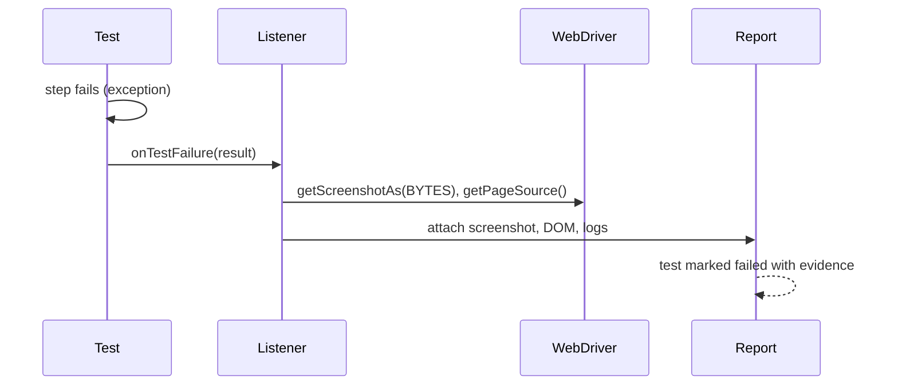

## Beginner-friendly explanation

After a football match there are two kinds of record. The **scoreboard** says who won, 2-1. The **match commentary** says what happened minute by minute: who passed to whom, who missed. Managers glance at the scoreboard; coaches study the commentary to improve.

A **test report** is the scoreboard: 480 passed, 3 failed, 2 skipped. **Logs** are the commentary: "opened login page, typed username, clicked submit, waited 10 seconds, error banner never appeared". When a test fails you need both, plus a photo of the moment (a screenshot).

## Technical explanation

### Reports

Runners produce raw results; reporters turn them into views.

- **JUnit XML**: Surefire and Failsafe write `TEST-*.xml` under `target/surefire-reports` or `target/failsafe-reports`. CI tools parse this for pass/fail counts and trends.
- **Framework HTML reports**: TestNG writes its own HTML output.
- **Allure Report**: collects results through framework adapters (`allure-testng`, `allure-junit5`) into `allure-results`, then generates an interactive HTML site with steps, attachments, history and categories.

### Logs

**SLF4J** is a logging API; **Logback** (or Log4j 2) is the implementation. Levels from most to least severe: `ERROR`, `WARN`, `INFO`, `DEBUG`, `TRACE`. **MDC** (Mapped Diagnostic Context) attaches values such as the test name to every line on the current thread.

### Evidence capture

Hooks run code on failure: TestNG `ITestListener.onTestFailure`, JUnit 5 `TestWatcher` or `AfterTestExecutionCallback`. Selenium's `TakesScreenshot` grabs the viewport.



## Real-world example

A retail QA team's nightly run showed "17 failed" in Jenkins with only stack traces. Each morning someone reran failures locally to see what happened, which took an hour. They added a listener that attaches a screenshot, URL and page source, put the test name in every log line via MDC, and published Allure. Most failures could then be triaged from the report alone, and repeated failure signatures were grouped as categories such as "environment down".

## Step-by-step walkthrough

1. Add `slf4j-api` and `logback-classic` as test dependencies.
2. Create `src/test/resources/logback-test.xml` with a pattern including time, level, thread and MDC test name.
3. Replace `System.out.println` with a `Logger`.
4. Add a failure listener that captures a screenshot and page source.
5. Add the Allure adapter and generate the report with the Allure command line.
6. In CI, publish the JUnit XML and archive the Allure output.

## Code examples

```java
public class LoginTests extends BaseTest {
    private static final Logger log = LoggerFactory.getLogger(LoginTests.class);

    @Test
    public void validUserSeesDashboard() {
        log.info("Opening login page");
        LoginPage page = new LoginPage(DriverManager.get()).open(Config.BASE_URL);
        log.info("Logging in as demo user");      // never log the password
        DashboardPage dash = page.loginAs("demo", Secrets.demoPassword());
        Assert.assertEquals(dash.userName(), "Demo User");
    }
}
```

```java
public class FailureEvidenceListener implements ITestListener {
    @Override
    public void onTestFailure(ITestResult result) {
        WebDriver driver = DriverManager.get();
        if (driver == null) return;
        String name = result.getMethod().getMethodName();
        try {
            byte[] png = ((TakesScreenshot) driver).getScreenshotAs(OutputType.BYTES);
            Path dir = Paths.get("target", "evidence");
            Files.createDirectories(dir);
            Files.write(dir.resolve(name + ".png"), png);
            Files.writeString(dir.resolve(name + ".html"), driver.getPageSource());
        } catch (IOException e) {
            LoggerFactory.getLogger(getClass()).warn("Could not save evidence for {}", name, e);
        }
    }
}
```

Register it with `@Listeners(FailureEvidenceListener.class)` or in `testng.xml`.

```xml
<!-- src/test/resources/logback-test.xml -->
<configuration>
  <appender name="CONSOLE" class="ch.qos.logback.core.ConsoleAppender">
    <encoder>
      <pattern>%d{HH:mm:ss.SSS} %-5level [%thread] [%X{test}] %logger{20} - %msg%n</pattern>
    </encoder>
  </appender>
  <root level="INFO"><appender-ref ref="CONSOLE"/></root>
</configuration>
```

Set the MDC in a `@BeforeMethod` with `MDC.put("test", method.getName())` and clear it afterwards with `MDC.clear()`.

## Expected output

```text
10:42:01.113 INFO  [TestNG-PoolService-1] [validUserSeesDashboard] LoginTests - Opening login page
10:42:02.540 INFO  [TestNG-PoolService-1] [validUserSeesDashboard] LoginTests - Logging in as demo user
```

On failure, `target/evidence/validUserSeesDashboard.png` and `.html` appear.

## Common mistakes

- **Logging secrets** such as passwords, tokens or full card numbers.
- **Everything at INFO or ERROR**, so real problems are buried.
- **Screenshots without names or timestamps**, impossible to match to tests.
- **Evidence capture that throws**, hiding the original failure.
- **Reports that nobody reads** because they are not published where the team looks.
- **Generating reports only locally**, so CI failures lack evidence.

## Troubleshooting

- **SLF4J "no providers" warning**: no binding such as `logback-classic` is on the classpath.
- **Black or blank screenshots in headless mode**: set an explicit window size.
- **Allure report empty**: check that `allure-results` is produced by the adapter and that you point the generator at the right folder.
- **Driver already quit in listener**: make sure teardown runs after the listener or capture evidence in teardown before quitting.

## Key takeaways summary

Reports tell the team what happened; logs and evidence tell an engineer why. Use a logging facade with levels and per-test context, capture screenshots and DOM automatically on failure, keep secrets out, and publish standard results where people already look.
