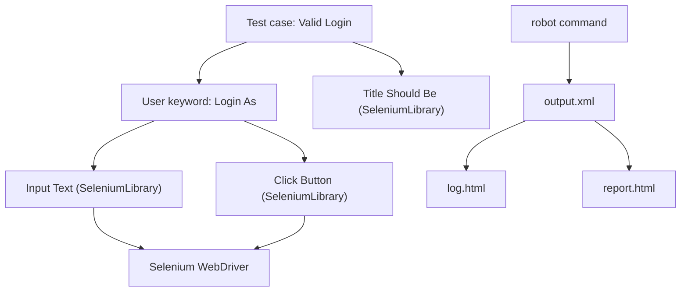

## Beginner-friendly explanation

Think of a recipe card written in plain words: "Preheat oven", "Mix flour and sugar", "Bake for 20 minutes". A beginner can follow it, and an expert can decide what "Mix" means in detail somewhere else.

**Robot Framework** lets you write tests like that recipe card. Each line is a **keyword**, a readable action such as `Open Browser` or `Page Should Contain`, followed by its inputs. Libraries supply the basic keywords, and you combine them into your own higher-level keywords like `Login As`. The result is tests that business people can read, while engineers handle the technical details.

## Technical explanation

Robot Framework is an open-source, generic automation framework implemented in Python and supported by the Robot Framework Foundation. It is used for acceptance testing, acceptance test-driven development and robotic process automation.

### File structure

A `.robot` file has sections marked with `*** ... ***`:

| Section | Purpose |
|---|---|
| `*** Settings ***` | Import libraries and resource files, set suite setup/teardown, documentation |
| `*** Variables ***` | Scalars `${NAME}`, lists `@{NAME}`, dictionaries `&{NAME}` |
| `*** Test Cases ***` | Tests, each a list of keyword calls |
| `*** Keywords ***` | User keywords built from other keywords |

Cells are separated by **two or more spaces** (or a tab, or ` | ` in pipe format). Test-level settings use square brackets: `[Tags]`, `[Setup]`, `[Teardown]`, `[Documentation]`, `[Arguments]` (for keywords).

### Libraries

- **BuiltIn**: always available (`Log`, `Should Be Equal`, `Sleep`, `Run Keyword If`, `Set Variable`).
- **Standard libraries**: `Collections`, `String`, `OperatingSystem`, `DateTime`, `Process`.
- **External libraries**: `SeleniumLibrary` (Selenium WebDriver), `Browser` (Playwright), `RequestsLibrary` (HTTP APIs), `AppiumLibrary`, `DatabaseLibrary`.
- **Custom**: any Python class or module can become a library.



## Real-world example

A telecom operator's QA team included domain experts who understood billing rules but did not program. Engineers built a resource file of keywords such as `Create Prepaid Customer`, `Recharge Account` and `Balance Should Be`, backed by RequestsLibrary and SeleniumLibrary. Domain experts then wrote and reviewed acceptance tests directly in `.robot` files, and the nightly CI job published `report.html` for the whole team.

## Step-by-step walkthrough

1. Install Python 3 and create a virtual environment.
2. Run `pip install robotframework robotframework-seleniumlibrary`.
3. Make sure a supported browser is installed (Selenium 4.6+ can manage drivers automatically through Selenium Manager).
4. Create `tests/login.robot` with the sections shown below.
5. Run `robot tests/` and open `log.html`.
6. Move shared keywords into a `resources/common.resource` file.

## Code examples

```text
*** Settings ***
Documentation     Login tests for the demo shop.
Library           SeleniumLibrary
Suite Setup       Open Browser    ${BASE_URL}    ${BROWSER}
Suite Teardown    Close All Browsers
Test Setup        Go To    ${BASE_URL}/login

*** Variables ***
${BASE_URL}       http://localhost:3000
${BROWSER}        chrome

*** Test Cases ***
Valid User Reaches Dashboard
    [Tags]    smoke
    Login As    demo@example.test    %{DEMO_PASSWORD}
    Wait Until Page Contains    Welcome
    Location Should Contain    /dashboard

Wrong Password Shows Error
    [Tags]    regression
    Login As    demo@example.test    wrong-password
    Wait Until Element Is Visible    css:[role="alert"]
    Element Text Should Be    css:[role="alert"]    Invalid email or password

*** Keywords ***
Login As
    [Arguments]    ${email}    ${password}
    Input Text        id:email       ${email}
    Input Password    id:password    ${password}
    Click Button      css:[data-testid="login-submit"]
```

`%{DEMO_PASSWORD}` reads an environment variable, and `Input Password` avoids writing the value to the log.

A data-driven variant with a test template:

```text
*** Test Cases ***    EMAIL                  PASSWORD    MESSAGE
Empty Email           ${EMPTY}               secret      Email is required
Bad Format            not-an-email           secret      Enter a valid email

*** Settings ***
Test Template    Login Should Fail With
```

(`Login Should Fail With` would be a user keyword taking the three arguments.)

Running:

```bash
robot tests/                                   # run everything
robot --include smoke tests/                   # only tests tagged smoke
robot --variable BROWSER:firefox tests/        # override a variable
robot --outputdir results --xunit xunit.xml tests/
```

## Expected output

```text
==============================================================================
Login :: Login tests for the demo shop.
==============================================================================
Valid User Reaches Dashboard                                          | PASS |
------------------------------------------------------------------------------
Wrong Password Shows Error                                            | PASS |
------------------------------------------------------------------------------
Login                                                                 | PASS |
2 tests, 2 passed, 0 failed
==============================================================================
Output:  .../output.xml
Log:     .../log.html
Report:  .../report.html
```

## Common mistakes

- **Single spaces** between keyword and arguments.
- **Using `Sleep`** instead of `Wait Until ...` keywords.
- **Huge test cases** with dozens of low-level steps instead of user keywords.
- **Keywords named after clicks** rather than business intent.
- **Hardcoding secrets** in `*** Variables ***`.
- **Ignoring `log.html`** and guessing at failures.

## Troubleshooting

- **"No keyword with name ... found"**: check spacing, spelling and that the library is imported.
- **Element not found**: confirm the locator prefix (`id:`, `css:`, `xpath:`) and wait for visibility.
- **Browser fails to start**: update Selenium and the browser; check that Selenium Manager can download a driver on your network.
- **Variables not overridden**: command-line `--variable` overrides file values, but check the exact name and case.

## Key takeaways summary

Robot Framework turns tests into readable keyword sequences backed by powerful libraries. Learn the section structure and two-space rule, build business-level user keywords, prefer `Wait Until` keywords over sleeps, and use `log.html` to understand every run.
