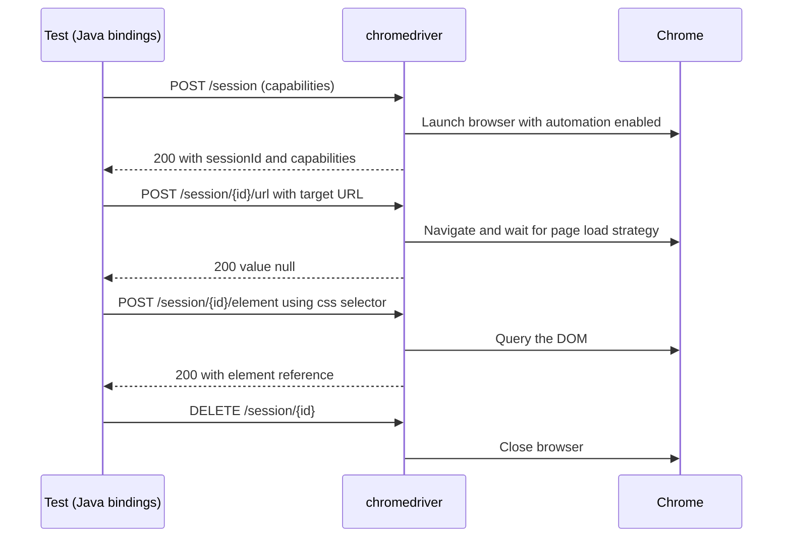

## Beginner-friendly explanation

Imagine ordering food at a restaurant where you do not speak the chef's language. You tell the **waiter** your order in English; the waiter writes it on a standard order slip; the **chef** reads the slip and cooks. You never step into the kitchen.

Selenium works the same way. Your **test code** is the customer. The **Selenium library** is the waiter, writing every request ("open this page", "click that button") on a standard slip called the **WebDriver protocol**. A **browser driver** such as chromedriver is the chef who knows how to make Chrome do it. Because the slip format is a standard, the same order works in Chrome, Firefox, Edge or Safari kitchens.

## Technical explanation

Selenium WebDriver has four layers:

1. **Language bindings** (Java, Python, C#, JavaScript, Ruby). `WebDriver`, `WebElement`, `By` and friends live here.
2. **The W3C WebDriver protocol**, a W3C Recommendation describing REST-style HTTP endpoints such as `POST /session`, `POST /session/{id}/url` and `POST /session/{id}/element`. Selenium 4 uses it natively.
3. **Browser drivers**, maintained by browser vendors: chromedriver, geckodriver (Firefox), msedgedriver, safaridriver. Each is a small HTTP server that receives protocol commands.
4. **The browser**, controlled by the driver through its internal automation interface.



### Sessions

`new ChromeDriver()` creates a **session**. Every later command carries the session ID. `driver.close()` closes the current window; `driver.quit()` ends the whole session. Commands after `quit()` raise `NoSuchSessionException`.

### Selenium Manager

From Selenium 4.6, if no driver is configured, **Selenium Manager** detects the browser version, downloads a matching driver into a local cache and uses it. Manual `System.setProperty("webdriver.chrome.driver", ...)` calls are now rarely needed.

### Options and capabilities

Browser options classes (`ChromeOptions`, `FirefoxOptions`, `EdgeOptions`) describe what kind of session you want: headless mode, window size, page load strategy, browser version.

### Remote execution and Grid

`RemoteWebDriver` sends the same protocol commands to a **Selenium Grid** URL instead of a local driver. Grid routes each new session to a node with a matching browser. Grid 4 runs in standalone, hub-and-node or fully distributed mode.

## Real-world example

A team's suite started failing every morning with `SessionNotCreatedException: This version of ChromeDriver only supports Chrome version N`. The CI machines auto-updated Chrome overnight, but the driver binary was committed to the repository. Upgrading to a current Selenium 4 release and deleting the hardcoded driver path let Selenium Manager pick a matching driver on each machine, and the morning failures stopped. They kept a pinned browser version in the CI image for reproducibility.

## Step-by-step walkthrough

1. **Add the dependency** `org.seleniumhq.selenium:selenium-java` (a current 4.x version) to your Maven project.
2. **Create options** for the browser and set what you need (for example `--headless=new` in CI).
3. **Create the driver**: `new ChromeDriver(options)`. Selenium Manager handles the driver binary.
4. **Issue commands**: `get`, `findElement`, `click`, `getText`.
5. **Quit in teardown** so the browser and driver process do not leak.
6. **Go remote** when you need scale: start Grid and create a `RemoteWebDriver` with the same options.

## Code examples

```java
import java.net.URI;
import org.openqa.selenium.WebDriver;
import org.openqa.selenium.chrome.ChromeDriver;
import org.openqa.selenium.chrome.ChromeOptions;
import org.openqa.selenium.remote.RemoteWebDriver;

public class FirstSession {
    public static void main(String[] args) throws Exception {
        ChromeOptions options = new ChromeOptions();
        options.addArguments("--headless=new", "--window-size=1366,768");

        boolean remote = Boolean.parseBoolean(System.getProperty("remote", "false"));
        WebDriver driver = remote
                ? new RemoteWebDriver(URI.create("http://localhost:4444").toURL(), options)
                : new ChromeDriver(options);   // Selenium Manager resolves chromedriver

        try {
            driver.get("https://www.selenium.dev/");
            System.out.println("Title: " + driver.getTitle());
            System.out.println("Session: " + ((RemoteWebDriver) driver).getSessionId());
        } finally {
            driver.quit();   // ends the session even if a step fails
        }
    }
}
```

`ChromeDriver` extends `RemoteWebDriver` in Selenium 4 (via `ChromiumDriver`), which is why the cast to read the session ID works for both branches.

To try Grid locally, download the Selenium Server jar from selenium.dev and run `java -jar selenium-server-<version>.jar standalone`, then run with `-Dremote=true`.

## Expected output

Illustrative console output (the session ID is random and the title depends on the live site):

```text
Title: Selenium
Session: 3f1c2a9e8b7d4c6e9a1b2c3d4e5f6a7b
```

## Common mistakes

- **Never calling `quit()`**, leaving orphaned browsers and driver processes that slow CI agents.
- **Committing driver binaries** or hardcoded driver paths that drift from the installed browser.
- **Mixing old and new APIs**, such as Selenium 3 era `DesiredCapabilities` tutorials, with Selenium 4.
- **Confusing `close()` with `quit()`**: `close()` leaves the session alive if other windows remain.
- **Assuming Selenium is a test framework.** It drives browsers; TestNG or JUnit provides tests, assertions and reports.

## Troubleshooting

- **`SessionNotCreatedException`** with a version message: browser and driver do not match. Remove manual driver paths and let Selenium Manager resolve it, or pin both versions.
- **Selenium Manager cannot download** behind a corporate proxy: configure the proxy, or pre-install the driver and set its path explicitly.
- **`NoSuchSessionException`**: the session was quit or the browser crashed; check teardown order and memory on the agent.
- **Remote session never starts**: check that the Grid URL is reachable and a node offers the requested browser in the Grid UI.

## Key takeaways summary

Selenium is a client that speaks the W3C WebDriver protocol to vendor-supplied browser drivers. Understanding that chain — bindings, protocol, driver, browser, optionally Grid — explains most setup errors and makes remote and parallel execution straightforward. Next, learn how to point at the right element with [locator strategies](/learn/automation/locator-strategies).
