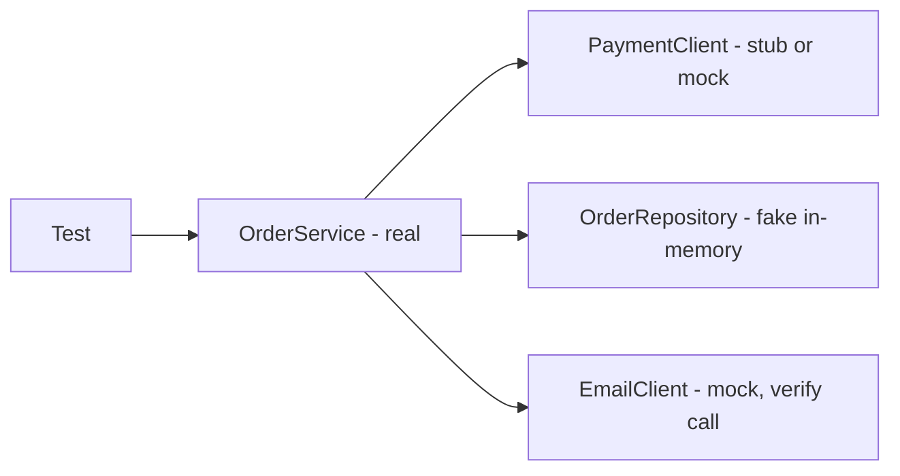

## Beginner-friendly explanation

When filming a dangerous scene, movies use a **stunt double**: someone who looks enough like the actor for that shot. The double is cheaper, safer and always available, but you would not use them for the close-up.

A **test double** is a stand-in for a real part of the system, such as a payment provider, an email service or a database, used during a test. It lets you test your code quickly and reliably, and lets you create situations that are hard to produce for real, like "the bank is down". The phrase "mocking" is often used loosely for all of this, but there are several kinds of double, each with its own job.

## Technical explanation

The terms come from Gerard Meszaros's *xUnit Test Patterns*, popularised by Martin Fowler's article "Mocks Aren't Stubs".

| Double | What it does | Example |
|---|---|---|
| Dummy | Passed in but never used | `null`-safe placeholder logger |
| Stub | Returns canned answers | Price client always returns 250 |
| Spy | Records calls for later checking, may wrap a real object | Counts emails sent |
| Mock | Pre-programmed with expectations that are verified | Verify `send("a@b.test")` called once |
| Fake | Working but simplified implementation | In-memory repository |

**State verification** checks results after the action (works with stubs and fakes). **Behaviour verification** checks the interactions (mocks and spies).

### Where doubles live

- **Unit level**: Mockito replaces Java collaborators behind interfaces.
- **Service level**: WireMock runs an HTTP server that returns configured responses.
- **UI level**: Playwright `page.route` and Cypress `cy.intercept` intercept browser network calls.



## Real-world example

A food delivery team's checkout tests called a real payment sandbox and an SMS provider. Runs were slow and failed whenever the sandbox was down, and nobody could test "card declined" reliably. They moved most checkout UI tests to a WireMock stub of the payment API, with scenarios for success, decline and timeout, and verified the SMS client with Mockito in service tests. A small nightly suite still exercised the real sandbox, and contract tests guarded the stubbed responses against API changes.

## Step-by-step walkthrough

1. Identify the boundary: which dependency makes the test slow, flaky or unable to reach an edge case?
2. Make sure your code depends on an interface or a configurable URL, so a double can be swapped in.
3. Pick the double: stub for inputs, mock for verifying calls, fake for richer behaviour.
4. Write the test: arrange the double, act on the real code, assert state or verify interactions.
5. Keep at least one integration or contract test against the real dependency.

## Code examples

Mockito with JUnit 5:

```java
@ExtendWith(MockitoExtension.class)
class RegistrationServiceTest {

    @Mock EmailClient email;
    @Mock UserRepository users;
    @InjectMocks RegistrationService service;

    @Test
    void sendsWelcomeEmailOnce() {
        when(users.existsByEmail("asha@example.test")).thenReturn(false);

        service.register("asha@example.test");

        verify(email, times(1)).sendWelcome("asha@example.test");
        verify(users).save(any(User.class));
    }

    @Test
    void rejectsDuplicateEmail() {
        when(users.existsByEmail("asha@example.test")).thenReturn(true);

        assertThrows(DuplicateUserException.class, () -> service.register("asha@example.test"));
        verifyNoInteractions(email);
    }
}
```

WireMock stub returning 503 (Java DSL, WireMock 3):

```java
WireMockServer wm = new WireMockServer(8089);
wm.start();
wm.stubFor(post(urlEqualTo("/payments"))
    .willReturn(aResponse().withStatus(503).withBody("{\"error\":\"unavailable\"}")));
// point the application under test at http://localhost:8089, run the test, then wm.stop()
```

Playwright route interception in TypeScript:

```typescript
await page.route('**/api/products', route =>
  route.fulfill({ status: 200, contentType: 'application/json', body: '[]' })
);
await page.goto('/shop');
await expect(page.getByText('No products found')).toBeVisible();
```

## Expected output

```text
RegistrationServiceTest > sendsWelcomeEmailOnce() PASSED
RegistrationServiceTest > rejectsDuplicateEmail() PASSED
```

If `sendWelcome` is never called, Mockito fails with a "Wanted but not invoked" message listing the actual interactions.

## Common mistakes

- **Mocking everything**, so tests only prove the code calls what it calls.
- **Mocking the class under test** itself.
- **Verifying every call**, coupling tests to implementation details.
- **Stubs drifting from reality** with no contract tests to catch API changes.
- **Calling every double a mock**, which causes confusion in reviews and interviews.
- **Unnecessary stubbing**: Mockito's strict stubs (default with `MockitoExtension`) report stubs a test never uses.

## Troubleshooting

- **`UnnecessaryStubbingException`**: remove the unused `when(...)` or move it to the test that needs it.
- **Mock returns null or 0**: the arguments did not match the stubbed ones; check `equals` or use matchers like `eq()` and `any()` consistently.
- **Cannot mock a final class or static method**: Mockito 5 uses the inline mock maker by default and supports this, but prefer refactoring to an interface where you can.
- **App still calls the real service**: the base URL is not configurable, or the stub server port differs.

## Key takeaways summary

Test doubles make tests fast, deterministic and able to reach awkward edge cases. Know the difference between stubs, mocks, spies and fakes, mock at boundaries, and keep a few real integration or contract tests so your doubles stay honest.
