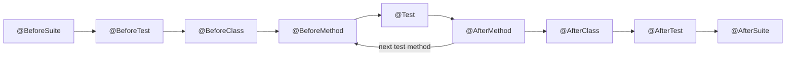

## Beginner-friendly explanation

Selenium can drive a browser, but it does not know what a "test" is. It cannot say which steps run first, whether a check passed, or produce a report. **TestNG** is the organiser. Think of it as a theatre stage manager: it sets the stage before each scene (open the browser), signals the actors (run the test), checks that each scene went as planned (assertions), clears the stage afterwards (quit the browser), and writes a review of the whole show (the report).

In the Saige-Prep automation track, **Java + Selenium + TestNG** is the core path; most Java automation roles expect you to be fluent in it.

## Technical explanation

### Annotations and lifecycle

| Annotation | Runs |
|---|---|
| `@BeforeSuite` / `@AfterSuite` | Once per suite |
| `@BeforeTest` / `@AfterTest` | Once per `<test>` tag in testng.xml |
| `@BeforeClass` / `@AfterClass` | Once per test class |
| `@BeforeMethod` / `@AfterMethod` | Around every `@Test` method |
| `@Test` | The test itself |
| `@DataProvider` | Supplies rows of parameters |



Useful `@Test` attributes: `groups`, `priority`, `enabled`, `dependsOnMethods`, `expectedExceptions`, `timeOut`, `dataProvider`, `invocationCount`, `retryAnalyzer`. Use `@AfterMethod(alwaysRun = true)` for teardown so the browser quits even when configuration fails or groups are filtered.

### Assertions

`org.testng.Assert` (hard) stops at the first failure. `org.testng.asserts.SoftAssert` collects failures until `assertAll()`. Signature order is `assertEquals(actual, expected, message)`.

### testng.xml

The suite file selects classes, packages, groups and parameters, and configures parallelism:

```xml
<!DOCTYPE suite SYSTEM "https://testng.org/testng-1.0.dtd">
<suite name="Regression" parallel="methods" thread-count="4">
  <parameter name="browser" value="chrome"/>
  <test name="Smoke on Chrome">
    <groups><run><include name="smoke"/></run></groups>
    <classes>
      <class name="com.shop.tests.LoginTests"/>
      <class name="com.shop.tests.CheckoutTests"/>
    </classes>
  </test>
</suite>
```

`@Parameters("browser")` on a method reads the value. Parallel modes are `methods`, `classes`, `tests` and `instances`.

### Listeners

Implement `ITestListener` (for example `onTestFailure`) to take screenshots or log results; register with `@Listeners` or a `<listeners>` block. See [reporting and logging](/learn/automation/reporting-and-logging).

## Real-world example

A subscription business's suite used `priority` and `dependsOnMethods` to chain "create account", "add plan", "pay", "cancel" into one long flow. When the payment sandbox was down, every downstream test was skipped, and nobody could run "cancel" alone to reproduce a bug. The team rewrote each test to create its own preconditions through API helpers in `@BeforeMethod`. Tests became independent, could run in parallel, and a single environment issue no longer hid the state of the whole suite.

## Step-by-step walkthrough

1. **Add the TestNG dependency** (`org.testng:testng`, a current 7.x) to the pom.
2. **Create a `BaseTest`** with `@BeforeMethod` creating the driver and `@AfterMethod(alwaysRun = true)` quitting it.
3. **Write test classes** extending `BaseTest`, one behaviour per `@Test`.
4. **Assert outcomes** with clear messages.
5. **Group tests** (`smoke`, `regression`) to build different suites.
6. **Create testng.xml** and point Maven Surefire at it.
7. **Read the report** in `target/surefire-reports` after `mvn test`.

## Code examples

```java
import java.time.Duration;
import org.openqa.selenium.By;
import org.openqa.selenium.WebDriver;
import org.openqa.selenium.chrome.ChromeDriver;
import org.testng.Assert;
import org.testng.annotations.*;

public class LoginTests {
    private WebDriver driver;

    @BeforeMethod
    public void setUp() {
        driver = new ChromeDriver();
        driver.manage().timeouts().pageLoadTimeout(Duration.ofSeconds(30));
        driver.get("https://example.test/login");
    }

    @Test(groups = {"smoke"}, description = "Valid user lands on the dashboard")
    public void validLoginShowsDashboard() {
        new LoginPage(driver).loginAs("demo", "s3cret");
        Assert.assertTrue(driver.getCurrentUrl().endsWith("/dashboard"),
                "Expected dashboard URL but was " + driver.getCurrentUrl());
    }

    @Test(groups = {"regression"})
    public void wrongPasswordShowsError() {
        new LoginPage(driver).loginAs("demo", "wrong");
        Assert.assertEquals(driver.findElement(By.id("error")).getText(),
                "Invalid username or password", "error banner text");
    }

    @AfterMethod(alwaysRun = true)
    public void tearDown() {
        if (driver != null) driver.quit();
    }
}
```

## Expected output

Illustrative console output from `mvn test` when one test fails:

```text
[INFO] Running TestSuite
[ERROR] Tests run: 2, Failures: 1, Errors: 0, Skipped: 0, Time elapsed: 9.84 s <<< FAILURE! -- in TestSuite
[ERROR] LoginTests.wrongPasswordShowsError -- Time elapsed: 3.112 s <<< FAILURE!
java.lang.AssertionError: error banner text expected [Invalid username or password] but found [Incorrect password]
[INFO]
[ERROR] Tests run: 2, Failures: 1, Errors: 0, Skipped: 0
[INFO] BUILD FAILURE
```

## Common mistakes

- **Using `@BeforeTest` thinking it runs before each test method.** That is `@BeforeMethod`.
- **Forgetting `alwaysRun = true` on teardown**, leaking browsers when setup fails.
- **Chaining tests with `priority` and `dependsOnMethods`**, creating fragile, order-dependent suites.
- **Forgetting `SoftAssert.assertAll()`**.
- **Static `WebDriver` fields** combined with `parallel="methods"`, so threads share one browser.
- **Mixing JUnit and TestNG assertion imports**, which swaps the argument order.

## Troubleshooting

- **No tests run with Maven**: check that Surefire points at the right testng.xml and that class names follow the configured pattern or are listed in the suite.
- **Tests skipped unexpectedly**: a configuration method failed; read the first configuration failure in the log.
- **Groups filter excludes setup methods**: configuration methods also need groups or `alwaysRun = true`.

## Key takeaways summary

TestNG turns Selenium scripts into a structured suite: lifecycle hooks for setup and teardown, assertions that report clearly, groups for different suites, data providers for variations and testng.xml for configuration. Keep tests independent and teardown robust, and the rest of the framework builds cleanly on top.
