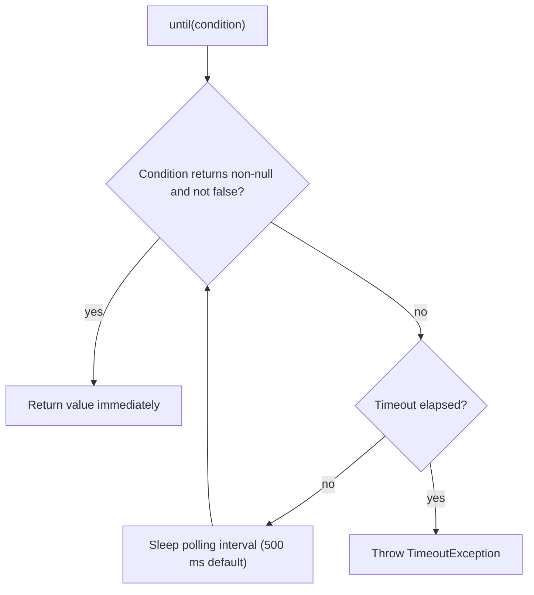

## Beginner-friendly explanation

Imagine waiting for a bus. One approach is to stand at the stop for exactly ten minutes, then leave whether or not the bus came. That is `Thread.sleep`: wasteful if the bus arrives in one minute, useless if it arrives in eleven. The sensible approach is to watch the road and get on as soon as the bus arrives, giving up only after a reasonable maximum.

Web pages load in pieces. Buttons appear after data arrives, spinners come and go, and animations move things around. Your test is much faster than any human, so it often tries to click something that is not ready yet. **Synchronization** means making the test wait for the right *condition*, just like watching for the bus.

## Technical explanation

### Why synchronization is needed

`driver.get()` waits for the document's load state (controlled by the page load strategy), but it does not know about later JavaScript activity: API calls, client-side rendering, animations. Selenium cannot guess what "ready" means for your page, so you tell it.

### The three kinds of wait

| Wait | Scope | Waits for | Failure |
|---|---|---|---|
| Implicit | Whole session | Element presence in `findElement(s)` | `NoSuchElementException` |
| Explicit (`WebDriverWait`) | One call site | Any condition you specify | `TimeoutException` |
| Fluent (`FluentWait`) | One call site | Any condition, with custom polling and ignored exceptions | `TimeoutException` |

Implicit wait is set with `driver.manage().timeouts().implicitlyWait(Duration.ofSeconds(n))` (Selenium 4; the `TimeUnit` overload is deprecated). The Selenium documentation advises **not mixing** implicit and explicit waits because the interaction makes timeouts unpredictable.

### WebDriverWait and ExpectedConditions

`new WebDriverWait(driver, Duration.ofSeconds(10))` polls a condition every 500 ms by default and ignores `NoSuchElementException` while polling. Useful conditions:

- `visibilityOfElementLocated(By)` and `invisibilityOfElementLocated(By)`
- `elementToBeClickable(By)` (visible and enabled; it does not detect overlays)
- `textToBePresentInElementLocated(By, String)` and `textToBe(By, String)`
- `urlContains(String)`, `titleIs(String)`
- `numberOfElementsToBeMoreThan(By, int)`
- `frameToBeAvailableAndSwitchToIt(By)`, `alertIsPresent()`

`until()` returns the condition's value, so `WebElement el = wait.until(visibilityOfElementLocated(...))` gives you the element directly.

### Custom conditions

A condition is a function from `WebDriver` to a value; return `null` or `false` to keep polling:

```java
wait.until(d -> d.findElements(By.cssSelector("#orders tbody tr")).size() >= 10);
```



## Real-world example

A banking team's suite took over an hour, and about one run in five failed somewhere. A review found hundreds of `Thread.sleep(3000)` calls added "to be safe". Replacing them with explicit waits on real conditions — spinner invisible, table row count, URL change — inside page-object methods cut the run time substantially and removed most of the intermittent failures. The remaining flaky tests turned out to be genuine race conditions in the application, which were then reported as defects.

## Step-by-step walkthrough

1. **Set implicit wait to zero** (the default) and decide to use explicit waits only.
2. **Identify the real readiness signal** for each action: a spinner disappears, a button is enabled, a row appears.
3. **Create one `WebDriverWait`** per page object, typically in `BasePage`.
4. **Wait, then act**, using the element returned by `until()`.
5. **After actions that trigger navigation or saving**, wait for the outcome (URL, toast, updated text) before asserting.
6. **Use `FluentWait`** when you need a different polling interval or to ignore extra exceptions such as `StaleElementReferenceException`.

## Code examples

```java
import java.time.Duration;
import org.openqa.selenium.*;
import org.openqa.selenium.support.ui.*;

public class SettingsPage {
    private final WebDriver driver;
    private final WebDriverWait wait;

    private final By spinner = By.id("spinner");
    private final By save = By.cssSelector("[data-testid='save']");
    private final By toast = By.cssSelector("[role='status']");

    public SettingsPage(WebDriver driver) {
        this.driver = driver;
        this.wait = new WebDriverWait(driver, Duration.ofSeconds(10));
    }

    public String saveAndReadToast() {
        wait.until(ExpectedConditions.invisibilityOfElementLocated(spinner));
        wait.until(ExpectedConditions.elementToBeClickable(save)).click();
        return wait.until(ExpectedConditions.visibilityOfElementLocated(toast)).getText();
    }

    public WebElement waitForStableRow(By row) {
        Wait<WebDriver> fluent = new FluentWait<>(driver)
                .withTimeout(Duration.ofSeconds(15))
                .pollingEvery(Duration.ofMillis(250))
                .ignoring(StaleElementReferenceException.class);
        return fluent.until(d -> {
            WebElement el = d.findElement(row);
            return el.isDisplayed() ? el : null;
        });
    }
}
```

## Expected output

When the toast never appears, a TestNG run reports a clear, condition-specific failure (illustrative):

```text
FAILED: savingSettingsShowsConfirmation
org.openqa.selenium.TimeoutException: Expected condition failed: waiting for visibility of element located by By.cssSelector: [role='status'] (tried for 10 second(s) with 500 milliseconds interval)
```

Compare that with a `Thread.sleep` approach, which typically fails later with a vaguer `NoSuchElementException`.

## Common mistakes

- **`Thread.sleep` as synchronization**: slow when the app is fast, flaky when it is slow.
- **Mixing implicit and explicit waits**, producing unexpectedly long or inconsistent timeouts.
- **Waiting for presence when you need visibility or clickability.**
- **Huge global timeouts** (60+ seconds) that hide performance regressions and make failures slow.
- **Waiting after acting instead of before**, or not waiting for the result of an action before asserting.
- **Using deprecated APIs** like `new WebDriverWait(driver, 10)` from old tutorials.

## Troubleshooting

- **`TimeoutException` but the element is clearly there**: check the condition (visible vs present), frames, and whether the locator matches a hidden duplicate.
- **`StaleElementReferenceException` after a wait**: the DOM re-rendered between finding and using; re-find inside the wait or use `FluentWait` ignoring stale elements.
- **`ElementClickInterceptedException`**: an overlay or sticky header covers the element; wait for the overlay to disappear or scroll the element into view.
- **Waits are fine locally, fail in CI**: CI is slower and often headless with a different window size; check the viewport and resource limits before raising timeouts.

## Key takeaways summary

Robust automation waits for meaningful conditions. Default to `WebDriverWait` with `Duration` and `ExpectedConditions`, keep implicit waits off, avoid `Thread.sleep`, and hide waits inside page-object methods. Good synchronization is the single biggest lever in [reducing flaky tests](/learn/automation/flaky-test-reduction).
