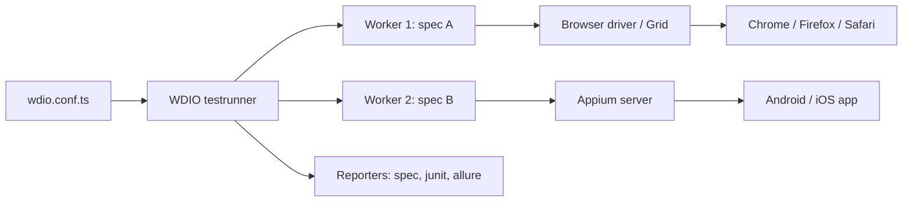

## Beginner-friendly explanation

Imagine a universal remote control that works with any TV that follows a common standard, and also with your set-top box and your phone. You learn one set of buttons and can control all of them.

**WebdriverIO** (often "WDIO") is that universal remote for JavaScript and TypeScript testers. It talks the same standard language as Selenium, called **WebDriver**, so it can control Chrome, Firefox, Edge and Safari, and through **Appium** it can also control Android and iOS apps. It comes with a ready-made test runner, so after a short setup wizard you can write tests straight away.

## Technical explanation

### Building blocks

- **Testrunner (`@wdio/cli`)**: reads `wdio.conf.ts`, starts sessions, runs spec files in parallel workers, and collects results.
- **Protocols**: W3C WebDriver, plus WebDriver BiDi for features like network and console events. Recent versions manage browser drivers automatically for local runs.
- **Frameworks**: Mocha, Jasmine or Cucumber.
- **Services**: lifecycle plugins (Appium service, cloud vendor services, visual testing).
- **Reporters**: spec, dot, junit, allure and others.

### Selectors

`$` returns one element, `$$` returns an array. Supported strategies include CSS, XPath, link text (`=Sign in`), partial link text (`*=Sign`), accessibility name (`aria/Sign in`) and, for mobile, Appium strategies such as accessibility id (`~login`).

### Waiting

Element commands wait implicitly for the element to exist up to `waitforTimeout`. Matchers from `expect-webdriverio` (`toBeDisplayed`, `toHaveText`, `toHaveUrl`) retry. Explicit helpers include `waitForDisplayed`, `waitForClickable` and `browser.waitUntil`.



## Real-world example

A travel company had separate Selenium Java tests for web and an unmaintained set of mobile scripts. Their front-end developers worked in TypeScript, so the QA team adopted WebdriverIO for both. The same page-object style and matchers covered the responsive website and, through the Appium service, the Android app. Shared helpers for login and search were reused across platforms, and CI published junit XML from both.

## Step-by-step walkthrough

1. Install an LTS version of Node.js.
2. In an empty folder run `npm init wdio@latest .` and answer the wizard: E2E testing of a web app, local run, Mocha, TypeScript, spec reporter.
3. Inspect `wdio.conf.ts`: `specs`, `capabilities`, `framework`, `reporters`, `baseUrl`, `waitforTimeout`.
4. Write a spec in `test/specs/`.
5. Run with `npx wdio run ./wdio.conf.ts`.
6. Add the junit reporter for CI.

## Code examples

```typescript
// wdio.conf.ts (trimmed)
export const config: WebdriverIO.Config = {
  runner: 'local',
  specs: ['./test/specs/**/*.ts'],
  maxInstances: 4,
  capabilities: [
    { browserName: 'chrome' },
    { browserName: 'firefox' },
  ],
  baseUrl: 'http://localhost:3000',
  waitforTimeout: 10000,
  framework: 'mocha',
  reporters: ['spec', ['junit', { outputDir: './reports/junit' }]],
  mochaOpts: { ui: 'bdd', timeout: 60000 },
};
```

```typescript
// test/specs/login.e2e.ts
describe('login', () => {
  beforeEach(async () => {
    await browser.url('/login');
  });

  it('valid user reaches the dashboard', async () => {
    await $('[data-testid=email]').setValue('demo@example.test');
    await $('[data-testid=password]').setValue(process.env.DEMO_PASSWORD ?? '');
    await $('aria/Sign in').click();

    await expect(browser).toHaveUrl(expect.stringContaining('/dashboard'));
    await expect($('h1')).toHaveText('Welcome');
  });

  it('lists three featured products', async () => {
    await browser.url('/');
    const cards = await $$('[data-testid=product-card]');
    await expect(cards).toBeElementsArrayOfSize(3);
  });
});
```

A page object in WDIO style:

```typescript
class LoginPage {
  get email()    { return $('[data-testid=email]'); }
  get password() { return $('[data-testid=password]'); }
  get submit()   { return $('aria/Sign in'); }

  async open() { await browser.url('/login'); }
  async loginAs(user: string, pass: string) {
    await this.email.setValue(user);
    await this.password.setValue(pass);
    await this.submit.click();
  }
}
export default new LoginPage();
```

## Expected output

The spec reporter prints something like:

```text
[chrome #0-0] login
[chrome #0-0]    ✓ valid user reaches the dashboard
[chrome #0-0]    ✓ lists three featured products
[chrome #0-0] 2 passing
Spec Files: 2 passed, 2 total (100% completed)
```

Exact formatting depends on the WebdriverIO version.

## Common mistakes

- **Missing `await`**, causing commands to run out of order or assertions to compare promises.
- **`browser.pause()` as a wait**; use matchers or `waitFor*` instead.
- **Storing elements across page reloads**, leading to stale element errors; use getters that re-query.
- **Too many `maxInstances`** for the machine, making tests time out.
- **Copying old sync-mode examples**; WebdriverIO v8 and later are async-only.

## Troubleshooting

- **Session not created / driver mismatch**: update WebdriverIO so it can fetch a matching driver, or check the Grid capabilities.
- **Element not interactable**: wait with `waitForClickable`, or check for overlays.
- **Appium service fails to start**: confirm Appium 2 and the needed driver (for example UiAutomator2) are installed.
- **TypeScript cannot find `browser` or `$` types**: make sure `@wdio/globals/types` is listed in `tsconfig.json` types.

## Key takeaways summary

WebdriverIO brings the WebDriver standard to JavaScript and TypeScript with a full-featured runner. Configure it in `wdio.conf`, use `$`/`$$` with stable selectors, rely on retrying matchers instead of pauses, and reuse the same skills for mobile with Appium.
