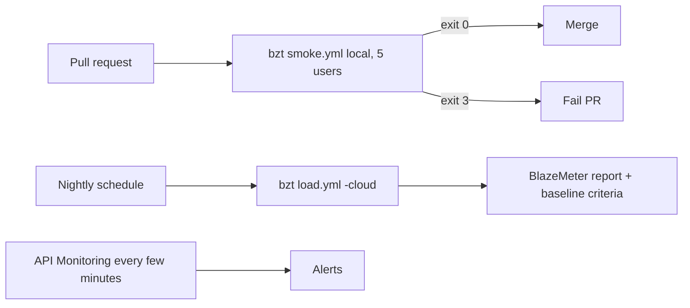

## Beginner-friendly explanation

In the previous lesson you made a load test into a text file with a clear pass or fail. Now you hand that file to the CI robot. Every time someone changes the code, the robot runs a short test; if the code made things slower than agreed, the robot says "no" and the change waits. Once a night, or before a release, the robot asks BlazeMeter's cloud to run the big test. The robot needs a key to BlazeMeter, and that key must be kept like a house key: in a safe, not taped to the front door (your repository).

## Technical explanation

**Gating with Taurus.** The pass/fail module plus bzt's exit codes (0 ok, 1 error, 2 manual stop, 3 automatic stop such as failed criteria or a failed cloud test) mean any CI system can gate without parsing results. Add `junit-xml` reporting if you want results in the CI test view (place `passfail` before `junit-xml` if you use pass/fail as its source).

**Three CI patterns:**

| Pattern | How | Good for |
|---|---|---|
| Local Taurus in the runner | `bzt smoke.yml` (optionally `-report`) | PR smoke tests against a test environment the job starts |
| Taurus cloud | `bzt load.yml -cloud` with token from secrets | Nightly or pre-release large runs from CI |
| BlazeMeter Jenkins plugin | Build step that runs an existing BlazeMeter test and maps its result to the build | Teams that manage tests in the BlazeMeter UI |

BlazeMeter also offers other integrations and a REST API (for example, starting a test and polling its status); check the current API and integration docs before relying on specific endpoints. Taurus can launch an existing BlazeMeter test by URL with `modules.cloud.test` and `launch-existing-test`, and `-detach` starts it without waiting.

**Secrets.** The key is `id:secret`. In GitHub Actions store `BZM_KEY_ID` and `BZM_KEY_SECRET` as repository or environment secrets; GitHub masks them in logs, but do not print them anyway. Secrets are not passed to workflows triggered from forks by default, which is what you want. In Jenkins use the Credentials store.

**API Monitoring.** BlazeMeter's API Monitoring (the former Runscope product) runs multi-step API tests with assertions on a schedule from various locations, with alerts and integrations. Use it for continuous correctness and uptime of APIs; use performance tests for behaviour under load. BlazeMeter documents converting an API Monitoring test into a performance test, with some limitations.



## Step-by-step walkthrough

**GitHub Actions PR smoke test**

1. Commit `perf/smoke.yml`, `perf/shop.jmx` and `perf/users.csv`.
2. Create `.github/workflows/perf-smoke.yml` (below). It starts your app with Docker Compose, installs a pinned bzt, runs the smoke test, uploads artifacts.
3. Open a PR. The job runs; a failed criterion shows as a red step with the criterion text in the log.

**Nightly cloud run**

1. In BlazeMeter, Settings, API Keys, create a key for CI (a dedicated key, easy to revoke).
2. In GitHub, Settings, Secrets and variables, Actions, add `BZM_KEY_ID` and `BZM_KEY_SECRET`.
3. Add the scheduled workflow (below). The target is your staging environment, reachable from the chosen locations, with owners informed.
4. Check the BlazeMeter report each morning; the baseline-based criteria in the YAML fail the job on regressions.

**Jenkins** (UI at the time of writing)

1. Manage Jenkins, Plugins: install the BlazeMeter plugin, or ensure Python and bzt exist on the agent.
2. Add credentials for the API key.
3. Either add a "BlazeMeter" build step choosing an existing test, or an `sh 'bzt perf/load.yml -cloud -o modules.cloud.token=$BZM_TOKEN'` step inside `withCredentials`.
4. Archive the artifacts folder and set the build result from the exit code.

## Code examples

`perf/smoke.yml`:

```yaml
execution:
- executor: jmeter
  scenario: shop
  concurrency: 5
  ramp-up: 30s
  hold-for: 2m

scenarios:
  shop:
    script: shop.jmx
    properties:
      host: localhost

reporting:
- module: final-stats
- module: passfail
  criteria:
  - p90>800ms, continue as failed
  - failures>1%, continue as failed
- module: junit-xml
  filename: perf-junit.xml
  data-source: pass-fail
```

PR workflow:

```yaml
name: perf-smoke
on: [pull_request]
jobs:
  smoke:
    runs-on: ubuntu-latest
    steps:
      - uses: actions/checkout@v4
      - uses: actions/setup-python@v5
        with: { python-version: "3.12" }
      - uses: actions/setup-java@v4
        with: { distribution: temurin, java-version: "17" }
      - run: docker compose -f perf/app-compose.yml up -d --wait
      - run: pip install "bzt==<pinned version>"
      - run: bzt perf/smoke.yml -o settings.artifacts-dir=perf-artifacts
      - uses: actions/upload-artifact@v4
        if: always()
        with: { name: perf-artifacts, path: perf-artifacts }
```

Nightly cloud job (token assembled from secrets, never echoed):

```yaml
name: perf-nightly
on:
  schedule: [{ cron: "0 2 * * *" }]
  workflow_dispatch:
jobs:
  cloud:
    runs-on: ubuntu-latest
    steps:
      - uses: actions/checkout@v4
      - uses: actions/setup-python@v5
        with: { python-version: "3.12" }
      - run: pip install "bzt==<pinned version>"
      - name: Run on BlazeMeter
        env:
          BZM_TOKEN: ${{ secrets.BZM_KEY_ID }}:${{ secrets.BZM_KEY_SECRET }}
        run: bzt perf/load.yml -cloud -o modules.cloud.token="$BZM_TOKEN"
```

Replace `<pinned version>` with the Taurus version you tested.

## Expected output

A passing PR shows the smoke step green and a `perf-artifacts` download. A failing one ends with a pass/fail message naming the criterion and exit code 3; the step is red. The nightly job logs a BlazeMeter report link and its status.

## Real-world example

A payments team had a nightly JMeter job that "always passed" because nobody read the report. They moved to Taurus with criteria `p90>700ms` and `failures>0.5%` and a baseline criterion on the authorisation endpoint. Two weeks later, the nightly cloud run failed with exit code 3: p90 rose 30% after an ORM upgrade. The report link in the failed job took the developer straight to Request Stats. They also added API Monitoring checks on the public status and token endpoints every few minutes, which caught a certificate problem in production that no load test would have.

## Common mistakes

- **Secrets in YAML or workflow files**, or printed with `echo`.
- **Gating PRs on large, noisy cloud runs.**
- **Ignoring exit code 1** (setup errors) as if it were a pass or a performance fail.
- **Uploading artifacts only on success.**
- **Unpinned bzt/JMeter versions**, making runs incomparable.
- **Nightly jobs pointed at production** or third-party services without approval.

## Troubleshooting

| Symptom | Fix |
|---|---|
| Job passes but criteria were breached | Criteria missing, misspelt or `continue as non-failed`; check `passfail` config |
| 401 from BlazeMeter | Token format must be `id:secret`; check secrets exist in this environment |
| Fork PRs fail on missing secret | Expected; run cloud jobs only on trusted branches |
| Cloud run cannot reach target | Use a reachable staging host or a private location |
| Exit code 1 | Read `bzt.log` in artifacts |

## Hands-on exercise

1. Add the PR smoke workflow to a repo with an app you own; make it pass, then fail it by setting `p90>1ms`.
2. Add the nightly cloud workflow with secrets and run it once manually.
3. Create one API Monitoring test (if your plan includes it) for a health endpoint of your own app and explain how its alerts differ from load test failures.

## Key takeaways summary

CI turns performance into a habit: Taurus criteria plus exit code 3 gate builds without custom scripts, small smoke runs protect every change, and scheduled BlazeMeter cloud runs with baselines track capacity. Keep API keys in secret stores, upload evidence always, use API Monitoring for continuous correctness, and run load only against systems you are authorised to test.
