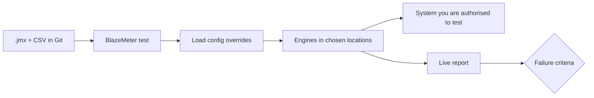

## Beginner-friendly explanation

You already know how to build a JMeter test and run it from your own computer. Your laptop is like one person pushing a shopping trolley: fine for a few trolleys, but you cannot fill a whole supermarket car park. **BlazeMeter** is a service that rents you a fleet of trolley pushers. You hand it the same JMeter script, say "1,000 shoppers, arriving over 5 minutes, from Europe and the US", and it starts machines in those regions, runs your script on them, gathers every result into one live report, and shuts the machines down at the end.

BlazeMeter is made by **Perforce** and describes itself as a continuous testing platform. Load testing is its best-known part, but it also offers functional/GUI testing, API monitoring, test data and service virtualisation. In this module we focus on performance testing with JMeter, plus **Taurus**, the free open-source command-line tool (`bzt`) that BlazeMeter maintains and that lets you describe tests as YAML.

One rule before anything else: **only load-test systems you own or are explicitly authorised to test.** A cloud platform makes it easy to send a lot of traffic; that is exactly why permission matters.

## Technical explanation

At the time of writing, a BlazeMeter **performance test** is made of:

| Part | What it is |
|---|---|
| Account, workspace, project | Containers for billing, team access and grouping tests |
| Script and files | Your `.jmx` (or a Taurus YAML, Gatling, Locust and others) plus CSV, JAR and properties files |
| Load configuration | Total users, ramp-up, duration or iterations, optional requests-per-second limit; these can **override** the thread group values in your script |
| Load distribution | Which locations generate traffic, and how many engines |
| Engines | Load generator machines started for the run; each runs your script with a share of the users |
| Failure criteria | Thresholds (for example average response time or error rate) that mark the run passed or failed |
| Report | Summary, timeline, request stats, errors, engine health, logs, comparisons |

BlazeMeter's documentation describes it as fully compatible with open-source JMeter and Taurus. In the current Performance test type, each engine runs your script with its share of the users; BlazeMeter computes the number of engines from **Total Users** and the **users per engine** ratio. Cloud engines run on public cloud providers (the docs mention Amazon, Azure and Google). For applications behind a firewall there are **private locations**: you install BlazeMeter's agent on your own servers, and the agent polls BlazeMeter with outgoing requests, so you do not need to open inbound firewall ports. Private locations are limited to certain plans.

**Taurus** (`pip install bzt`) runs locally. It can execute a `.jmx` or a YAML scenario with JMeter on your machine, stream results to a BlazeMeter report with `-report`, or hand the whole run to BlazeMeter's cloud with `-cloud`.

**Plans and limits.** The free and paid plans limit things such as concurrent users, engines, test duration, locations, private locations and how long reports are kept. Those numbers change, so this course does not quote them: check the current limits on BlazeMeter's pricing page and your account's billing screen before planning a test. If a test asks for more engines than your plan allows, BlazeMeter refuses it with a plan-limit error.

## Step-by-step walkthrough

UI labels below are as described in the documentation at the time of writing. Product screens change; if a label differs, search the BlazeMeter help site for the feature name.

1. **Create an account.** Go to blazemeter.com and sign up. After you log in, the top bar shows your account and workspace selectors and the product tabs (for example Performance, Functional, API Monitoring, Test Data, Mock Services).
2. **Look at the workspace and project.** Open the workspace selector; a workspace holds projects and members. Create a project called `learning`.
3. **Open the Performance tab.** You see recent tests and reports. Find **Create Test**; it offers **Performance Test** among other types. Do not create anything yet; next lessons do that step by step.
4. **Find the reports list.** Under the Performance tab there is a **Reports** view listing past runs, newest first, with a search box.
5. **Find your API keys.** In your user **Settings** there is an **API Keys** page. A key is an ID and a secret; Taurus joins them as `id:secret`. Create one only when a later lesson needs it, copy the secret once into a password manager, and never paste it into a script or chat.
6. **Read your plan.** Open the account or billing page and note your current user, engine and duration limits so you design tests that fit.
7. **Write down your authorised targets.** Before any run, list the host names you are allowed to test and who approved them.

## Real-world example

A ticketing company sells concert tickets. Normal traffic is modest, but when a big tour goes on sale, tens of thousands of fans arrive in minutes from many countries. Their performance engineer had a solid JMeter script, but one load generator saturated its CPU long before the target load, and running a home-made JMeter cluster meant patching servers that sat idle eleven months a year. They moved the same `.jmx` and its CSV of test accounts to BlazeMeter, generated load from two regions near their customers, watched the Engine Health report to prove the generators were not the bottleneck, and set failure criteria on the checkout transaction. The target was their own staging environment, sized like production, with the operations team on call. The test revealed that the payment-queue workers were the limit, and they were scaled before the sale.

## When to use what

| Situation | Good choice |
|---|---|
| Script development and debugging | JMeter GUI with one thread, then non-GUI locally |
| Smoke performance in every pull request | Local non-GUI JMeter or Taurus in CI |
| Large load beyond one machine, public target | BlazeMeter cloud engines |
| Load from several regions | BlazeMeter multiple locations |
| Internal app behind a firewall at scale | Private location, or self-hosted distributed JMeter |
| Strict data residency, no third parties allowed | Self-hosted JMeter |

## Worked example: from a local script to a cloud plan

Suppose you have `shop.jmx`, built and debugged in earlier lessons, and your product owner asks: "Will the shop cope with 1,500 concurrent shoppers during the spring sale?" Here is how the parts of BlazeMeter map to that question before you click anything.

1. **Can one machine do it?** You run the script non-GUI on your laptop at 150 threads and watch the operating system's CPU monitor. It sits at 85% and the JMeter log warns about long garbage-collection pauses. Your laptop is now part of the measurement, so 1,500 users locally is not credible. This is the classic reason to move to cloud engines.
2. **Where are the shoppers?** Analytics says roughly two thirds of traffic comes from Europe and one third from North America. That becomes a load distribution of two locations, weighted about 67/33.
3. **What does "cope" mean?** You agree with the owner: p90 of checkout at most 1 second, error rate at most 1%, during a 30-minute steady state. Those become failure criteria, so the report will say pass or fail instead of leaving it to opinion.
4. **What is the target?** The staging environment, which the operations lead has approved for a named window, with a contact who can stop the test. You write that down before configuring anything.
5. **What will the run cost in plan terms?** You check your account's billing page for concurrent-user, engine and duration limits. If the test does not fit, you either shorten it, reduce users and extrapolate cautiously, or ask for a plan change; you do not try to work around limits.

Only now do you create the test. Because you thought it through first, every BlazeMeter setting has a reason you can explain in a review.

## Reading the platform's vocabulary correctly

New users often misread a few terms, which leads to wrong conclusions later.

| Term | What people assume | What it actually means |
|---|---|---|
| Total Users | Users per location or per engine | Peak concurrent users for the whole test, split across engines and locations |
| Engine | A server of your application | A load generator that BlazeMeter starts; it sends traffic, it is not the system under test |
| Location | Where your app runs | Where load is generated from (a cloud region or your private location) |
| Debug Test | A dry run that sends no traffic | A small real run with reduced users and duration; it still hits your target |
| Report | Only produced at the end | Fills in live while the test runs, so you can watch and stop early |
| Override | A change to your JMX file | A run-time replacement of thread-group values; your uploaded file is unchanged |

## How BlazeMeter fits a team's workflow

A healthy pattern is to keep the source of truth in Git: the `.jmx`, CSV files and, ideally, a Taurus YAML that records the load settings. Developers run small checks locally or in CI. BlazeMeter is used for the runs that need scale, several regions or shared reports that managers and developers can open from a link. The Taurus lessons later in this module show how the same YAML can run on a laptop, in CI and on BlazeMeter, which avoids the drift that happens when settings live only in a web form.

Treat the BlazeMeter workspace like any shared production tool: give people the least access they need, use a dedicated API key per integration so you can revoke one without breaking others, and record who approved each large run.

## Common mistakes

- **Uploading an undebugged script.** Errors at 1,000 users cost money and time; debug at one user locally first.
- **Pointing cloud engines at localhost or an internal host name.** Engines cannot reach them.
- **Quoting plan limits from a blog post.** Limits change; check the current plan.
- **Committing the API key** in a YAML file or pipeline file.
- **Testing a system you do not own or have permission for**, including third-party APIs your app calls (payment, maps, email). Stub them or get written permission.
- **Believing BlazeMeter numbers blindly.** If engines were overloaded, the response times describe the generators, not your app.

## Troubleshooting

| Symptom | Likely cause and fix |
|---|---|
| "Load generators are more than account's plan limit" | Too many engines for your plan; reduce users or engines, or change plan |
| Test cannot reach the target | Host not publicly reachable or firewall blocks engines; use a private location or open access for the test |
| Cannot create a private location | Feature not in your plan or you lack admin rights; ask the account admin |
| Taurus says it needs a token | Put `modules.blazemeter.token` in `~/.bzt-rc`, not in the test file |

## Hands-on exercise

1. Sign up, create a `learning` project and explore the Performance tab and Reports list.
2. In a notebook, draw the parts table from this lesson and fill in where each part lives in the UI you see.
3. Write a one-paragraph "test authorisation note" for an app you own (for example a small app you run locally or on your own server): target URL, environment, owner, approved load, date window.
4. Check your plan's current limits and decide the largest test you could run.

## Key takeaways summary

BlazeMeter is Perforce's platform for running JMeter-compatible tests at scale on cloud or private engines, with shared reports and pass/fail criteria. You bring the same `.jmx` and data files; BlazeMeter adds load configuration, locations, engines and analysis. Taurus connects your command line and CI to it. Check plan limits on the live pricing page, guard your API keys, and only load-test what you are authorised to test.
