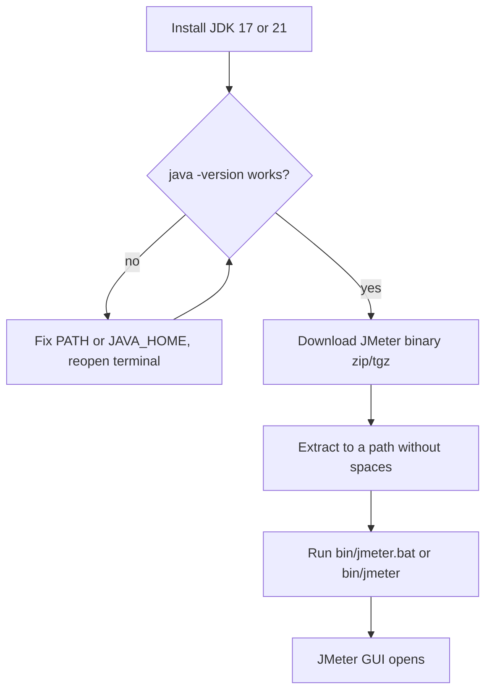

## Beginner-friendly explanation

Installing JMeter is like setting up a games console. First you need a power supply (Java), because the console (JMeter) simply cannot switch on without it. Then you unpack the console from its box (extract the zip) and press the power button (run the launcher script). There is no installer wizard: JMeter is a folder you unzip and run.

**Java** is a programming platform. Programs written in Java need a **Java Runtime** to run. The **JDK** (Java Development Kit) includes that runtime plus developer tools; installing a JDK is the simplest choice.

## Technical explanation

| Requirement | Detail |
|---|---|
| Java | JMeter 5.6.x needs Java 8 or later. Use a current LTS (long-term support) JDK such as 17 or 21 |
| Where to get Java | A free OpenJDK build, for example Eclipse Temurin from adoptium.net |
| JMeter download | The **Binaries** section of jmeter.apache.org/download_jmeter.cgi: `apache-jmeter-5.6.x.zip` (Windows) or `.tgz` (macOS/Linux) |
| Launchers | `bin/jmeter.bat` (Windows), `bin/jmeter` (macOS/Linux) |
| Disk layout | `bin` (scripts, `jmeter.properties`), `lib` (libraries), `lib/ext` (plugins), `docs`, `printable_docs` |

Two **environment variables** matter. `PATH` is the list of folders your terminal searches for commands; if Java's `bin` folder is on it, `java` works anywhere. `JAVA_HOME` points to the JDK folder and is used by many Java tools to pick a specific Java when several are installed.



## Step-by-step walkthrough

**1. Install Java.** Go to https://adoptium.net/, choose an LTS release (17 or 21) for your operating system and run the installer. On Windows, tick the options to set `JAVA_HOME` and add to `PATH` if offered.

**2. Verify Java.** Open a **new** terminal (Command Prompt or PowerShell on Windows, Terminal on macOS/Linux):

```bash
java -version
```

**3. Download JMeter.** Visit https://jmeter.apache.org/download_jmeter.cgi. Under **Binaries**, download `apache-jmeter-5.6.x.zip` (or `.tgz`). Do not pick the file with `_src` in its name. Optionally verify the file with the published SHA-512 checksum.

**4. Extract it** to a simple path such as `C:\tools\apache-jmeter-5.6.3` or `~/tools/apache-jmeter-5.6.3`. Avoid folders with spaces.

**5. Launch the GUI.**

```bash
# Windows (Command Prompt)
cd C:\tools\apache-jmeter-5.6.3\bin
jmeter.bat

# macOS / Linux
cd ~/tools/apache-jmeter-5.6.3/bin
./jmeter
```

A console window appears first, then the JMeter window. Keep the console open; closing it closes JMeter.

**6. Confirm the version** via **Help → About**.

**7. Prepare your practice target.** In a separate terminal, create an empty folder, add a file named `index.html` with any text, and run:

```bash
python -m http.server 8000
```

Open `http://localhost:8000` in a browser. This server is yours, so it is a safe target for every exercise in this track. Never point practice tests at websites you do not own.

**8. Optional conveniences.** You can add JMeter's `bin` folder to your PATH so that typing `jmeter` works from any terminal. If you later build large plans, JMeter's memory (the Java heap) can be raised by setting the `HEAP` environment variable before launching, for example `HEAP=-Xms1g -Xmx1g`; the defaults are fine for every exercise in this module. Leave `jmeter.properties` untouched for now: when you do want to change a setting, put it in `bin/user.properties` instead, so upgrades do not overwrite your changes.

## Expected output

Illustrative output of `java -version` (your vendor and build numbers will differ):

```text
openjdk version "21.0.4" 2024-07-16 LTS
OpenJDK Runtime Environment Temurin-21.0.4+7 (build 21.0.4+7-LTS)
OpenJDK 64-Bit Server VM Temurin-21.0.4+7 (build 21.0.4+7-LTS, mixed mode, sharing)
```

The JMeter console prints a reminder similar to this (illustrative):

```text
================================================================================
Don't use GUI mode for load testing !, only for Test creation and Test debugging.
For load testing, use CLI Mode (was NON GUI):
   jmeter -n -t [jmx file] -l [results file] -e -o [Path to web report folder]
================================================================================
```

That message is not an error; it is JMeter's own advice, covered in [non-GUI and distributed execution](/learn/jmeter/jmeter-non-gui-and-distributed).

## Troubleshooting

| Symptom | Cause | Fix |
|---|---|---|
| `'java' is not recognized` / `command not found` | Java not installed or not on PATH | Install a JDK; add its `bin` to PATH; open a new terminal |
| Console flashes and closes on Windows | Java missing or wrong JAVA_HOME | Run `jmeter.bat` from an open Command Prompt so you can read the error |
| `Permission denied` running `./jmeter` | Script not executable | `chmod +x jmeter` in the bin folder |
| No launcher in `bin` | Downloaded the `_src` archive | Download the binary archive instead |
| Odd path errors | Spaces or special characters in the path | Move JMeter to a simple path |
| Old Java used despite new install | Old JAVA_HOME still set | Update JAVA_HOME to the new JDK, reopen the terminal |
| Port 8000 already in use | Another program uses it | Run `python -m http.server 8001` and use that port |

## Real-world example

A QA team onboarding several new testers writes a one-page setup checklist: install the same LTS JDK, download the same JMeter 5.6.x binary from the official site, extract to the same folder path, and confirm with Help → About. Because everyone runs identical versions, a `.jmx` file shared in the team repository behaves the same on every laptop, and "works on my machine" problems disappear.

## Common mistakes

- **Downloading the source archive.** Look for "Binaries".
- **Closing the console window.** It is part of JMeter and shows errors.
- **Downloading from unofficial mirrors or random sites.** Use jmeter.apache.org.
- **Installing into Program Files** or other paths with spaces, which some scripts handle poorly.
- **Not reopening the terminal** after changing PATH or JAVA_HOME.
- **Practising on public websites.** Use your own `localhost` server.

## Key takeaways summary

Install a current LTS JDK, confirm with `java -version`, download the JMeter **binary** archive from the official site, extract it to a simple path, and run `bin/jmeter.bat` or `bin/jmeter`. Keep the console open, read its messages, and use a local server you own for practice. Next, take the [GUI tour](/learn/jmeter/jmeter-gui-tour).
