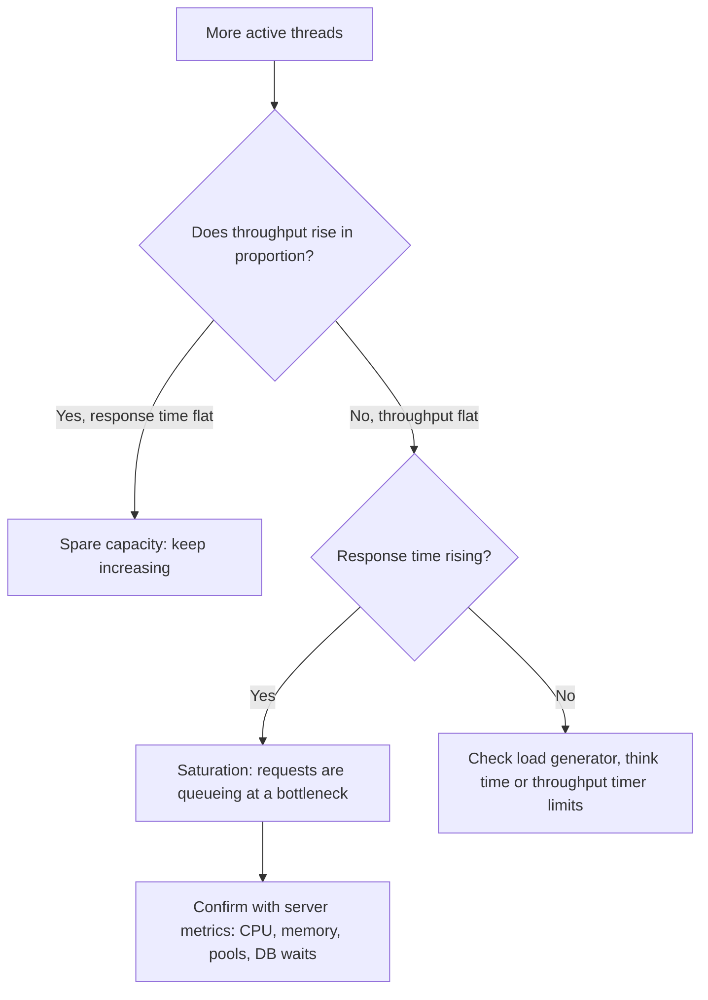

## Beginner-friendly explanation

A doctor does not say "your average heartbeat is fine" and stop. They look at patterns: what happens when you climb stairs, where it hurts, how today compares to your last check-up. Analysing a load test is the same. A report full of numbers is not the answer; you have to ask what the numbers mean for users and where the system starts to struggle.

A **bottleneck** is the narrowest part of a bottle: the one resource (CPU, database, connection pool, a slow service) that limits how much the whole system can handle. Your job is to find the point where the system stops coping and gather evidence about why.

> **Authorisation rule:** analyse only tests run against systems you own, such as an app on `localhost`, or have written permission to test.

## Technical explanation

**1. Percentiles, not averages.** Response times are usually skewed: most are fast, a few are very slow. The **Nth percentile** is the value N % of samples were at or below.

| Sample times (ms) | Average | Median | 90th pct | Max |
|---|---|---|---|---|
| 100, 110, 120, 120, 130, 130, 140, 150, 160, 3,000 | 416 | 130 | 160 | 3,000 |

Here the average (416 ms) describes nobody: nine users got about 130 ms and one waited 3 s. Report median, 90th, 95th and 99th, plus max for outliers. More in [Throughput, latency and percentiles](/learn/performance/throughput-latency-and-percentiles).

**2. Correlate three charts.** In the [HTML dashboard](/learn/jmeter/jmeter-html-dashboard-report) put Active Threads Over Time, Transactions per Second and Response Times Over Time side by side (or use Time vs Threads).



Little's Law explains it: when throughput X can no longer grow, extra concurrency N can only increase response time R ([Little's Law](/learn/performance/littles-law)).

**3. Saturation signs**

- Throughput plateaus while threads increase.
- Response time (especially the 95th/99th) bends upward like a hockey stick.
- Errors appear: timeouts, 503 Service Unavailable, connection refused, 500s.
- Server metrics show a resource at its limit: CPU near 100 %, thread or connection pool exhausted, database lock waits, garbage collection pauses.

**4. Error analysis.** Use the Errors and Top 5 Errors tables, then classify:

| Error type | Likely origin | Check |
|---|---|---|
| Assertion failure, literal `${var}`, `<EOF>` data | Test script | Debug run with View Results Tree |
| Non HTTP response: connection refused / socket timeout | Server overloaded or generator limits | Server logs, generator CPU and ports |
| 4xx (401, 409) rising with load | Data or correlation (expired tokens, duplicate data) | Token lifetime, data uniqueness |
| 5xx rising with load | System defect or saturation | Server logs and resource metrics |

**5. Baseline comparison.** A **baseline** is a trusted earlier run used as a reference. Compare only like with like: same plan, data volume, environment, duration and load profile. Express change as a percentage and flag regressions beyond an agreed tolerance. See [Capacity planning and baselines](/learn/performance/capacity-planning-and-baselines).

## Step-by-step walkthrough

1. **Check the test was valid.** Did it reach the target throughput and mix? Was generator CPU healthy? Are there script errors? If not, fix and re-run before analysing.
2. **Trim warm-up and ramp-up** from steady-state conclusions.
3. **Read Statistics** per transaction: error %, 95th/99th percentile, throughput. Compare against targets (for example "95th ≤ 800 ms, errors < 1 %").
4. **Correlate over time** using the three charts; note the time or thread count where things change.
5. **Classify errors** with the table above.
6. **Line up server metrics** for the same time window (from your monitoring, see [Resource utilisation and bottlenecks](/learn/performance/resource-utilization-and-bottlenecks)).
7. **Compare with the baseline.**
8. **Write the findings summary.**

## Expected output

Illustrative baseline comparison for a local app (numbers are examples only):

| Transaction | Baseline 95th | New 95th | Change | Baseline errors | New errors | Verdict |
|---|---|---|---|---|---|---|---|
| Login | 310 ms | 320 ms | +3 % | 0.0 % | 0.0 % | Within tolerance |
| Search | 470 ms | 1,150 ms | +145 % | 0.1 % | 0.2 % | Regression |
| Checkout | 1,250 ms | 1,240 ms | −1 % | 1.5 % | 1.4 % | Unchanged |

Illustrative findings summary:

```text
Goal: sustain 10 iterations/s for 15 min, 95th percentile <= 800 ms, errors < 1 %.
Result: FAILED for Search (95th 1,150 ms); Login and Checkout met targets.
Evidence: Search 95th rose from 470 ms to 1,150 ms vs baseline run 12; throughput
  flattened at about 9 iterations/s above 50 threads; DB CPU 95 % in the same window.
Likely cause: new search filter query without an index (to be confirmed by dev).
Next action: add index, re-run same plan and compare against baseline run 12.
```

## Real-world example

A team's nightly test showed average response time unchanged but the 99th percentile doubling. Correlating with Active Threads showed the spikes were not load related: they occurred every 10 minutes regardless of thread count. Server logs revealed a cache refresh that blocked requests. Without percentiles and time correlation, the regression would have shipped.

## Common mistakes

- **Concluding from averages** or from a single number.
- **Analysing an invalid test** (target not reached, generator overloaded, script errors).
- **Blaming the system for script errors** or ignoring real 5xx as "noise".
- **Comparing runs with different conditions** and calling it a regression.
- **Stating a cause without evidence**; JMeter shows symptoms, server metrics show causes.
- **Writing a 20-page report** with no clear pass/fail and next action.

## Troubleshooting

- **Results vary a lot between identical runs:** run longer, check for background jobs and shared environments, repeat runs and compare ranges.
- **Response times high from the very first minute:** check warm-up (cold caches, JIT) and the generator itself.
- **Errors only on the generator side:** reduce listeners, run non-GUI, increase heap or add generators (see [Non-GUI and distributed](/learn/jmeter/jmeter-non-gui-and-distributed)).

## Key takeaways summary

Good analysis validates the test, reads percentiles, correlates response time with threads and throughput to find saturation, classifies errors by origin, compares against a like-for-like baseline and ends with a short, evidence-based findings summary that says pass or fail and what happens next.
