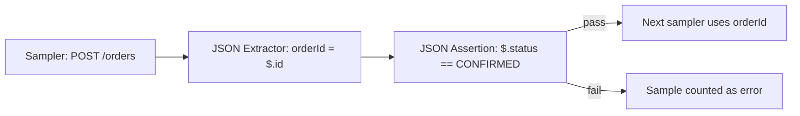

## Beginner-friendly explanation

Imagine timing pizza deliveries. A driver who arrives in five minutes with an empty box is fast, but the delivery failed. If you only measure speed, the empty boxes make your average look great.

Load tests have the same trap. A server under pressure may answer quickly with "Something went wrong" while still saying "200 OK". **Assertions** open the box and check the pizza is actually inside. **Extractors** read information from a response, like the order number on the receipt, so the next request can use it.

## Technical explanation

### Assertions

Assertions run after the sampler and post-processors, in the same scope. A failed assertion marks the sample unsuccessful, so it appears in the error count.

| Assertion | Checks | Typical use |
|---|---|---|
| **Response Assertion** | Text response, response code, message, headers, URL; rules Contains, Matches, Equals, Substring, with Not and Or options | "Response code equals 200", "body contains Welcome", "body does not contain Exception" |
| **JSON Assertion** | That a JSONPath exists and optionally that its value equals an expected value (or matches a regex) | `$.status` equals `CONFIRMED` |
| **Duration Assertion** | Sample took no longer than N milliseconds | Hard per-request timeout check |
| **Size Assertion** | Response size compared with a byte count | Detect truncated or empty responses |
| **JSR223 Assertion** | Any logic in Groovy | Multi-field business rules |

Note the difference between **Contains/Matches** (regular expressions) and **Equals/Substring** (plain text). Using Contains with a string containing `?` or `.` can match unexpectedly because they are regex metacharacters.

### Extractors (post-processors)

| Extractor | Input | Key settings |
|---|---|---|
| **Regular Expression Extractor** | Body, headers, URL, response code | Reference name, regex, template (`$1$`), Match No., default |
| **JSON Extractor** | JSON body | Variable names, JSONPath (e.g. `$.data.token`), Match No., default |
| **Boundary Extractor** | Any text | Left boundary, right boundary, Match No., default |
| **CSS Selector Extractor** | HTML | CSS selector and attribute |
| **XPath Extractor** | XML or XHTML | XPath query |

**Match No.** works the same across these extractors: `1` is the first match, `n` the nth, `0` a **random** match, and `-1` all matches (creating `name_1`, `name_2`, … and `name_matchNr`).



## Real-world example

A payments team's load test reported 0% errors and a healthy p95. During a review, someone noticed the p95 had *improved* at the highest load step. Inspecting a sample of responses showed that, beyond a certain rate, the gateway returned HTTP 200 with a JSON body containing `"status":"REJECTED","reason":"RATE_LIMITED"`. Those rejections were fast, pulling percentiles down. After adding a JSON Assertion on `$.status` the error rate at that step became clearly visible and the test correctly identified the rate limit as the capacity ceiling.

## Step-by-step walkthrough

1. **List what "success" means** for each request: status code, key text, key JSON fields.
2. **Add a Response Assertion** for status code (and, for HTML, a key text marker).
3. **Add JSON Assertions** for business fields on API responses.
4. **Add extractors** for every value later requests need, with `NOT_FOUND` defaults.
5. **Assert extraction**: a Response Assertion on the variable or the next request's success.
6. **Debug with View Results Tree** using one or two threads, then disable it for load.
7. **Review assertion cost**: avoid regex over multi-megabyte bodies on every sample.

## Code examples

JSON Extractor and JSON Assertion settings for an order response:

```text
JSON Extractor
  Names of created variables: orderId;orderStatus
  JSON Path expressions:      $.id;$.status
  Match No.:                  1;1
  Default Values:             NOT_FOUND;NOT_FOUND

JSON Assertion
  Assert JSON Path exists:    $.status
  Additionally assert value:  checked
  Expected Value:             CONFIRMED
```

Boundary Extractor for a token in a header such as `X-Request-Token: abc123;`:

```text
Field to check:   Response Headers
Left Boundary:    X-Request-Token:
Right Boundary:   ;
Match No.:        1
Default Value:    NOT_FOUND
```

The Boundary Extractor returns the text between the boundaries exactly, so a space after the colon would be included; add it to the left boundary if needed.

## Expected output

When the JSON Assertion fails, View Results Tree shows a failure message along these lines (exact wording varies by version):

```text
Assertion error: false
Assertion failure: true
Assertion failure message: Value expected to be 'CONFIRMED', but found 'REJECTED'
```

In the HTML dashboard, these samples appear in the Errors and Top 5 Errors by sampler tables.

## Common mistakes

- **No assertions at all**, so HTTP 200 error pages count as success.
- **Treating Match No. 0 as "first match"**; it is random.
- **Regex for JSON**, which breaks when field order or formatting changes.
- **Asserting on whole bodies** with large regexes, burning load generator CPU.
- **Duration Assertions used as SLOs**, which turns slowness into "errors" and confuses error analysis.
- **Extractor scoped too broadly**, running on every sampler and overwriting a good value with the default.

## Troubleshooting

- **Variable is NOT_FOUND.** Check "Apply to" (main sample versus sub-samples after redirects), the field to check and the expression against the actual response.
- **Assertion passes but data is wrong.** Assert on business fields, not just a keyword that also appears in error pages.
- **High CPU on load generators.** Simplify assertions and prefer JSON or Boundary extractors over complex regexes.

## Key takeaways summary

Assertions turn a speed test into a correct speed test, and extractors make multi-step journeys work. Assert on what success really means, extract with structure-aware tools and safe defaults, and keep both cheap enough that the load generator stays healthy.
