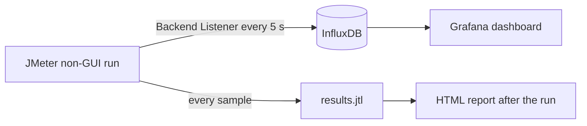

## Beginner-friendly explanation

Running a long load test without live monitoring is like driving at night with the dashboard lights off: you only learn you ran out of fuel when the car stops. The **Backend Listener** turns the dashboard lights on. Every few seconds JMeter sends a short summary ("this many requests, this many errors, this fast") to a time-series database called **InfluxDB**. **Grafana** draws those numbers as live charts in your browser.

## Technical explanation



The **Backend Listener** (Add → Listener → Backend Listener) collects sample results in a queue and hands them to a client class on a background thread, so it adds little overhead. With `org.apache.jmeter.visualizers.backend.influxdb.InfluxDBBackendListenerClient` the key parameters are:

| Parameter | Meaning |
|---|---|
| `influxdbMetricsSender` | Sender class; keep the default HTTP sender |
| `influxdbUrl` | Write endpoint. InfluxDB 1.x: `http://localhost:8086/write?db=jmeter` |
| `application` | A tag naming the system or test, so dashboards can filter |
| `measurement` | Measurement name, default `jmeter` |
| `summaryOnly` | `true` sends only totals; `false` sends a series per sampler |
| `samplersRegex` | Regex for which samplers to send, e.g. `TX_.*` |
| `percentiles` | Semicolon list, e.g. `90;95;99` |
| `testTitle` | Annotation text written at start and end |
| `eventTags` | Extra tags for the annotations |
| `influxdbToken` | Only for InfluxDB 2.x |

**Versions matter.** InfluxDB 1.x uses databases and the `/write?db=` endpoint, queried with InfluxQL. InfluxDB 2.x uses organizations, buckets and tokens; the URL becomes `http://localhost:8086/api/v2/write?org=<org>&bucket=<bucket>` and you fill `influxdbToken`. This lesson uses 1.x because it is simplest to run locally; check https://docs.influxdata.com/ for your version.

Metrics are sent once per interval (5 seconds by default, set by the `backend_influxdb.send_interval` property).

## Step-by-step walkthrough

1. Install Docker Desktop (or Docker Engine) and create a folder `monitoring`.
2. Save the `docker-compose.yml` below and run `docker compose up -d`.
3. Create the database: `docker compose exec influxdb influx -execute "CREATE DATABASE jmeter"` (or rely on `INFLUXDB_DB` in the compose file).
4. In JMeter, right-click your Thread Group's parent Test Plan → **Add → Listener → Backend Listener**.
5. Choose `InfluxDBBackendListenerClient`. Set `influxdbUrl` to `http://localhost:8086/write?db=jmeter`, `application` to `local-shop`, `summaryOnly` to `false`, `percentiles` to `90;95;99`.
6. Run in non-GUI mode against an app you own: `jmeter -n -t shop.jmx -l results.jtl`.
7. Open Grafana at `http://localhost:3000` (default login admin/admin, change it). Go to **Connections → Data sources → Add data source → InfluxDB**, URL `http://influxdb:8086`, database `jmeter`, query language InfluxQL. Click **Save & test**.
8. Create a dashboard, or import a community JMeter dashboard from the Grafana dashboards site that matches the InfluxDBBackendListenerClient schema.

## Code examples

```yaml
# docker-compose.yml - local lab only, InfluxDB 1.8 + Grafana
services:
  influxdb:
    image: influxdb:1.8
    ports:
      - "8086:8086"
    environment:
      - INFLUXDB_DB=jmeter
    volumes:
      - influx-data:/var/lib/influxdb
  grafana:
    image: grafana/grafana
    ports:
      - "3000:3000"
    depends_on:
      - influxdb
    volumes:
      - grafana-data:/var/lib/grafana
volumes:
  influx-data:
  grafana-data:
```

An InfluxQL panel query for the 95th percentile per transaction:

```sql
SELECT mean("pct95.0") FROM "jmeter"
WHERE "application" = 'local-shop' AND "statut" = 'all' AND $timeFilter
GROUP BY time($__interval), "transaction"
```

The tag really is spelled `statut` in the JMeter client (values `ok`, `ko`, `all`).

## Expected output

During the run, `SHOW MEASUREMENTS` in the `jmeter` database lists `jmeter` and `events`. Grafana panels update every few seconds: active threads rising during ramp-up, throughput levelling off, and percentile lines per transaction. An annotation marks the start and end of the test.

## Real-world example

A team runs a two-hour soak test overnight against its staging environment. With the Grafana dashboard, the on-call tester sees the error rate climb after about forty minutes and memory-related slowness growing on one transaction. They stop the test early, attach the dashboard screenshot and the partial JTL to the defect, and save hours of wasted run time.

## Common mistakes

- **Using the 1.x URL against InfluxDB 2.x**, or forgetting the token.
- **Pointing Grafana at `localhost`** inside Docker; containers talk to each other by service name (`influxdb`).
- **Sending every sampler** with dozens of requests; use `samplersRegex` for transaction controllers only.
- **Dropping the JTL** because Grafana "has everything". It has aggregates, not raw samples.
- **Running InfluxDB on the load generator** during big tests, which steals its CPU.

## Troubleshooting

| Symptom | Fix |
|---|---|
| No data in InfluxDB | Check the JMeter log for Backend Listener errors; confirm the URL and database exist |
| Grafana "Save & test" fails | Use `http://influxdb:8086`, not localhost, from the Grafana container |
| Only an "all" series | Set `summaryOnly` to false |
| Percentile fields missing | Check the `percentiles` value; field names follow it, e.g. `pct95.0` |

## Reading the live dashboard

A live dashboard is only useful if you know what to look at. Build, or check that your imported dashboard has, these panels:

1. **Active threads** over time. It should follow the ramp-up you configured. If it drops, threads are dying, often because of errors with "Stop thread" on sampler error.
2. **Throughput (requests per second)** per transaction. During steady state it should be roughly flat. A falling line with constant threads means responses are slowing down.
3. **Error count or error rate** from the `ko` series. Any sudden rise deserves immediate attention; open the JMeter log on the load generator.
4. **Percentiles (p90, p95, p99)** per transaction. Averages hide slow outliers, so watch the higher percentiles.
5. **Annotations** for test start and end, so you can line up JMeter data with server metrics in other dashboards.

Put server-side panels (CPU, memory, database connections) from your existing monitoring next to these, using the same time range. The question you are always asking is: "When the user-facing numbers changed, what changed on the server at the same moment?"

Remember that every point is an aggregate for one send interval. A 5-second interval smooths short spikes, so confirm interesting moments in the JTL-based HTML report after the run.

## Key takeaways summary

The Backend Listener gives you live visibility with little overhead: JMeter writes aggregates to InfluxDB, Grafana visualizes them, and the JTL remains your detailed record. Match the URL to your InfluxDB version, tag runs with `application`, and only load-test systems you own or are explicitly authorized to test.
