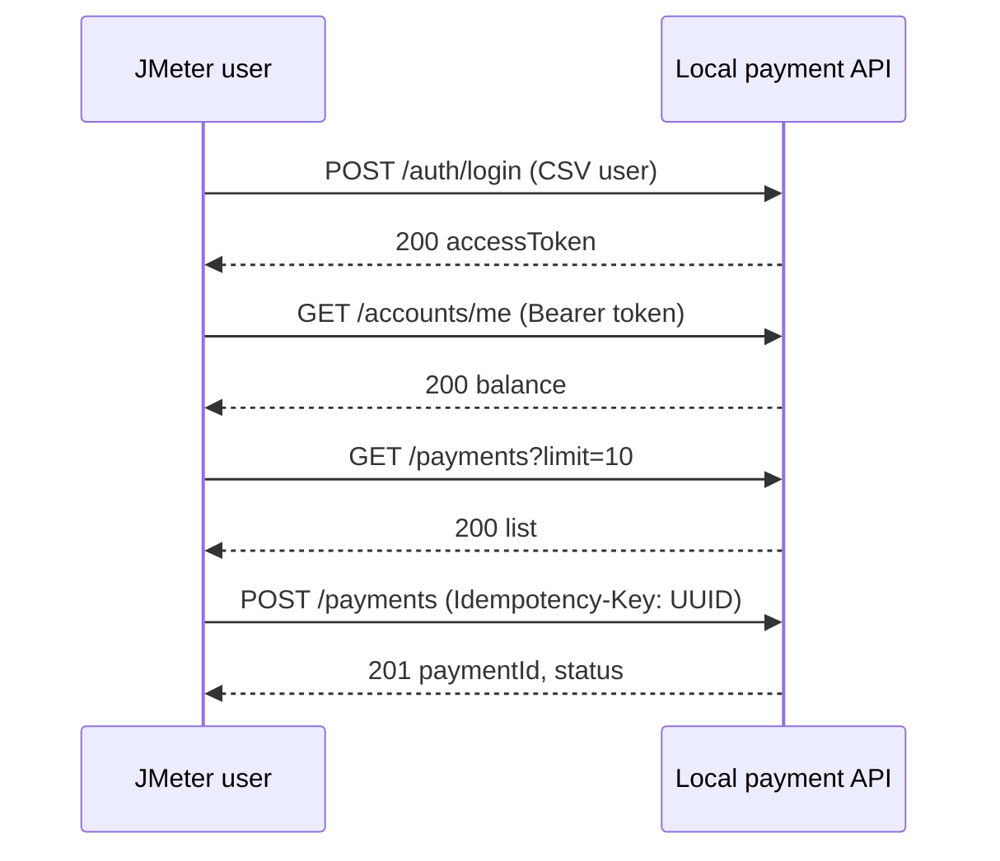

## Beginner-friendly explanation

This capstone is your driving test. You have learned the controls one at a time; now you drive a full route. The route is a small online payment: a user signs in, looks at their account, and pays. You will plan how many "drivers" to send, build the route in JMeter, check that every payment is correct, run it, and write a short report saying whether the system passed and what slowed it down.

**Important:** you test a payment API you run locally on your own machine (for example a sample service in Docker). Never point this test at a real payment provider or any system you do not own or have written permission to test.

## Technical explanation

**Workload model.** Agree goals first. Example goals for the lab: 20 payments per second in steady state, payment p95 under 800 ms, errors under 1%.

Little's Law: **concurrent users = throughput x time per iteration**. If one journey takes about 1.5 s of responses plus 4.5 s of think time, that is 6 s, so 20/s x 6 s = **120 users**. Use a Constant Throughput Timer or the Throughput Shaping Timer to hold the rate (see [workload design](/learn/jmeter/jmeter-workload-design)).

**Journey and assertions**



Each step sits in a **Transaction Controller** (`TX_Login`, `TX_Browse`, `TX_CreatePayment`) so the report shows business transactions.

## Step-by-step walkthrough

1. **Start the app** you own, e.g. `docker compose up -d`, and confirm `http://localhost:8080/health` returns 200.
2. **Test data:** create `users.csv` with `username,password` for 50 test accounts seeded in your local app.
3. **Test Plan:** add HTTP Request Defaults (`${__P(host,localhost)}`, port `${__P(port,8080)}`), an HTTP Header Manager with `Content-Type: application/json`, and a CSV Data Set Config (`users.csv`, Recycle on EOF true, Sharing mode All threads).
4. **Thread Group:** users `${__P(users,120)}`, ramp-up `${__P(rampup,120)}`, duration `${__P(duration,900)}` seconds, loop forever.
5. **TX_Login:** POST `/auth/login` with the body below. Add a JSON Extractor: name `token`, path `$.accessToken`, default `NOT_FOUND`. Add a Response Assertion for code 200. Use a Once Only Controller if tokens are long-lived.
6. **TX_Browse:** GET `/accounts/me` and GET `/payments?limit=10`, each with a child Header Manager `Authorization: Bearer ${token}` and a JSON Assertion on `$.id` or `$.items`.
7. **TX_CreatePayment:** POST `/payments` with a child Header Manager containing `Authorization: Bearer ${token}` and `Idempotency-Key: ${__UUID()}`. Assert code 201, JSON Assertion `$.status` equals `PENDING` or `COMPLETED` per your API, and a Duration Assertion of 2000 ms.
8. **Think time:** Uniform Random Timer between transactions; a Constant Throughput Timer set to `${__P(tpm,1200)}` per minute, shared across all active threads.
9. **Debug** with 1 user in the GUI, then disable View Results Tree.
10. **Run** non-GUI with a Backend Listener if you have [Grafana](/learn/jmeter/jmeter-backend-listener-grafana), monitoring the app, the database and the generator.
11. **Report:** open `report/index.html` and fill the analysis template.

## Code examples

```json
{ "username": "${username}", "password": "${password}" }
```

```json
{ "amount": ${__Random(100,5000)}, "currency": "EUR", "reference": "lab-${__threadNum}-${__time()}" }
```

```bash
jmeter -n -t payment-capstone.jmx -l capstone.jtl -e -o capstone-report \
  -Jusers=120 -Jrampup=120 -Jduration=900 -Jtpm=1200
```

Analysis template:

```markdown
# Payment load test - analysis
- Goal: 20 payments/s, p95 < 800 ms, errors < 1%, environment: local lab (owned)
- Build / versions: app x.y, JMeter 5.6.x, generator spec
- Steady-state window: from end of ramp-up to end of test
- Results per transaction: throughput, p90/p95/p99, error %
- Resources: app CPU, DB CPU, pool usage, generator CPU
- Verdict: PASS / FAIL against each goal
- Bottleneck and evidence
- Recommendations and next test
```

## Expected output

The illustrative table below shows what a filled-in result could look like. **These are made-up teaching numbers, not measurements of any real system**; your numbers will differ.

| Transaction | Throughput (/s) | p95 (ms) | Error % |
|---|---|---|---|
| TX_Login | 2.1 | 310 | 0.0 |
| TX_Browse | 20.4 | 180 | 0.0 |
| TX_CreatePayment | 17.6 | 1450 | 1.8 |

## Real-world example

Reading the illustrative table: browse is fast and stable, but payments miss both the throughput goal (17.6 vs 20/s) and the p95 goal, and errors exceed 1%. The failures are Duration Assertion failures and some 503 responses. Server monitoring shows moderate app CPU, while the database connection pool sits at its maximum and the payment insert waits on a unique-index check of the idempotency key. Conclusion: the bottleneck is the payment write path at the database, not JMeter (generator CPU stayed low) and not the network. Recommendations: review the pool size and the idempotency table index, then rerun the same test to compare.

## Common mistakes

- Picking a thread count without a workload model.
- A fixed idempotency key, which turns every payment into a duplicate.
- Asserting only status codes and missing wrong payment states.
- Including ramp-up in the results window.
- Testing a real payment provider or shared environment without authorization.

## Troubleshooting

| Symptom | Fix |
|---|---|
| `Bearer NOT_FOUND` | Fix the JSON path against the real login response |
| All payments 409 | Idempotency key reused; use `${__UUID()}` per request |
| Throughput below target, server idle | Check timers and generator CPU |
| Some users fail login | CSV data does not match seeded accounts |

## Self-review checklist

Before you call the capstone finished, check each item:

- The goals, environment and authorization are written at the top of your analysis.
- Your Little's Law calculation is shown, and the achieved throughput in the report is close to the target.
- A single-user run is fully green, and every request has at least one assertion beyond the status code.
- Each payment uses a new idempotency key, and you ran one deliberate duplicate check.
- The steady-state window excludes ramp-up, and the report uses percentiles, not only averages.
- Load-generator CPU and memory were monitored and stayed comfortably below saturation.
- The verdict is a clear pass or fail per goal, the bottleneck is supported by evidence, and the next test is named.

If you can explain every line of this checklist to a colleague, you can plan and run a real load test.

## Key takeaways summary

A complete load test is a chain: goals, a workload model sized with Little's Law, a realistic and correctly asserted script, a clean non-GUI run, and an analysis that names the bottleneck with evidence. Only load-test systems you own or are explicitly authorized to test.
