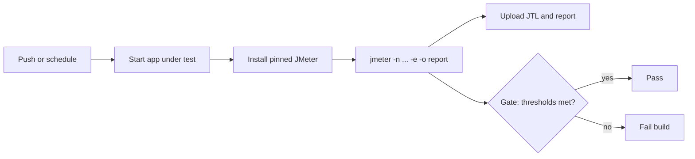

## Beginner-friendly explanation

A CI pipeline is a robot that checks every change automatically. Adding JMeter to it is like adding a quick fitness test to a team's daily routine: not a full marathon each day, just a short run that would reveal if something suddenly got much worse. If the run is too slow or too many requests fail, the robot raises a red flag and the change does not ship until someone looks.

## Technical explanation

In CI, JMeter always runs in **non-GUI mode**:

```text
jmeter -n -t plan.jmx -l results.jtl -e -o report -Jhost=localhost -Jusers=10
```

`-J` sets JMeter properties, read in the plan with `${__P(host,localhost)}`, so one `.jmx` works for every environment. `-e -o report` generates the HTML dashboard, which includes `report/statistics.json` with per-transaction and `Total` figures such as `errorPct`, `meanResTime`, `pct1ResTime` (90th), `pct2ResTime` (95th) and `pct3ResTime` (99th) by default.

**JMeter does not fail the build on sample errors.** Gates you can use:

- **Assertions** (Response Assertion, JSON Assertion, **Duration Assertion**) mark samples as failed, which raises the error percentage.
- **A threshold script** reads `statistics.json` and exits non-zero.
- **Build tool plugins**: the `jmeter-maven-plugin` (`com.lazerycode.jmeter`) downloads JMeter, runs `.jmx` files from `src/test/jmeter` during the `verify` phase, and has a results-check goal that can fail the build on errors. Gradle users have similar community plugins.



## Step-by-step walkthrough

1. Commit `perf/shop.jmx`, `perf/users.csv` and `perf/gate.py`. Use relative CSV paths.
2. Create `.github/workflows/perf.yml` (below).
3. Start the application under test in the same job (for example with Docker Compose) and wait for its health endpoint.
4. Download a pinned JMeter release from the Apache archive and unzip it.
5. Run JMeter non-GUI with small load.
6. Upload artifacts with `actions/upload-artifact@v4` using `if: always()` so you get the report even on failure.
7. Run the gate script; it fails the job if thresholds are exceeded.

## Code examples

```yaml
name: perf-smoke
on:
  pull_request:
  workflow_dispatch:
jobs:
  jmeter:
    runs-on: ubuntu-latest
    env:
      JMETER_VERSION: "5.6.3"
    steps:
      - uses: actions/checkout@v4
      - uses: actions/setup-java@v4
        with:
          distribution: temurin
          java-version: "17"
      - name: Start app under test
        run: docker compose -f perf/app-compose.yml up -d --wait
      - name: Install JMeter
        run: |
          curl -sSLO https://archive.apache.org/dist/jmeter/binaries/apache-jmeter-${JMETER_VERSION}.tgz
          tar -xzf apache-jmeter-${JMETER_VERSION}.tgz
      - name: Run test
        run: |
          apache-jmeter-${JMETER_VERSION}/bin/jmeter -n -t perf/shop.jmx \
            -l results.jtl -e -o report -Jhost=localhost -Jusers=10 -Jduration=120
      - uses: actions/upload-artifact@v4
        if: always()
        with:
          name: jmeter-report
          path: |
            results.jtl
            report/
      - name: Threshold gate
        run: python perf/gate.py report/statistics.json
```

```python
# perf/gate.py - fail the build when thresholds are exceeded
import json, sys

MAX_ERROR_PCT = 1.0
MAX_P95_MS = 800

stats = json.load(open(sys.argv[1]))["Total"]
problems = []
if stats["errorPct"] > MAX_ERROR_PCT:
    problems.append(f"error rate {stats['errorPct']:.2f}% > {MAX_ERROR_PCT}%")
if stats["pct2ResTime"] > MAX_P95_MS:
    problems.append(f"p95 {stats['pct2ResTime']:.0f} ms > {MAX_P95_MS} ms")
for p in problems:
    print("FAIL:", p)
sys.exit(1 if problems else 0)
```

The pct field to percentile mapping follows the `aggregate_rpt_pct1..3` properties (defaults 90, 95, 99); check them if your team changed them.

## Expected output

The job log shows JMeter's summariser lines (`summary = ... Err: 0 (0.00%)`), then `... end of run`. The gate prints nothing and exits 0 when healthy, or lines such as `FAIL: error rate 2.50% > 1.0%` and exits 1. The run page lists a `jmeter-report` artifact you can download and open (`report/index.html`).

## Real-world example

A team adds a five-minute, ten-user smoke performance test on pull requests that touch the checkout service, using a containerized copy of the service and its database. A full one-hour load test runs weekly from dedicated load generators against a staging environment they own. The PR job once failed because a new query lacked an index; the 95th percentile tripled, the gate caught it, and the fix landed before merge.

## Common mistakes

- **Assuming a green JMeter step means a healthy system.** Add a gate.
- **Unpinned JMeter or plugin versions**, which make runs incomparable.
- **Hardcoded hosts** instead of `-J` properties.
- **Treating shared-runner numbers as capacity results.**
- **Uploading artifacts only on success**, losing the evidence you need most.
- **Pointing CI at production or third-party systems** without authorization.

## Troubleshooting

| Symptom | Fix |
|---|---|
| `-o` fails: folder not empty | Delete `report` first or use a fresh path |
| CSV not found | Paths are relative to where JMeter resolves them; use paths relative to the `.jmx` or `${__P(dataDir)}` |
| Plugin class missing | Install plugins in the job (see [Plugins Manager](/learn/jmeter/jmeter-plugins-manager)) |
| Connection refused | App not ready; wait for its health check before running |

## Choosing what runs where

Not every performance test belongs in every pipeline. A practical split:

| Trigger | Test | Load | Purpose |
|---|---|---|---|
| Pull request | Smoke performance | A few users, 2 to 5 minutes | Catch broken scripts and large regressions |
| Nightly | Baseline load | Expected normal load, 15 to 30 minutes | Track trends between builds |
| Before release | Load, stress, soak | Full model on dedicated generators | Capacity and stability decision |

Store each run's `statistics.json` (or a summary of it) so you can compare builds over time; a slow drift across ten builds is easy to miss if you only look at one run.

**Using Maven instead.** If your project is Java-based, the `jmeter-maven-plugin` lets developers run `mvn verify` locally and in CI with the same configuration. Typical setup: put `.jmx` files in `src/test/jmeter`, declare the plugin in `pom.xml` with goals to configure, run the tests and check results, and list any jmeter-plugins.org dependencies in the plugin configuration so they are downloaded automatically. Check the plugin's own documentation for the exact goal names and options for your version, as they change between releases.

**Secrets.** Store passwords and tokens as GitHub Actions secrets and pass them as `-J` properties; never commit them inside the `.jmx`.

## Key takeaways summary

CI turns performance testing into a habit: pinned JMeter, non-GUI runs, artifacts every time and an explicit threshold gate. Keep pipeline tests small and stable, run big tests on dedicated infrastructure, and only load-test systems you own or are explicitly authorized to test.
