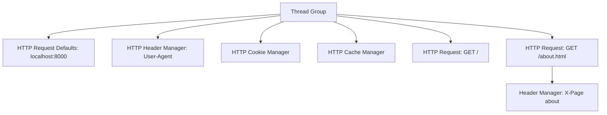

## Beginner-friendly explanation

Imagine filling in twenty delivery forms that all have the same return address. You would buy a rubber stamp. **Config elements** are JMeter's rubber stamps: they hold settings once and apply them to every request beneath them in the tree.

- **HTTP Request Defaults** stamps the address (server, port, protocol).
- **HTTP Header Manager** stamps extra labels on the envelope (headers).
- **HTTP Cookie Manager** is a wallet that keeps the membership card (session cookie) the server hands you and shows it on every visit.
- **HTTP Cache Manager** is a memory of pictures you already have, so you do not ask for them again.

A **header** is a small name/value note sent with a request, like `Accept-Language: en`. A **cookie** is a value the server asks the client to store and send back, often used to remember who is logged in. A **cache** is a local copy of a file kept to avoid downloading it again.

## Technical explanation

All four are added via **right-click (Test Plan, Thread Group, controller or sampler) → Add → Config Element → ...**. A config element affects samplers **in its scope**: those in the same branch of the tree at or below its level. See [scope and execution order](/learn/jmeter/jmeter-scope-and-execution-order).

| Element | Key fields | Behaviour |
|---|---|---|
| HTTP Request Defaults | Protocol, Server Name, Port, Path, Content encoding, Timeouts, Embedded resources | Fills empty fields on samplers in scope; sampler values win |
| HTTP Header Manager | Table of Name / Value | Adds headers; managers in scope are merged, and for the same name the one closest to the sampler wins |
| HTTP Cookie Manager | Clear cookies each iteration?, Cookie Policy (standard), user-defined cookies | Stores cookies per thread and resends them like a browser |
| HTTP Cache Manager | Clear cache each iteration?, Use Cache-Control/Expires headers, Max number of elements | Per-thread cache; may skip requests or send conditional ones (304) |

Thread Group's **Same user on each iteration** interacts with these: when ticked, cookies and cache survive between iterations; when unticked, they are cleared, like a new user each time.

Here both samplers get the defaults, the cookie and cache behaviour and the User-Agent header; only `/about.html` also gets `X-Page`.

## Step-by-step walkthrough

1. Run `python -m http.server 8000` in a folder with `index.html` and `about.html`. If you want to try caching, also create a `style.css` file and reference it from `index.html` with a normal stylesheet link.
2. Add a Thread Group: 1 thread, Loop Count 2, **Same user on each iteration** ticked.
3. **Right-click Thread Group → Add → Config Element → HTTP Request Defaults**: Protocol `http`, Server `localhost`, Port `8000`.
4. Add two HTTP Requests with **only** Path filled in: `/` and `/about.html`.
5. **Add → Config Element → HTTP Header Manager** under the Thread Group. Click **Add**: Name `User-Agent`, Value `Saige-Prep-Learner`.
6. **Add → Config Element → HTTP Cookie Manager** under the Thread Group. Leave defaults.
7. **Add → Config Element → HTTP Cache Manager**. On the `/` sampler's **Advanced** tab tick **Retrieve All Embedded Resources**.
8. Add **View Results Tree** and **Start**.
9. Inspect **Request → Request Headers**: you should see `User-Agent: Saige-Prep-Learner`.

## Expected output

Illustrative View Results Tree list (first iteration, then second):

| Sample | Response code |
|---|---|
| GET / | 200 |
|   ↳ /style.css (sub-result) | 200 |
| GET /about.html | 200 |
| GET / | 200 or 304 |
|   ↳ /style.css | served from cache or 304 |
| GET /about.html | 200 or 304 |

Exact codes depend on the headers your server sends; Python's simple server sends `Last-Modified`, so conditional requests returning **304 Not Modified** are typical.

## Troubleshooting

| Symptom | Cause | Fix |
|---|---|---|
| Samplers fail with empty host | Defaults outside the Thread Group's scope or disabled | Place under Test Plan or the same Thread Group; enable it |
| Header missing | Typo in name, or manager scoped to a different branch | Check spelling and tree position |
| Logged-in steps redirect to login | No Cookie Manager | Add one per Thread Group |
| Each iteration downloads everything | No Cache Manager, or "Clear cache each iteration" ticked | Add it; untick that option for returning users |
| Unexpected duplicated headers | Two managers set the same name at different levels | Keep each header in one place |

## Real-world example

A team load-testing its own web shop in staging keeps one HTTP Request Defaults element pointing at the staging host, one Header Manager with `Accept` and `Accept-Language`, a Cookie Manager for sessions and a Cache Manager so returning shoppers behave like real browsers. When they move the same plan to a second environment, only the Defaults' Server Name changes, usually supplied by a property.

There are other config elements you will meet later in this track. **CSV Data Set Config** feeds rows of test data, such as usernames, into variables ([CSV Data Set Config](/learn/jmeter/jmeter-csv-data-set-config)). **User Defined Variables** holds named values like a base path. **Counter** generates increasing numbers. They all follow the same scoping idea you learned here.

## Common mistakes

- **Copying host and port into every sampler** instead of using Defaults.
- **Forgetting the Cookie Manager** on any login-based flow.
- **Putting secrets like real tokens in plain headers** in a shared `.jmx`; use variables instead ([variables and properties](/learn/jmeter/jmeter-variables-and-properties)).
- **Assuming the Cache Manager speeds up the server**; it only changes what the client requests.
- **Testing systems you do not own.** Stay on localhost or authorised environments.

## Key takeaways summary

Config elements are shared settings, not requests. Defaults centralise the address, Header Managers add headers, the Cookie Manager keeps sessions alive and the Cache Manager mimics browser caching. Where you place them decides which samplers they affect.
