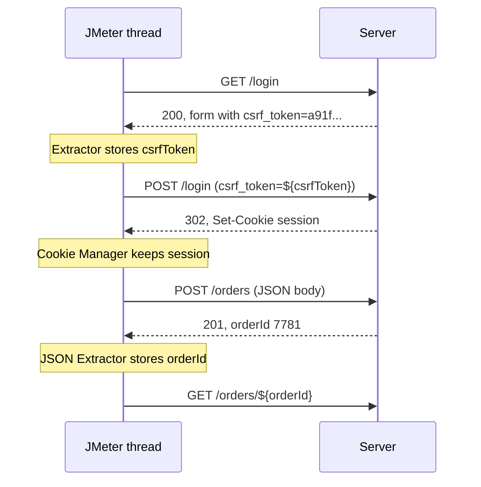

## Beginner-friendly explanation

Imagine visiting a cloakroom. You hand over your coat and get ticket number 147. Later, you must show ticket 147 to get your coat back. If you photographed yesterday's ticket (number 52) and showed that instead, the attendant would refuse.

A recorded load test script is like that photograph. During recording, the server issued "tickets" such as session IDs and security tokens. Replaying the old ones fails. **Correlation** means reading the new ticket from each response and showing it on the next request.

**Parameterization** is the other half: instead of every virtual user being the same person buying the same product, you give each user their own name, password and choices from a data file, so the system does realistic work.

## Technical explanation

### Correlation

A **dynamic value** is generated by the server and changes per session, request or time. Examples: session cookies, CSRF tokens, OAuth access tokens, `ViewState`-style hidden fields, IDs of newly created records, signed URLs.

The correlation loop:

1. **Identify** values that change between two recordings and are not user input.
2. **Locate** the first response that contains the value.
3. **Extract** it with a post-processor (JSON Extractor, Regular Expression Extractor, Boundary Extractor, CSS Selector Extractor or XPath Extractor) into a variable.
4. **Replace** the hard-coded value with `${variableName}` in later requests.
5. **Verify** with a Debug Sampler and an assertion that the value was found.

Cookies are a special case: the **HTTP Cookie Manager** stores and resends them automatically, so session cookies usually need no manual extraction.



### Parameterization with CSV Data Set Config

| Setting | Meaning |
|---|---|
| Filename | Path to the CSV file (relative paths resolve from the test plan's folder) |
| Variable Names | Comma-separated names; leave empty to use the file's header line |
| Ignore first line | Skip a header line when Variable Names is set |
| Delimiter | Usually `,` |
| Recycle on EOF | Start again from the top when the file ends |
| Stop thread on EOF | Stop the thread when the file ends (used when each line must be used once) |
| Sharing mode | All threads, Current thread group, or Current thread |

Lines are read once per iteration of the thread. Other parameterization sources include JMeter functions such as `${__Random(1,1000)}`, `${__UUID()}`, `${__time()}` and `${__threadNum}`, documented in the JMeter functions reference.

## Real-world example

A team scripted an insurance quote journey and saw excellent response times at the target load. A reviewer noticed every virtual user requested a quote for the same postcode and vehicle. The pricing service cached results by those inputs, so almost every request was a cache hit. After parameterizing postcodes and vehicles from a file built from anonymised, representative data, the cache hit ratio dropped to a realistic level and the pricing service's p95 rose well above the objective, revealing a genuine capacity gap.

## Step-by-step walkthrough

1. **Record** the journey twice with different users (HTTP(S) Test Script Recorder or browser export).
2. **Diff** the two recordings and list every changing value.
3. **Classify** each: user input (parameterize), server-generated (correlate), or time-based (generate with a function).
4. **Add extractors** to the responses that first issue each dynamic value, with a default of `NOT_FOUND`.
5. **Create CSV data** with enough unique rows for the concurrency and duration.
6. **Configure CSV Data Set Config** and replace literals with `${variables}`.
7. **Debug with 2 threads** and a Debug Sampler to confirm each thread gets its own data and tokens.

## Code examples

Test data file `users.csv`:

```text
username,password,productId
user0001,Test-Pass-0001,1043
user0002,Test-Pass-0002,2210
user0003,Test-Pass-0003,1877
```

Regular Expression Extractor settings for a hidden form field:

```text
Apply to:            Main sample only
Field to check:      Body
Name of variable:    csrfToken
Regular Expression:  name="csrf_token" value="([^"]+)"
Template:            $1$
Match No.:           1
Default Value:       NOT_FOUND
```

The request body then uses the variables:

```text
username=${username}&password=${password}&csrf_token=${csrfToken}
```

## Expected output

A Debug Sampler after login shows each thread's variables, for example:

```text
csrfToken=3c0d5e7b9a
username=user0002
productId=2210
```

If you see `csrfToken=NOT_FOUND`, the extractor did not match and the next request will fail.

## Common mistakes

- **Leaving recorded tokens hard-coded**, which often passes briefly and then fails when tokens expire.
- **Extracting from the wrong response** (for example, after a redirect the token is in the final page, not the 302).
- **No default value**, so failed extraction sends an empty string that is hard to spot.
- **Using Current thread sharing mode** by accident, giving every thread the same data.
- **Too little test data**, causing duplicate logins, unique-constraint errors or unrealistic caching.
- **Using production personal data** in test files instead of synthetic or properly anonymised data.

## Troubleshooting

- **Extraction works for one thread but not many.** The value may be per-user; confirm the extractor is in thread scope and data is unique.
- **Regex matches the wrong occurrence.** Make the pattern more specific or prefer a JSON or CSS selector extractor for structured responses.
- **CSV values come out quoted or empty.** Check the delimiter, encoding and "Allow quoted data" setting.

## Key takeaways summary

Correlation replays server-generated values correctly; parameterization makes each virtual user a distinct, realistic user. Find dynamic values systematically, extract with safe defaults, verify with a Debug Sampler, and size your test data for the concurrency and duration of the test.
