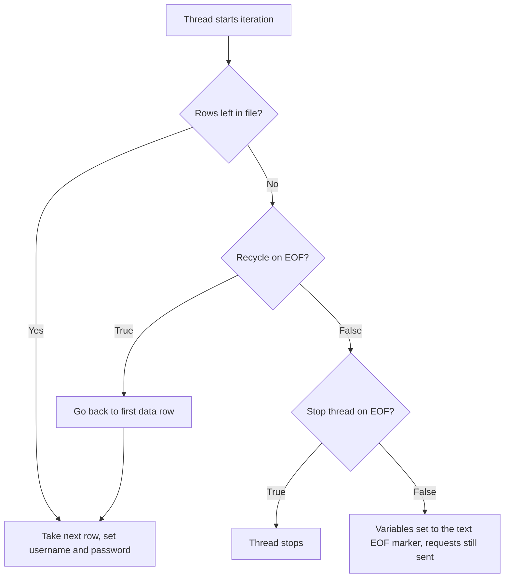

## Beginner-friendly explanation

Picture a theatre with a pile of numbered tickets at the door. Each person who walks in takes the top ticket, so no two people sit in the same seat. If the pile runs out you can either stop letting people in or start the pile again from the top.

**CSV Data Set Config** is that pile of tickets. A **CSV file** ("comma-separated values") is a plain text file where each line is a row and commas separate the columns, for example `alice,Secret1!`. Every time a virtual user (a **thread**) starts a new **iteration** (one pass through its steps), it takes the next line and stores the columns in variables such as `${username}` and `${password}`.

Without it, 100 users would all log in as the same person, which is unrealistic and often hides or creates problems such as caching, locking or session conflicts.

## Technical explanation

Add it with **right-click Thread Group → Add → Config Element → CSV Data Set Config**. Fields:

| Field | Meaning | Typical value |
|---|---|---|
| Filename | Path to the file. Relative paths resolve from the folder of the .jmx | `users.csv` |
| File encoding | Character set used to read the file | `UTF-8` |
| Variable names (comma-delimited) | Names for the columns. If empty, the first line is used as names | `username,password` |
| Ignore first line | Skip a header row (only used when Variable names is filled) | True if file has a header |
| Delimiter | Column separator; use `\t` for tab | `,` |
| Allow quoted data? | Lets values contain the delimiter inside double quotes | False unless needed |
| Recycle on EOF? | At end of file, go back to the first row | False for unique data |
| Stop thread on EOF? | At end of file, stop the thread (only when Recycle is False) | True for unique data |
| Sharing mode | Who shares a file pointer: All threads, Current thread group, Current thread | All threads |

**When a row is read:** once per iteration of each thread, when the element is first used in that iteration. **EOF** means "end of file".



**Sharing modes compared** (file with rows u1…u6, 2 threads, 2 loops, Sharing on All threads vs Current thread):

| Iteration | All threads | Current thread |
|---|---|---|
| Thread 1, loop 1 | u1 | u1 |
| Thread 2, loop 1 | u2 | u1 |
| Thread 1, loop 2 | u3 | u2 |
| Thread 2, loop 2 | u4 | u2 |

(With All threads the exact order depends on which thread asks first, but no row is handed out twice before the file wraps.)

**Unique data rule:** rows needed = threads × iterations per thread. For 50 users × 20 iterations you need 1,000 rows if every login must be unique.

## Step-by-step walkthrough

Practice target: your own local app with test accounts you created. Only test systems you own or are authorised in writing to test.

1. Create `users.csv` next to your `.jmx` file:

```text
username,password
qa_user01,Passw0rd!01
qa_user02,Passw0rd!02
qa_user03,Passw0rd!03
qa_user04,Passw0rd!04
```

2. Add CSV Data Set Config to the Thread Group: Filename `users.csv`, File encoding `UTF-8`, Variable names `username,password`, Ignore first line `True`, Delimiter `,`, Recycle `False`, Stop thread `True`, Sharing mode `All threads`.
3. In the login HTTP Request, body data or parameters: `username` = `${username}`, `password` = `${password}`.
4. Set the Thread Group to 2 threads, 2 loops.
5. Add **View Results Tree**, run, and open each login's **Request** tab.

## Expected output

Illustrative View Results Tree request bodies:

```text
Login (thread 1-1, loop 1)  {"username":"qa_user01","password":"Passw0rd!01"}
Login (thread 1-2, loop 1)  {"username":"qa_user02","password":"Passw0rd!02"}
Login (thread 1-1, loop 2)  {"username":"qa_user03","password":"Passw0rd!03"}
Login (thread 1-2, loop 2)  {"username":"qa_user04","password":"Passw0rd!04"}
```

Change loops to 3 and the threads stop after the fourth row is used: you see four logins, not six.

## Real-world example

A team load-testing an internal banking demo noticed response times were suspiciously fast. Every thread logged in as one account, so the server cached that customer's dashboard. After switching to a CSV of several hundred seeded accounts with All threads sharing, cache hits dropped to realistic levels and a slow database query appeared that the single-user test had hidden.

## Common mistakes

- **Too few rows** with Recycle True, so users silently repeat and caching flatters results.
- **Recycle False and Stop thread False**, sending `<EOF>` as data.
- **Absolute Windows paths** like `C:\Users\me\users.csv` that break on CI and Linux load generators.
- **Header row used as data** because Ignore first line was left False.
- **Placing the element inside a loop controller and expecting a new row per inner loop.** Rows advance per thread iteration, not per inner loop.
- **Real customer data in CSVs.** Use synthetic accounts only.

## Troubleshooting

- **Literal `${username}`:** file not found or variable names misspelled; check `jmeter.log`.
- **Strange characters:** set File encoding to match the file (UTF-8 is safest; avoid a BOM).
- **Same user in two threads:** Sharing mode is Current thread, or the file has duplicates.
- **Distributed runs reuse data:** each remote engine reads its own copy of the file; split the data per engine (see [Non-GUI and distributed](/learn/jmeter/jmeter-non-gui-and-distributed)).

## Preparing the data file

Seed the accounts in your local app first (for example with a script or an admin API you own), then export them to CSV. Keep the file in version control next to the plan if it contains only synthetic data, and generate larger files with a small script rather than by hand.

## Key takeaways summary

CSV Data Set Config turns a text file into per-iteration variables. Choose Sharing mode deliberately, size the file as threads × iterations for unique data, and use Recycle False with Stop thread True so the test never runs on repeated or `<EOF>` data. Combine it with [functions](/learn/jmeter/jmeter-functions) for values that can be generated instead of stored.
