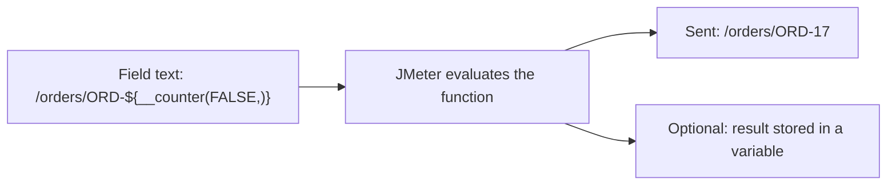

## Beginner-friendly explanation

A vending machine button does a small job every time you press it: give a drink. A **JMeter function** is a little button you put inside a text field. Each time JMeter uses that field, it "presses the button" and replaces it with a fresh result, such as a random number, today's date or a unique id.

You write a function as `${__name(arguments)}`. The two underscores tell JMeter it is a function, not a variable. For example, `${__Random(1,6)}` rolls a dice and inserts a number from 1 to 6.

Functions are how you avoid sending exactly the same data with every request, which is unrealistic and often fails (for example "order reference already exists").

## Technical explanation

**Syntax rules**

- Form: `${__functionName(arg1,arg2,...)}`. Functions with no arguments can be written `${__threadNum}` or `${__UUID()}`.
- Arguments are separated by commas. A literal comma in an argument must be escaped as `\,`.
- Many functions take an optional last argument: a **variable name** to store the result in, so you can reuse it later as `${name}`.
- Functions can be nested: `${__Random(1,${__P(max,10)},)}`.
- They are evaluated each time the field is processed, so `${__Random(1,9)}` in a sampler gives a new number on every request.

**Function Helper Dialog:** **Tools → Function Helper Dialog**. Pick a function from the drop-down, fill the argument table, click **Generate** and the dialog shows the call string and the result it produces right now. Copy it into your field. It is the easiest way to learn arguments without typos.

| Function | Example | Illustrative result | Use |
|---|---|---|---|
| `__Random(min,max,var)` | `${__Random(1000,9999,)}` | `4821` | Random integer, inclusive |
| `__RandomString(len,chars,var)` | `${__RandomString(8,abcdef0123,)}` | `a3f0cd21` | Random text from a character set |
| `__time(format,var)` | `${__time(yyyy-MM-dd,)}` | `2026-10-30` | Timestamps; no format gives epoch ms |
| `__UUID()` | `${__UUID()}` | `6f1c...-...` (36 chars) | Unique ids, idempotency keys |
| `__counter(perThread,var)` | `${__counter(FALSE,)}` | `1`, `2`, `3`… | Sequences; FALSE = global |
| `__threadNum` | `${__threadNum}` | `3` | Number of the current thread in its group |
| `__P(name,default)` | `${__P(users,1)}` | `1` | Read a property (see [variables and properties](/learn/jmeter/jmeter-variables-and-properties)) |
| `__jexl3(expr,var)` | `${__jexl3(${qty} > 5,)}` | `true` | Small expressions, conditions |
| `__groovy(script,var)` | `${__groovy(vars.get('qty').toInteger() * 2,)}` | `14` | One-line Groovy |

**`__jexl3` vs `__groovy`:** JEXL is a lightweight expression language and is the recommended choice for If Controller conditions. `__groovy` gives full Groovy with access to `vars`, `props`, `ctx` and `log`. For multi-line logic use a JSR223 element instead (see [Groovy and JSR223](/learn/jmeter/jmeter-groovy-jsr223)).



## Step-by-step walkthrough

Practice target: a REST app running on your own machine. Only test systems you own or are authorised in writing to test.

1. Open **Tools → Function Helper Dialog**, choose `__time`, enter `yyyy-MM-dd'T'HH:mm:ss` as the format, press **Generate**. Copy the result string.
2. Add an HTTP Request `POST /api/orders` with this **Body Data**:

```json
{
  "orderRef": "ORD-${__time(yyyyMMddHHmmss,)}-${__threadNum}-${__counter(FALSE,)}",
  "idempotencyKey": "${__UUID()}",
  "quantity": ${__Random(1,5,qty)},
  "note": "${__RandomString(10,abcdefghij,)}"
}
```

3. Add an **HTTP Header Manager** with `Content-Type: application/json`.
4. Add an **If Controller** after it with condition `${__jexl3(${qty} >= 4,)}` and a child request, for example `GET /api/orders/bulk-discount`.
5. Run 3 threads × 2 loops with **View Results Tree** and inspect each request body.

## Expected output

Illustrative request body for thread 2, second iteration:

```json
{
  "orderRef": "ORD-20261030101512-2-5",
  "idempotencyKey": "0b6a3f6e-1c2d-4c57-9a7e-2f1b8f2d9c11",
  "quantity": 4,
  "note": "cjbadgiehf"
}
```

Every `orderRef` and `idempotencyKey` differs. The bulk-discount request appears only for iterations where `qty` was 4 or 5.

## Real-world example

A team testing its own invoice API kept getting 409 Conflict errors under load because every virtual user sent the same invoice number from the recording. Replacing it with `INV-${__time(yyyyMMdd,)}-${__counter(FALSE,)}` removed the false errors, and the remaining errors turned out to be a real locking problem worth investigating.

## Common mistakes

- **Using `__Random` for uniqueness.** Collisions happen; use `__UUID` or a global counter.
- **Putting functions in User Defined Variables** and expecting a new value each iteration. UDV is evaluated once.
- **Forgetting to escape commas** in `__groovy` and `__jexl3` arguments.
- **Heavy logic in `__groovy`** on every request, which costs CPU on the load generator.
- **Confusing `__threadNum`** (thread number, constant per thread) with an iteration counter.

## Troubleshooting

- **Literal `${__Random(...)}` in the request:** the function name is misspelled (they are case-sensitive) or the brackets are unbalanced. Rebuild it in the Function Helper Dialog.
- **Script errors in `jmeter.log`:** check escaping of commas and quotes; test the call in the Function Helper Dialog first.
- **Same "random" values in every thread:** the function is probably in a UDV; move it into the sampler.

## Functions vs variables vs scripts

Beginners often wonder which tool to reach for. Use this progression, from simplest to most powerful:

| Need | Best tool | Why |
|---|---|---|
| A fixed value used in many places | User Defined Variable | Evaluated once, easy to change |
| Realistic data that must exist in the system (accounts, product ids) | CSV Data Set Config | Values must be valid, so you prepare them |
| A fresh but meaningless value (reference, note, random quantity) | Function in the field | No file to maintain, new value per use |
| A value taken from a previous response | Extractor | Only the server knows it |
| Logic with several steps, loops or error handling | JSR223 element with Groovy | Readable, debuggable, cached compilation |

A good habit is to store a function result in a variable (the optional last argument) whenever you need the same value twice. For example `${__Random(1,5,qty)}` sends a number and also saves it as `${qty}` for a later assertion or If Controller. Every call produces a new value, so writing `${__Random(1,5,)}` twice gives two different numbers. A few functions, such as `__UUID`, take no variable-name argument; to reuse one UUID in both a header and a body, generate it once in a **User Parameters** pre-processor (Add → Pre Processors → User Parameters, name `reqId`, value `${__UUID()}`) and refer to `${reqId}` in both places. Always confirm the exact arguments in the Function Helper Dialog.

## Key takeaways summary

Functions inject fresh, computed values into any field. Learn the handful that cover most needs: `__Random` and `__RandomString` for variety, `__UUID` and global `__counter` for uniqueness, `__time` for timestamps, `__threadNum` for identity, `__P` for settings, and `__jexl3`/`__groovy` for small logic. Build calls in the Function Helper Dialog to avoid syntax errors.
