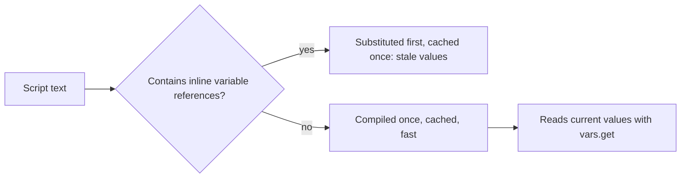

## Beginner-friendly explanation

JMeter's built-in elements are like the standard tools in a toolbox: a hammer, a screwdriver, a spanner. Most jobs need nothing else. Occasionally you need something special, such as calculating a signature, picking a random item that is in stock, or checking that an order total equals the sum of its lines.

**JSR223 elements** are the workshop where you can make your own tool, using a scripting language. **Groovy** is the recommended language: it reads like simplified Java and, crucially, JMeter can compile it once and reuse it, so it stays fast when thousands of virtual users run it.

## Technical explanation

JSR223 is the Java standard for scripting engines. JMeter provides JSR223 versions of several element types:

| Element | Runs | Typical use |
|---|---|---|
| JSR223 PreProcessor | Before the sampler | Generate keys, timestamps, signatures |
| JSR223 PostProcessor | After the sampler | Parse responses, choose next data |
| JSR223 Assertion | After post-processors | Complex business-rule checks |
| JSR223 Sampler | As the sample | Custom protocol call or calculation timed as a sample |
| JSR223 Timer | Before the sampler | Computed delays (the script's return value is the delay in ms) |
| JSR223 Listener | After the sample | Custom result handling (use sparingly) |

### Bindings available to scripts

| Name | What it is |
|---|---|
| `vars` | This thread's JMeter variables (`vars.get`, `vars.put`; values are strings, `putObject` for objects) |
| `props` | JMeter properties shared by all threads |
| `prev` | The previous `SampleResult` |
| `ctx` | `JMeterContext`: thread number, current sampler, thread group |
| `sampler` | The current sampler |
| `log` | Logger writing to `jmeter.log` |
| `Parameters`, `args` | Text from the Parameters field, whole and split |
| `SampleResult` | In a JSR223 Sampler or Assertion, the result being built or checked |
| `AssertionResult` | In a JSR223 Assertion, used to report failure |

### Performance rules

- **Groovy plus caching.** With "Cache compiled script if available" ticked (or a script file), Groovy is compiled once and reused. BeanShell has no such compilation and is much more expensive per execution; the JMeter best practices recommend migrating to JSR223 with Groovy.
- **No `${...}` inside scripts.** JMeter substitutes it before the script runs, so with caching only the first substitution is kept. Use `vars.get('name')` or the Parameters field.
- **Keep scripts small.** Every line runs for every sample on the load generator.



## Real-world example

A team signing API requests with an HMAC used a BeanShell PreProcessor written years earlier. At low load everything was fine, but at the target rate the load generators' CPU saturated before the application did, and reported response times included time spent queueing inside JMeter. Rewriting the logic as a cached Groovy JSR223 PreProcessor, with the secret read from a property rather than inlined, cut the generators' CPU substantially and allowed the test to reach the target rate from the same machines.

## Step-by-step walkthrough

1. **Check for a built-in element first** (extractor, function, assertion). Use a script only when needed.
2. **Add the JSR223 element** in the narrowest scope that needs it.
3. **Select Groovy** and tick "Cache compiled script if available".
4. **Read inputs with `vars.get`**, never `${}` in the script body.
5. **Write outputs with `vars.put`** as strings, with a fallback such as `NOT_FOUND`.
6. **Debug with one thread**, a Debug Sampler and `log.info`, then reduce logging.
7. **Measure generator CPU** in a short load run before the real test.

## Code examples

PreProcessor: unique idempotency key and timestamp for a payment request.

```groovy
import java.time.Instant

vars.put('idempotencyKey', UUID.randomUUID().toString())
vars.put('requestTs', Instant.now().toString())
```

PostProcessor: choose a random in-stock product.

```groovy
import groovy.json.JsonSlurper

def json = new JsonSlurper().parseText(prev.getResponseDataAsString())
def inStock = json.items.findAll { it.stock > 0 }

if (inStock) {
    def pick = inStock[new Random().nextInt(inStock.size())]
    vars.put('productId', pick.id.toString())
} else {
    vars.put('productId', 'NOT_FOUND')
    log.warn('No in-stock items for thread ' + ctx.getThreadNum())
}
```

Assertion: order total must equal the sum of its lines.

```groovy
import groovy.json.JsonSlurper

def order = new JsonSlurper().parseText(SampleResult.getResponseDataAsString())
def expected = order.lines.sum { it.price * it.qty }

if (order.total != expected) {
    AssertionResult.setFailure(true)
    AssertionResult.setFailureMessage('Order total does not match line items')
}
```

## Expected output

With a Debug Sampler after the post-processor, a successful iteration shows a variable such as:

```text
productId=1043
```

When the total check fails, View Results Tree shows the assertion with the message `Order total does not match line items`, and the sample counts as an error in reports.

## Common mistakes

- **BeanShell in load tests**, burning generator CPU.
- **`${var}` inside Groovy code**, causing stale values with caching or recompilation without it.
- **Putting non-strings with `vars.put`**; use `String.valueOf(...)` or `vars.putObject`.
- **Verbose logging** on every sample, filling disks and slowing threads.
- **Hard-coded secrets** in scripts committed to source control; pass them as properties (`-J`) from a secure store.
- **Scripting what an extractor already does**, adding maintenance cost for no benefit.

## Troubleshooting

- **`groovy.json.JsonException`**: the response is not JSON (often an error page); add a status assertion before parsing and guard with `try/catch`.
- **Script works in GUI but not in non-GUI runs**: check property values passed on the command line and file paths relative to the working directory.
- **High CPU on generators**: confirm caching is enabled, remove `${}` from scripts and cut logging.

## Key takeaways summary

JSR223 with Groovy is the right way to add custom logic to JMeter. Cache compiled scripts, use the `vars`, `props`, `prev` and `ctx` bindings instead of inline variable references, keep scripts small, and prefer built-in elements whenever they are enough.
