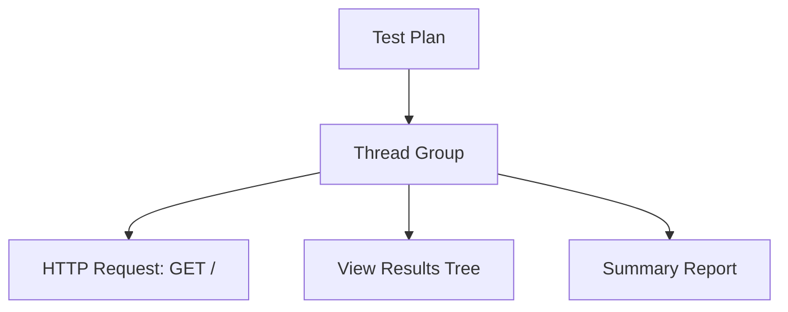

## Beginner-friendly explanation

The JMeter window is like a recipe card holder. On the left is the **list of recipe steps** arranged as a tree: the main recipe, then sections, then individual steps. On the right is the **detail card** for whichever step you clicked: the quantities, temperatures and notes. You add a step by right-clicking where it belongs, then fill in its card. When you are happy, you press the green **Start** button and JMeter "cooks" the recipe.

## Technical explanation

| Area | Location | What it does |
|---|---|---|
| Menu bar | Top | File, Edit, Search, Run, Options, Tools, Help |
| Toolbar | Below menus | New, Templates, Open, Save, Cut/Copy/Paste, Expand/Collapse, Toggle, **Start**, Start no pauses, **Stop**, **Shutdown**, Remote start/stop, **Clear**, **Clear All**, Search, Reset search, Function helper, Help |
| Test plan tree | Left | The hierarchy of elements; position determines scope |
| Element panel | Right | Settings of the selected element |
| Status area | Top right | Elapsed time, warning/error counter (opens the log viewer), active threads e.g. `0/10` |

Every node in the tree is an **element** (also called a component). Common categories you will add via the right-click **Add** menu:

| Add menu category | Examples |
|---|---|
| Threads (Users) | Thread Group, setUp Thread Group, tearDown Thread Group |
| Sampler | HTTP Request, Debug Sampler, JDBC Request |
| Logic Controller | Transaction Controller, Loop Controller, If Controller |
| Config Element | HTTP Request Defaults, HTTP Header Manager, CSV Data Set Config |
| Timer | Constant Timer, Uniform Random Timer |
| Pre/Post Processors | JSR223 PreProcessor, JSON Extractor |
| Assertions | Response Assertion |
| Listener | View Results Tree, Summary Report, Aggregate Report |

The Add menu only shows elements that are valid for the node you right-clicked. That is why you cannot add a sampler directly under Test Plan: samplers must live inside a Thread Group.

Useful shortcuts: **Ctrl+S** save, **Ctrl+R** start, **Ctrl+.** stop, **Ctrl+,** shutdown, **Ctrl+E** clear, **Ctrl+Shift+E** clear all, **Ctrl+T** toggle enable/disable. Elements can be dragged to a new position; a popup asks whether to insert before, after or as a child.

## Step-by-step walkthrough

Start your own practice server first: in an empty folder containing an `index.html`, run `python -m http.server 8000`.

1. Launch JMeter. You see **Test Plan** selected. In its panel, change **Name** to `GUI tour`.
2. **Right-click Test Plan → Add → Threads (Users) → Thread Group.** A Thread Group node appears. Set **Number of Threads (users)** to `2` and **Loop Count** to `3`.
3. **Right-click Thread Group → Add → Sampler → HTTP Request.** Set **Protocol** `http`, **Server Name or IP** `localhost`, **Port Number** `8000`, **Method** `GET`, **Path** `/`. Rename it to `Home page` using the Name field; names appear in results, so make them meaningful.
4. **Right-click Thread Group → Add → Listener → View Results Tree**, and again for **Summary Report**.
5. **File → Save Test Plan as** (Ctrl+S) and save as `gui-tour.jmx`. JMeter warns you if you try to run an unsaved plan in some situations, so save first as a habit.
6. Click the green **Start** button. The status area shows active threads, e.g. `2/2`, then `0/2` when finished.
7. Select **View Results Tree**. You see six green-ticked entries named `Home page`. Click one and open the **Response data** tab to see your HTML.
8. Open the log viewer with **Options → Log Viewer** (or click the warning counter). It should show only informational lines.
9. Click **Clear All** to reset listeners before the next run.

## Expected output

Illustrative Summary Report after the run (values will differ on your machine):

| Label | # Samples | Average | Min | Max | Error % |
|---|---|---|---|---|---|
| Home page | 6 | 3 | 1 | 9 | 0.00% |
| TOTAL | 6 | 3 | 1 | 9 | 0.00% |

Six samples, because 2 threads × 3 loops = 6 requests.

## Troubleshooting

| Problem | Cause | Fix |
|---|---|---|
| "Add → Sampler" missing | You right-clicked Test Plan | Right-click the Thread Group instead |
| Red entries with `Connection refused` | Practice server not running or wrong port | Start `python -m http.server 8000`, check Port Number |
| Listener empty after Start | Listener disabled or outside the Thread Group's scope | Enable it; place it under Test Plan or the Thread Group |
| Clicked Start, nothing runs | All Thread Groups disabled, or an error | Check greyed-out nodes and the log viewer |
| Lost your work | Not saved | Save with Ctrl+S often; keep `.jmx` files in Git |

## Real-world example

A tester reviewing a colleague's `.jmx` file opens it in the GUI, uses **Expand All** to see the whole tree, and uses **Search** (the magnifier) to highlight every element that mentions `login`. They disable an experimental branch rather than deleting it and save the plan to the team repository. Because the tree is readable and elements are well named, the review takes minutes.

Before moving on, try the **Templates** button on the toolbar (the icon next to Open). It offers ready-made starting plans such as a simple web test. Opening one and reading its tree is a good way to see how experienced users arrange elements. Also explore **Options → Look and Feel** if the default theme is hard to read, and **Options → Zoom In** to enlarge text on high-resolution screens.

## Common mistakes

- **Leaving default names** like "HTTP Request" everywhere, making results unreadable.
- **Running heavy load from the GUI.** The GUI is for building and debugging; see [non-GUI execution](/learn/jmeter/jmeter-non-gui-and-distributed).
- **Forgetting Clear All** and mixing results from several runs.
- **Ignoring the warning counter** in the top right.
- **Pointing practice tests at public websites.** Only use servers you own.

## Key takeaways summary

The tree on the left defines your test; the panel on the right configures the selected element. Add elements with right-click → Add on the right parent, name them clearly, save often, disable rather than delete while experimenting, and check the log viewer whenever something looks wrong. Next, put it all together in [JMeter fundamentals](/learn/jmeter/jmeter-fundamentals).
