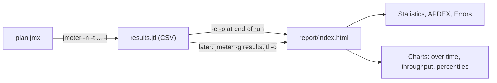

## Beginner-friendly explanation

After a long car trip, the dashboard tells you average speed, fuel used and warning lights. A JMeter test produces thousands of raw result lines, which are hard to read. The **HTML dashboard report** is JMeter's trip summary: a folder of web pages with tables and charts built from your results file.

You open `index.html` in a browser and see, for every request type, how many ran, how many failed, how fast they were and how the numbers changed over time. It is the main way to share results with your team.

> **Authorisation rule:** the results you report must come from tests on systems you own (for example a local app) or are authorised in writing to test.

## Technical explanation

**Generating it**

```bash
# During a non-GUI run: results to results.jtl, report to report/
jmeter -n -t plan.jmx -l results.jtl -e -o report/

# Afterwards, from an existing results file
jmeter -g results.jtl -o report/
```

- `-n` non-GUI, `-t` test plan, `-l` results log (a **.jtl**, which is CSV by default), `-e` generate report at end, `-o` output folder, `-g` generate from an existing file.
- The output folder must be empty or not exist.
- Settings live in `bin/reportgenerator.properties` and can be overridden in `user.properties` or with `-J`.

**APDEX (Application Performance Index)** scores user satisfaction from 0 (everyone frustrated) to 1 (everyone satisfied):

| Sample category | Rule (JMeter defaults) |
|---|---|
| Satisfied | time ≤ T (500 ms) |
| Tolerating | T < time ≤ F (1500 ms) |
| Frustrated | time > F, or the sample failed |

Score = (satisfied + tolerating ÷ 2) ÷ total. Set thresholds with `jmeter.reportgenerator.apdex_satisfied_threshold` and `jmeter.reportgenerator.apdex_tolerated_threshold` (in ms) to match your agreed targets.

**Dashboard page**

- **Test and Report information:** file, start and end time.
- **APDEX table:** score per transaction.
- **Requests Summary:** pie of pass vs fail.
- **Statistics table:** per label: #Samples, FAIL, Error %, Average, Min, Max, Median, 90th, 95th, 99th percentile, Transactions/s, Received and Sent KB/sec.
- **Errors table:** error type (for example `500/Internal Server Error` or an assertion message), count, % of errors and % of all samples.
- **Top 5 Errors by sampler.**

**Charts menu** (left side): *Over Time* (Response Times Over Time, Active Threads Over Time, Bytes Throughput, Latencies, Connect Time), *Throughput* (Hits per Second, Codes per Second, Transactions per Second, Response Time vs Request), and *Response Times* (Response Time Percentiles, Response Time Overview, Time vs Threads, Response Time Distribution).



**Percentile** reminder: the 95th percentile is the value that 95 % of samples were at or below. See [Throughput, latency and percentiles](/learn/performance/throughput-latency-and-percentiles).

## Step-by-step walkthrough

1. Run your plan (pointed at your local app) from JMeter's `bin` folder:

```bash
jmeter -n -t shop.jmx -l run1/results.jtl -e -o run1/report -Jjmeter.reportgenerator.apdex_satisfied_threshold=300 -Jjmeter.reportgenerator.apdex_tolerated_threshold=1200
```

2. Open `run1/report/index.html` in a browser.
3. Read **Statistics** first. Sort by Error % and then by 95th percentile.
4. Open **Errors** to see what kinds of failures occurred.
5. Open **Charts → Over Time → Response Times Over Time**, then **Active Threads Over Time** and **Throughput → Transactions Per Second**, and compare their time axes.
6. Open **Charts → Response Times → Response Time Percentiles** to see the shape of the distribution.
7. Use **Transaction Controllers** in your plan so the report shows business steps, not dozens of URLs. With "Generate parent sample" ticked, child samplers are hidden and only the transaction appears.

## Expected output

Illustrative Statistics excerpt (numbers depend entirely on your app and machine):

| Label | #Samples | Error % | Average | 90th pct | 95th pct | 99th pct | Transactions/s |
|---|---|---|---|---|---|---|---|
| 01 Login | 1,200 | 0.00 % | 180 | 260 | 310 | 520 | 4.0 |
| 02 Search | 3,600 | 0.08 % | 240 | 390 | 470 | 900 | 12.0 |
| 03 Checkout | 600 | 1.50 % | 610 | 980 | 1,250 | 2,400 | 2.0 |

Reading it: checkout has the highest error rate and a long tail (99th about 4× the average), so it is the first place to investigate.

## Real-world example

A team shared only the average response time from the report: "checkout 610 ms, fine". A reviewer opened the Percentiles chart and Response Times Over Time and saw that the 99th percentile was several seconds and that spikes lined up with every minute mark. The cause was a scheduled job on the test server competing for the database. The averages had hidden it.

## Common mistakes

- **Reporting averages only**; always show 90th/95th/99th percentiles.
- **Default APDEX thresholds** that have nothing to do with your targets.
- **Including ramp-up and warm-up** in conclusions about steady state; the report generator can filter with `jmeter.reportgenerator.start_date` / `end_date` or you can trim the .jtl.
- **Too many labels** from un-renamed recorded URLs, making the tables unreadable.
- **Running the GUI with listeners** during the load test instead of non-GUI plus the report.

## Troubleshooting

- **"Output folder not empty":** use a new `-o` folder.
- **Report generation errors about missing fields:** the .jtl must be CSV with timestamp, label and success fields saved; do not set XML output.
- **Empty or weird charts:** very short tests give few points; adjust `jmeter.reportgenerator.overall_granularity` (ms) for shorter runs.
- **Transactions missing:** check Transaction Controller settings and that sample labels are consistent.

## Sharing the report

The `report/` folder is self-contained: zip it, or publish it as a build artifact in CI, and anyone can open `index.html` offline. Keep the matching `results.jtl` alongside it so the report can be regenerated with different thresholds or time filters later. Name folders by date and run purpose (for example `2026-10-30-baseline`) so comparisons are easy.

## Key takeaways summary

The dashboard turns a .jtl into a shareable report. Generate it with `-e -o` or `-g`, set APDEX thresholds to your real targets, read Statistics and Errors for the "what", and the time-series and percentile charts for the "when" and "why". The next lesson, [Analysing results](/learn/jmeter/jmeter-analyzing-results), turns these readings into findings.
