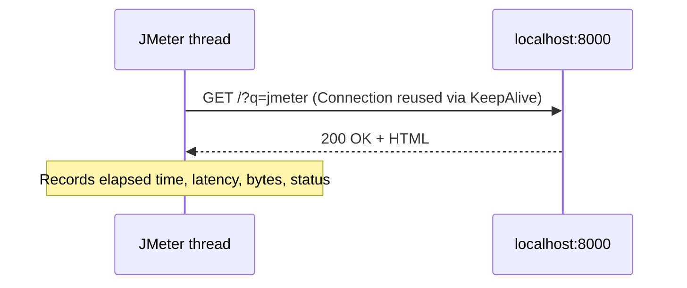

## Beginner-friendly explanation

Sending an HTTP request is like posting a letter. The **protocol** is the delivery service (ordinary or secure, `http` or `https`). The **server name** is the town, the **port** is the building's door number, and the **path** is the flat inside. The **method** says what you want: GET means "please send me this", POST means "please accept this package". The **body** is what is inside the envelope.

The **HTTP Request sampler** is JMeter's letter-writing form. Each time a thread reaches it, JMeter posts that letter and writes down how long the reply took.

## Technical explanation

Add it with **right-click Thread Group → Add → Sampler → HTTP Request**.

| Field | What to enter | Example |
|---|---|---|
| Name | A meaningful label shown in results | `GET home page` |
| Protocol [http] | `http` or `https`; empty means http | `http` |
| Server Name or IP | Host only, no scheme, no slash | `localhost` |
| Port Number | Empty means 80 for http, 443 for https | `8000` |
| HTTP Request (method) | GET, POST, PUT, DELETE, PATCH, HEAD, OPTIONS... | `GET` |
| Path | Starts with `/`; may include a query string | `/index.html` |
| Content encoding | Character set for the body, usually `UTF-8` | `UTF-8` |
| Redirect Automatically | HTTP client follows redirects silently | off |
| Follow Redirects | JMeter follows 3xx and records each hop | on |
| Use KeepAlive | Reuse the TCP connection | on |
| Use multipart/form-data | For file uploads and multipart forms | off |
| Parameters / Body Data / Files Upload | Tabs for the request content | see below |

**Parameters vs Body Data.** The **Parameters** tab holds name/value pairs. For GET they become a query string (`?q=jmeter`); for POST they become a URL-encoded form body. The **Body Data** tab sends raw text, ideal for JSON or XML. You use one or the other, not both. **Files Upload** attaches files for multipart requests.

**Advanced tab.** Here you find **Timeouts** (connect and response, in milliseconds; empty means no timeout, which can hang threads), **Retrieve All Embedded Resources** (download images, CSS and scripts referenced in HTML, optionally in parallel, like a browser would), the HTTP client **Implementation** (HttpClient4 by default) and an optional proxy.



Each sample records **elapsed time** (whole request until last byte), **latency** (until the first byte of the response) and **connect time**.

## Step-by-step walkthrough

1. In an empty folder create `index.html` and `about.html`, then run `python -m http.server 8000`.
2. Add a Thread Group (1 thread, 1 loop).
3. Right-click **Thread Group → Add → Sampler → HTTP Request**. Name `GET home`; Protocol `http`; Server `localhost`; Port `8000`; Method `GET`; Path `/`.
4. On the **Parameters** tab click **Add**: Name `q`, Value `jmeter`.
5. Add a second HTTP Request named `GET about` with Path `/about.html`.
6. Add a third named `GET missing` with Path `/missing.html`.
7. On the **Advanced** tab of each, set Connect timeout `5000` and Response timeout `10000`.
8. Right-click **Thread Group → Add → Listener → View Results Tree**, then **Start**.
9. Click `GET home` and open the **Request** tab → **Request Body** / **Request Headers**; check the URL ends with `?q=jmeter`.

## Expected output

Illustrative View Results Tree **Sampler result** fields for `GET home`:

```text
Thread Name: Thread Group 1-1
Load time: 4
Connect Time: 1
Latency: 4
Size in bytes: 512
Response code: 200
Response message: OK
```

`GET missing` shows a red icon with `Response code: 404` and `Response message: File not found`. If you try POST against Python's simple server, expect `501 Unsupported method`, because that server only handles GET and HEAD. That is your server's behaviour, not a JMeter bug.

## Troubleshooting

| Symptom | Cause | Fix |
|---|---|---|
| `UnknownHostException` | Typo in Server Name or `http://` included | Host only, e.g. `localhost` |
| `Connection refused` | Nothing listening on that port | Start your server; check the port |
| Threads hang | No timeouts set and server stalls | Set connect and response timeouts |
| JSON API returns 415 or 400 | Missing Content-Type header | Add HTTP Header Manager with `Content-Type: application/json` ([config elements](/learn/jmeter/jmeter-config-elements)) |
| Garbled non-English characters | Encoding not set | Content encoding `UTF-8` |
| Redirect hops missing from results | Redirect Automatically ticked | Use Follow Redirects instead |

## Real-world example

A team testing its own order API in a test environment builds three samplers: `POST /api/orders` with a JSON body, `GET /api/orders/{id}` and `DELETE /api/orders/{id}`. They give each a clear name, set response timeouts so stuck calls fail instead of hanging threads, and use one HTTP Request Defaults element for the host and port. When the environment's host name changes, they edit one field instead of thirty.

One more field worth knowing is **Path with a query string**. You can type `/search?q=jmeter` directly into Path instead of using the Parameters tab; both work for GET. The Parameters tab is easier to read and has a **URL Encode?** checkbox, which converts spaces and special characters into a form a server accepts. If your values contain spaces or symbols, prefer the Parameters tab with encoding ticked.

## Common mistakes

- **Putting the full URL in Server Name.**
- **Using Parameters for JSON** instead of Body Data.
- **No timeouts**, so a slow server freezes threads and hides the real problem.
- **Assuming 200 means correct.** Add assertions; see [assertions and extractors](/learn/jmeter/jmeter-assertions-and-extractors).
- **Hitting real websites to practise.** Use your own local server only; load-testing systems you do not own is not allowed.

## Key takeaways summary

Split the URL into protocol, server, port and path; choose Parameters for name/value data and Body Data for raw payloads; keep Follow Redirects and KeepAlive on for realism; set timeouts; and always verify in View Results Tree. For API-specific techniques see [testing REST APIs](/learn/jmeter/jmeter-testing-rest-apis).
