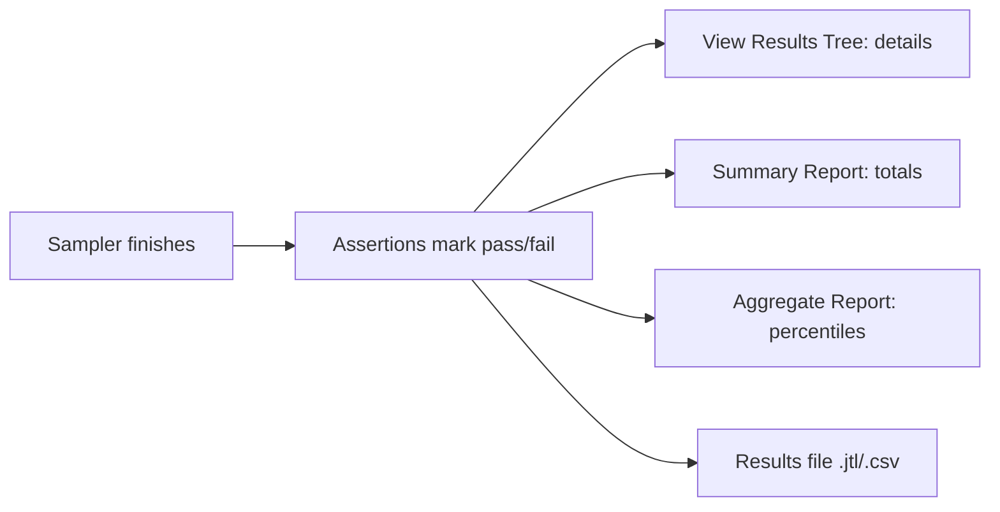

## Beginner-friendly explanation

When you run a race, someone at the finish line holds a stopwatch and a clipboard. **Listeners** are JMeter's clipboard holders. Every time a request finishes, JMeter hands the result to the listeners, which either show you the details (like a photo-finish camera) or add it to a scoreboard (like a league table of averages).

Two terms first. A **percentile** answers "how long did most people wait?". The 90th percentile is the time within which 90 out of 100 requests finished. The **median** is the 50th percentile: half were faster, half slower. **Throughput** is how many requests completed per second, like customers served per minute at a till.

## Technical explanation

Add listeners with **right-click Thread Group (or Test Plan) → Add → Listener → ...**. A listener records samples from samplers in its scope.

| Listener | Use it for | Cost |
|---|---|---|
| View Results Tree | Debugging: request, response body, headers, sampler result | High: stores everything |
| Summary Report | Quick statistics per label | Low |
| Aggregate Report | Statistics including median and percentiles | Moderate: keeps values to compute percentiles |
| Simple Data Writer | Only writes results to a file | Low |

**Summary Report columns**

| Column | Meaning |
|---|---|
| Label | The sampler name; same names are grouped |
| # Samples | Number of samples |
| Average | Mean elapsed time (ms) |
| Min / Max | Fastest / slowest sample (ms) |
| Std. Dev. | How spread out the times are |
| Error % | Percentage of failed samples |
| Throughput | Samples per second/minute/hour |
| Received KB/sec, Sent KB/sec | Data volume per second |
| Avg. Bytes | Mean response size |

**Aggregate Report** adds **Median**, **90% Line**, **95% Line** and **99% Line** (the 90th/95th/99th percentiles) and keeps Average, Min, Max, Error %, Throughput, Received and Sent KB/sec.

A sample is "failed" when the response code is an error (by default 4xx/5xx), the connection fails, or an **assertion** fails. Throughput is calculated as samples ÷ (end of last sample − start of first sample).

Every listener has **Write results to file / Read from file**. Results files (`.jtl`, CSV by default) are what you keep; in non-GUI mode you pass `-l results.jtl` and build the HTML report later, see [the HTML dashboard report](/learn/jmeter/jmeter-html-dashboard-report).

## Step-by-step walkthrough

1. Run `python -m http.server 8000` with an `index.html`.
2. Thread Group: 5 threads, ramp-up 5, loop count 20.
3. HTTP Requests: `Home page` (`/`) and `Missing page` (`/missing.html`).
4. Add **View Results Tree**, **Summary Report** and **Aggregate Report** under the Thread Group.
5. In Summary Report, under **Write results to file**, type a path such as `results/run1.csv`.
6. Start. Open each listener.
7. In View Results Tree, set the dropdown at the top to **Text** or **HTML** to change how responses are shown; tick **Errors** to see only failures.
8. Disable View Results Tree (Ctrl+T), Clear All, and run again; note that the reports still fill.

## Expected output

Illustrative Aggregate Report (your numbers will differ; local runs are very fast):

| Label | # Samples | Average | Median | 90% Line | 95% Line | 99% Line | Min | Max | Error % | Throughput | Received KB/sec |
|---|---|---|---|---|---|---|---|---|---|---|---|
| Home page | 100 | 3 | 2 | 5 | 7 | 15 | 1 | 18 | 0.00% | 45.1/sec | 22.6 |
| Missing page | 100 | 2 | 2 | 4 | 5 | 9 | 1 | 11 | 100.00% | 45.3/sec | 21.0 |
| TOTAL | 200 | 2 | 2 | 5 | 6 | 12 | 1 | 18 | 50.00% | 89.8/sec | 43.5 |

Reading it: every Missing page sample failed (404), so overall Error % is 50%. Home page's 99% Line is much higher than its median, showing occasional slow outliers.

## Troubleshooting

| Symptom | Cause | Fix |
|---|---|---|
| Listener stays empty | Disabled, or placed in another Thread Group's branch | Enable; move to Test Plan level |
| JMeter slows down or runs out of memory | View Results Tree under load | Disable it; run non-GUI with `-l` |
| Error % is 0 but pages show errors | Server returns 200 with an error page | Add a Response Assertion |
| Results from previous runs mixed in | Didn't clear or file appended | Clear All; use a new file name per run |
| Percentiles look odd with few samples | Too little data | Run more iterations before drawing conclusions |

## Real-world example

A tester debugging a new script against their team's test environment keeps View Results Tree enabled while running a single thread, fixing each red sample. Before the real run they disable it, keep only a Simple Data Writer, and run in non-GUI mode. Afterwards they generate the HTML dashboard and report the 95th percentile and error rate per transaction against the agreed targets, not just averages.

A note on **Std. Dev.** (standard deviation) in the Summary Report: it measures how much response times vary around the average. A low value means times are consistent; a high value means some requests are much slower or faster than others, so check the percentiles and Max to understand why.

## Common mistakes

- **Reporting only the average.** Include percentiles and error rate.
- **Leaving View Results Tree on under load.**
- **Duplicate labels** for different requests, merging their statistics.
- **Confusing throughput with users.** 50 users may produce far more or fewer than 50 requests per second.
- **Treating 200 OK as success** without assertions.
- **Generating load against systems you do not own.**

## Key takeaways summary

Use View Results Tree to debug, Summary and Aggregate Reports to measure, and results files for anything you keep. Read percentiles alongside average, check Error %, and remember throughput is completed requests per second. Disable heavy listeners under load. Go deeper in [analysing JMeter results](/learn/jmeter/jmeter-analyzing-results).
