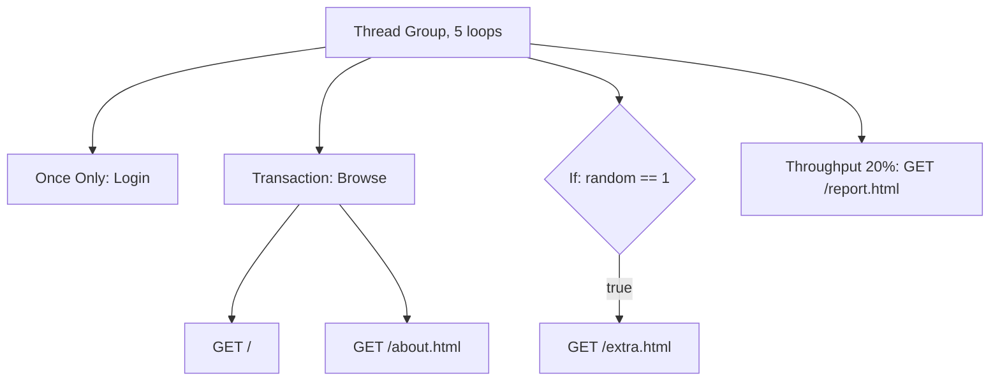

## Beginner-friendly explanation

If samplers are individual actions ("open home page", "click product"), **logic controllers** are the instructions that arrange them: "do these three as one step called Login", "repeat this five times", "only do this if the basket is not empty", "do this just once", "one in ten users goes to checkout". They are like the "if", "repeat" and "group" blocks in a children's coding game. Controllers never send requests themselves; they decide which children run, how often and in what order.

## Technical explanation

Add with **right-click Thread Group (or another controller) → Add → Logic Controller → ...**.

| Controller | What it does | Key settings |
|---|---|---|
| Simple | Groups children for organisation; runs them in order | none |
| Loop | Repeats children N times (in addition to Thread Group loops) | Loop Count, Infinite |
| Transaction | Measures total time of its children as one named sample | Generate parent sample; Include duration of timer and pre-post processors in generated sample |
| If | Runs children only if the condition is true | Condition; Interpret Condition as Variable Expression; Evaluate for all children |
| While | Repeats children while the condition is true | Condition (blank = until a sampler fails; LAST = until last sample fails) |
| Once Only | Runs children on the first iteration of each thread only | none |
| Throughput | Runs children for a share of executions | Total Executions or Percent Executions; Per User |
| Random | Runs one randomly chosen child per pass | Ignore sub-controller blocks |
| Module | Runs another controller in the plan (often in a Test Fragment) | Module to run |
| Include | Loads a Test Fragment from another `.jmx` file | Filename |

**Transaction Controller details.** Without **Generate parent sample**, reports show each child row plus a transaction row. With it ticked, children become sub-samples and only the transaction row appears in reports (View Results Tree still lets you expand children). By default timer and processor time is **excluded**; tick the include option to count it.

**If and While conditions.** With **Interpret Condition as Variable Expression** ticked (the default), the condition must evaluate to the text `true`, so write it with a function:

```text
${__jexl3("${status}" == "ok")}
${__groovy(vars.get("count").toInteger() < 3)}
```

The legacy JavaScript mode (unticked) works but is slower, and the manual recommends `__jexl3` or `__groovy`. Learn more in [JMeter functions](/learn/jmeter/jmeter-functions).



## Step-by-step walkthrough

1. In a folder with `index.html`, `about.html`, `extra.html` and `report.html`, run `python -m http.server 8000`.
2. Thread Group: 2 threads, Loop Count 5. Add HTTP Request Defaults for `localhost:8000`.
3. **Add → Logic Controller → Once Only Controller**, name `Login once`; inside add HTTP Request `Login (simulated)` with path `/`.
4. **Add → Logic Controller → Transaction Controller**, name `Browse`. Inside add `GET home` (`/`) and `GET about` (`/about.html`). Tick **Generate parent sample**.
5. **Add → Logic Controller → If Controller**, condition `${__jexl3(${__Random(1,2)} == 1)}`. Inside add `GET extra` (`/extra.html`).
6. **Add → Logic Controller → Throughput Controller**: Percent Executions, Throughput `20`, Per User unticked. Inside add `GET report` (`/report.html`).
7. Add **Summary Report** and **View Results Tree**. Start.

## Expected output

Illustrative Summary Report (counts for random parts will vary):

| Label | # Samples | Notes |
|---|---|---|
| Login (simulated) | 2 | Once per thread |
| Browse | 10 | 2 threads × 5 loops; children hidden |
| GET extra | about 5 | Roughly half the iterations |
| GET report | 2 | 20% of 10 executions |

Untick Generate parent sample and rerun: `GET home` and `GET about` now appear as separate rows alongside `Browse`.

## Troubleshooting

| Symptom | Cause | Fix |
|---|---|---|
| If Controller never runs children | Raw comparison in variable-expression mode | Wrap in `__jexl3` or `__groovy` |
| While Controller loops forever | Condition never becomes false | Update the variable inside the loop, or add a counter limit |
| Transaction time looks too long | Timers included | Untick include-duration option, or keep it consistently |
| Children rows missing from reports | Generate parent sample ticked | Untick it if you need per-request rows |
| Module Controller shows nothing to choose | No controller or Test Fragment to target | Add a Test Fragment containing a controller |

## Real-world example

A team scripting a user journey for its own shopping app in staging uses a Once Only Controller for login, Transaction Controllers named after business steps (Search, View product, Add to basket, Checkout) so reports match the language of the requirements, an If Controller to skip checkout when the basket is empty, and a Throughput Controller so only a fraction of iterations check out. Shared steps live in a Test Fragment reused via Module Controllers.

Two more controllers appear in the Add menu that are worth recognising. The **Interleave Controller** runs one child per pass, in turn, so successive iterations alternate between children. The **Runtime Controller** runs its children for a set number of seconds. And a **Test Fragment** (added via right-click Test Plan → Add → Test Fragment) is a container that never runs by itself; it only runs when a Module or Include Controller calls it.

## Common mistakes

- **Using Simple Controller and expecting timings.** Use a Transaction Controller.
- **Nested Transaction Controllers with parent samples**, producing confusing double counting.
- **Slow JavaScript conditions** at high load.
- **Infinite While loops.**
- **Using Throughput Controller as a precise workload model**; for exact mixes consider separate Thread Groups, see [workload design](/learn/jmeter/jmeter-workload-design).
- **Pointing practice runs at systems you do not own.**

## Key takeaways summary

Controllers shape the journey: group with Simple, measure with Transaction, repeat with Loop and While, branch with If, run once with Once Only, split traffic with Throughput and Random, and reuse with Module and Include. Write conditions with `__jexl3` or `__groovy`, and name transactions after business steps.
