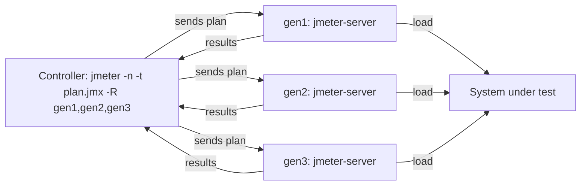

## Beginner-friendly explanation

Building a test in the JMeter window is like rehearsing a play on stage with the lights and cameras on: great for checking every line, but expensive. When the real show starts, you turn off the rehearsal equipment and let the actors perform. That is **non-GUI mode**: JMeter runs the test from the command line, saving its energy for generating load.

Sometimes one stage is not big enough for the cast. **Distributed mode** puts the same play on several stages at once, with one director (the controller) starting them all and collecting the reviews.

## Technical explanation

### Non-GUI mode

```bash
jmeter -n -t plan.jmx -l results.jtl -e -o report/
```

| Option | Meaning |
|---|---|
| `-n` | Non-GUI mode |
| `-t` | Test plan (`.jmx`) |
| `-l` | Results file (`.jtl`, CSV by default) |
| `-e` | Generate the HTML dashboard after the test |
| `-o` | Dashboard output folder (must be empty or not exist) |
| `-g` | Generate a dashboard from an existing results file (with `-o`) |
| `-j` | JMeter log file |
| `-J name=value` | Set a local JMeter property |
| `-G name=value` | Set a global property sent to remote servers |
| `-q file` | Additional property file |
| `-R h1,h2` | Start the test on these remote servers |
| `-r` | Start on the servers listed in `remote_hosts` |
| `-X` | Exit remote servers when the test ends |

Plans read properties with the `__P` function, for example `${__P(threads,10)}`, where 10 is the default.

### Distributed mode



Key facts from the JMeter remote-testing documentation:

- Every server runs the **whole** plan, so **total threads = threads in the plan × number of servers**.
- All machines should run the **same JMeter and Java versions**, and the same plugins.
- **Data files** (CSV) are read locally on each server; they must exist there, and should contain different rows per server when uniqueness matters.
- Communication uses Java RMI. Since JMeter 4.0, RMI uses SSL by default, which needs a keystore created with the `create-rmi-keystore` script and copied to every machine; disabling SSL (`server.rmi.ssl.disable=true`) is only acceptable on an isolated, trusted network.
- Firewalls must allow the RMI registry port (1099 by default) and the server and client ports, which you can fix with `server.rmi.localport` and `client.rmi.localport`.
- Results stream back to the controller; the sample sender `mode` property controls batching, which matters at high sample rates.
- Generators, controller and system under test should be on a fast, close network so the network path does not distort results.

## Real-world example

A team needed 1,200 concurrent users for a soak test. A single generator ran out of CPU at around 500 threads, so they set up 4 remote servers. Their first run produced 4,800 users, because they left the plan at 1,200 threads and forgot that each server runs the whole plan. The second run used `-Gthreads=300`. It then hit duplicate-login errors, since all four servers read the same `users.csv`. Splitting the file into four distinct 300-row files, one per server at the same path, fixed the test. Throughout, they monitored generator CPU to confirm the generators were never the bottleneck.

## Step-by-step walkthrough

1. **Parameterize the plan**: threads, ramp-up, duration and host via `${__P(...)}`.
2. **Remove heavy listeners** (View Results Tree, graph listeners); results go to the `.jtl` file.
3. **Run a short non-GUI smoke test** with a handful of threads.
4. **For distributed runs**, install identical JMeter, Java and plugins on each server, create and distribute the RMI keystore, and copy data files.
5. **Start `jmeter-server`** on each generator, then run the controller with `-R` and `-G` properties.
6. **Monitor generators** (CPU, memory, GC, network) as closely as the system under test.
7. **Generate and archive the dashboard** with the plan version, properties and environment details.

## Code examples

Single machine, parameterized:

```bash
jmeter -n -t checkout.jmx \
  -Jthreads=150 -Jrampup=300 -Jduration=900 -Jhost=perf-env.internal.example \
  -l results/run-01.jtl -j results/run-01.log \
  -e -o results/run-01-report
```

Distributed, 4 servers × 300 threads = 1,200 users:

```bash
# on each generator
jmeter-server

# on the controller
jmeter -n -t soak.jmx -R gen1,gen2,gen3,gen4 \
  -Gthreads=300 -Grampup=600 -Gduration=21600 \
  -l results/soak.jtl -e -o results/soak-report -X
```

Thread Group fields in the plan: `${__P(threads,10)}`, `${__P(rampup,30)}`, `${__P(duration,300)}`.

## Expected output

The console prints the summariser every 30 seconds by default, and at the end a line such as `Tidying up ...` followed by `... end of run`. The `-o` folder contains `index.html`; opening it shows the APDEX table, request summary, statistics with percentiles, errors and time-series graphs.

## Common mistakes

- **Load from GUI mode**, making JMeter the bottleneck.
- **Forgetting the multiplier** in distributed mode.
- **Same CSV on every server** when data must be unique.
- **Mismatched versions or missing plugins** on a generator, causing the plan to fail to load there.
- **Reusing a report folder**, which JMeter rejects.
- **Not monitoring generators**, so client-side saturation is reported as server slowness.

## Troubleshooting

- **Controller cannot connect to a server.** Check firewall rules, the RMI ports, the `java.rmi.server.hostname` setting on multi-homed hosts, and that the keystore is present.
- **Report generation fails.** Check that the `.jtl` file has the default CSV columns and a header line, and that the output folder is empty.
- **Out of memory on the controller.** Reduce what is sent back (sample sender mode), save fewer fields, or increase the heap with the `HEAP` environment variable.

## Key takeaways summary

Run every real load test in non-GUI mode with properties, a results file and the HTML dashboard. Scale out with distributed mode, remembering that each server runs the full plan, data files are local to each server and every generator needs identical software. Watch the generators as carefully as the system under test, and only target systems you are authorized to load.
