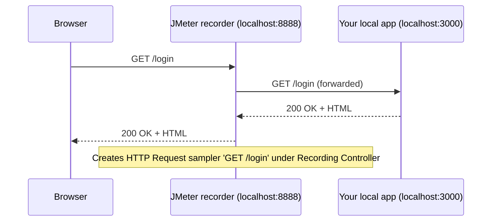

## Beginner-friendly explanation

Writing every HTTP request by hand is slow. Imagine instead hiring a note-taker who stands between you and a shop counter. Every time you ask the shopkeeper for something, the note-taker passes your request on, brings back the answer, and writes both down. At the end you have a perfect list of everything you asked for.

The **HTTP(S) Test Script Recorder** is that note-taker. It is a small **proxy** (a program that forwards traffic on your behalf) built into JMeter. You tell your browser "send everything through JMeter", click through your app normally, and JMeter writes one **HTTP Request sampler** (the element that sends a request) for every request it sees.

The result is a fast first draft of a script. It is only a draft, though: it contains noise and values that will not work a second time, and you will learn to clean it.

> **Authorisation rule:** only record and load-test applications you run yourself (for example on `localhost`) or that you have written permission to test. Never point JMeter at third-party websites.

## Technical explanation

The recorder listens on a TCP **port** (a numbered door on your computer), **8888 by default**. The browser is configured to use `localhost:8888` as its HTTP and HTTPS proxy.



Key parts of the recorder (Component Reference → HTTP(S) Test Script Recorder):

| Setting | What it does |
|---|---|
| Port | Proxy port, default 8888 |
| Target Controller | Where new samplers go, e.g. the Recording Controller |
| Grouping | Put each group of requests in a new controller or transaction, or add separators |
| URL Patterns to Include / Exclude | Regular expressions that decide what is recorded |
| Add suggested Excludes | One click adds patterns for common static files (images, CSS, JS, fonts) |
| Naming scheme / prefix | How sampler names are built, e.g. a step prefix |

**HTTPS** traffic is encrypted, so JMeter must decrypt and re-encrypt it. On start, JMeter generates a root certificate called **ApacheJMeterTemporaryRootCA** and saves `ApacheJMeterTemporaryRootCA.crt` in its `bin` folder. Your browser must trust it; otherwise you see "Your connection is not private". The certificate is **valid for about 7 days**, after which you must import the regenerated one.

Note: many browsers bypass a proxy for `localhost` addresses by default. If your local app is on `localhost`, either use your machine's hostname or LAN IP, or remove localhost from the browser's proxy bypass list.

## Step-by-step walkthrough

1. Start your practice app locally, for example on `http://localhost:3000`.
2. In JMeter choose **File → Templates…**, pick **Recording** in the drop-down and click **Create**. Enter your app's host when asked. JMeter builds a plan with **User Defined Variables**, **HTTP Request Defaults**, an **HTTP Cookie Manager**, a **Thread Group** containing a **Recording Controller**, and the **HTTP(S) Test Script Recorder** under the Test Plan.
3. Select the recorder. Check that **Port** is 8888 and **Target Controller** is "Test Plan > Thread Group > Recording Controller".
4. Under **Request Filtering**, click **Add suggested Excludes**.
5. Click **Start**. A dialog tells you the root CA certificate was created. Click OK. A small **Recorder: Transactions Control** window appears.
6. Configure the browser proxy. In Firefox: **Settings → Network Settings → Settings… → Manual proxy configuration**, HTTP Proxy `localhost`, Port `8888`, tick "Also use this proxy for HTTPS". In Windows (affects Chrome and Edge): **Settings → Network & internet → Proxy → Manual proxy setup**.
7. For HTTPS apps, import `bin/ApacheJMeterTemporaryRootCA.crt`: in Firefox **Settings → Privacy & Security → Certificates → View Certificates → Authorities → Import**, tick "Trust this CA to identify websites".
8. In the Transactions Control window, type a prefix like `01 Home` before each step, then perform it in the browser.
9. Click **Stop**, switch the browser proxy back off, and expand the Recording Controller.

## Expected output

Illustrative result after recording home → login → profile with suggested excludes on:

```text
Recording Controller
├── 01 Home
│   └── /           (HTTP Request + HTTP Header Manager)
├── 02 Login
│   ├── /login
│   └── /api/session
└── 03 Profile
    └── /profile
```

Without excludes the same journey typically also contains samplers for every stylesheet, script, image and favicon.

## Real-world example

A QA team needs a load test for the checkout of an internal web shop running in their own test environment. Hand-writing 25 requests would take hours, so they record the journey once. The raw recording has 140 samplers, most of them images and analytics calls. After adding excludes and re-recording, 22 samplers remain. They rename each to the business step, wrap steps in Transaction Controllers, replace the recorded session id with a correlated variable, and only then add users.

## Cleaning the recording

| Problem in raw recording | Fix |
|---|---|
| Hundreds of `.png`, `.css`, `.js` samplers | Exclude patterns, or enable "Retrieve All Embedded Resources" in HTTP Request Defaults if you want them fetched realistically |
| Names like `/api/v1/x?id=93` | Rename to `03 View product - GET /api/v1/x` |
| Calls to external analytics or fonts domains | Delete them; you are not authorised to load them |
| Hard-coded session ids, CSRF tokens | Correlate, see [Correlation and parameterization](/learn/jmeter/jmeter-correlation-and-parameterization) |
| Hard-coded usernames | Parameterise with [CSV Data Set Config](/learn/jmeter/jmeter-csv-data-set-config) |
| No pauses | Add timers, see [Timers](/learn/jmeter/jmeter-timers-and-throughput-shaping) |

## Common mistakes

- **Leaving the browser on the proxy** after recording, then wondering why the internet is broken when JMeter is closed.
- **Recording with dozens of browser tabs open**, which records background traffic from other sites.
- **Replaying without correlation**, so every user reuses one expired session.
- **Keeping the root certificate trusted forever.** Remove it after recording; a trusted interception CA is a security risk.
- **Recording third-party sites.** It is unauthorised traffic, even "just for practice".

## Troubleshooting

- **Nothing is recorded:** confirm the browser proxy is `localhost:8888`, the recorder says it is running, and your include patterns are not too strict. Check the localhost bypass note above.
- **"Address already in use" on Start:** another program uses 8888; pick another port in both the recorder and the browser.
- **Certificate errors on HTTPS:** import the current `ApacheJMeterTemporaryRootCA.crt`; delete the old one if it expired.
- **Requests from other domains appear:** add an include pattern for your app's host only.

## Key takeaways summary

The recorder is a proxy that converts your browsing into samplers. Use the Recording template, route the browser through port 8888, trust the temporary root CA for HTTPS, and filter static files. Treat the output as a draft: rename, group, correlate, parameterise and add think time before any load is applied, and only against systems you are authorised to test.
