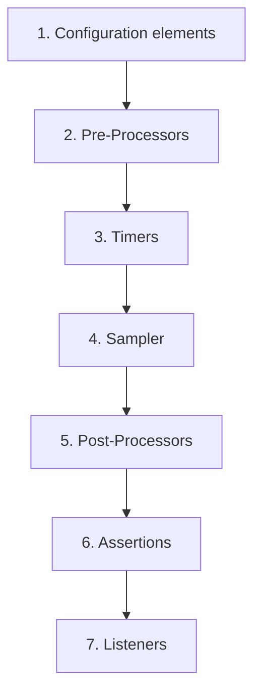

## Beginner-friendly explanation

Think of a school. A rule announced in assembly ("no phones") applies to every class. A rule a teacher sets in their own classroom ("no talking during the test") applies only to that class. A note handed to one student applies only to that student. The JMeter tree works the same way: an element placed high up applies to everything below it; one placed under a single request applies only to that request. This is called **scope**.

**Execution order** is the daily routine that never changes: before each request JMeter first reads its settings, then does preparation, then waits, then sends the request, then extracts data, then checks the answer, then records it. You cannot reorder this by dragging elements; you can only change what is in scope.

## Technical explanation

JMeter has two kinds of elements:

| Kind | Elements | Behaviour |
|---|---|---|
| Ordered | Samplers, Logic Controllers | Run top to bottom in tree order |
| Hierarchical | Config elements, Pre-Processors, Timers, Post-Processors, Assertions, Listeners | Apply to samplers in their scope |

**Scoping rules.** A hierarchical element applies to every sampler at the same level and below in its branch. As a child of a sampler, it applies to that sampler only. Elements in a sibling branch, such as another controller, are out of scope.

**Execution order** for each sampler, per the JMeter manual:



Notes:

- **Timers add up.** All timers in scope run before the sampler, and their delays are summed.
- **Outer before inner.** When several elements of one type are in scope, those at outer levels run before those closer to the sampler.
- **Post-Processors and Assertions need a result.** They run only if the sampler produced a sample.
- **Config elements differ slightly.** Some, like Header Managers, are merged; for HTTP Request Defaults, sampler values win. The User Defined Variables element is processed at the start of the test regardless of position.

## Step-by-step walkthrough

Start `python -m http.server 8000`. Build:

```text
Test Plan
└── Thread Group (1 thread, 1 loop)
    ├── HTTP Request Defaults (localhost, 8000)
    ├── Constant Timer: 1000 ms          ← applies to A and B
    ├── Response Assertion: code = 200   ← applies to A and B
    ├── HTTP Request A: GET /
    ├── HTTP Request B: GET /missing.html
    │   └── Constant Timer: 2000 ms      ← applies to B only
    └── View Results Tree
```

1. **Right-click Thread Group → Add → Timer → Constant Timer**, Thread Delay `1000`.
2. **Right-click Thread Group → Add → Assertions → Response Assertion**: Field to Test **Response Code**, Pattern Matching Rules **Equals**, Patterns to Test `200`.
3. Add the two HTTP Requests (path only).
4. **Right-click HTTP Request B → Add → Timer → Constant Timer**, `2000`.
5. Add View Results Tree, Start, and compare each sample's **Sample Start** time in the Sampler result tab.
6. Now drag the Response Assertion onto HTTP Request A and choose **Add as Child**. Run again.

## Expected output

Illustrative timings for the first run:

| Sample | Delay before it | Result |
|---|---|---|
| A: GET / | about 1 s | Pass |
| B: GET /missing.html | about 3 s (1 s + 2 s) | Fail: 404 and assertion failure |

After step 6, B still fails (404 is an error code by default) but now without an assertion message, because the assertion only checks A.

## Troubleshooting

| Symptom | Cause | Fix |
|---|---|---|
| Whole test far slower than expected | Timer at a high level delays every sampler | Move the timer under the sampler(s) it is meant for |
| Extractor variable empty in the next request | Extractor in the wrong branch or under a different sampler | Make it a child of the sampler whose response holds the value |
| Assertion failing on unrelated requests | Assertion at Thread Group level | Move it under the specific sampler |
| A config element seems ignored | Placed in a sibling controller | Move it up to a common parent |
| Unsure what ran | Hard to see | Add a Debug Sampler to view variables at that point |

## Real-world example

A tester adds a "think time" timer at the Thread Group level to simulate users pausing. Later they add a transaction with eight samplers, including image and API calls that a browser fires in parallel, and the test shows unrealistically low throughput: every sampler waits. Moving the timer to a single sampler at the start of each user action fixes the pacing. Understanding scope turned a confusing result into a one-minute fix.

A helpful habit is to read your tree from the sampler's point of view. Pick a sampler and walk upwards to the Test Plan, listing every config element, pre-processor, timer, post-processor, assertion and listener you pass at each level, including siblings at those levels. That list is exactly what applies to this sampler, and the execution order tells you when each one runs. If an element you expected is not on the list, it is in the wrong place.

## Common mistakes

- **Thinking tree order changes execution order** for hierarchical elements. A timer placed after a sampler still runs before it.
- **Placing extractors at Thread Group level**, so they run against every response and overwrite variables.
- **Forgetting that timers add up.**
- **Putting listeners inside one controller** and wondering why other samples are missing.
- **Running experiments against systems you do not own.** Use your local server.

## Key takeaways summary

Where you put an element decides what it affects; what kind of element it is decides when it runs. Remember the sequence config, pre-processors, timers, sampler, post-processors, assertions, listeners, and keep element placement as close as possible to the samplers they are meant for. Next: steering flow with [logic controllers](/learn/jmeter/jmeter-logic-controllers).
