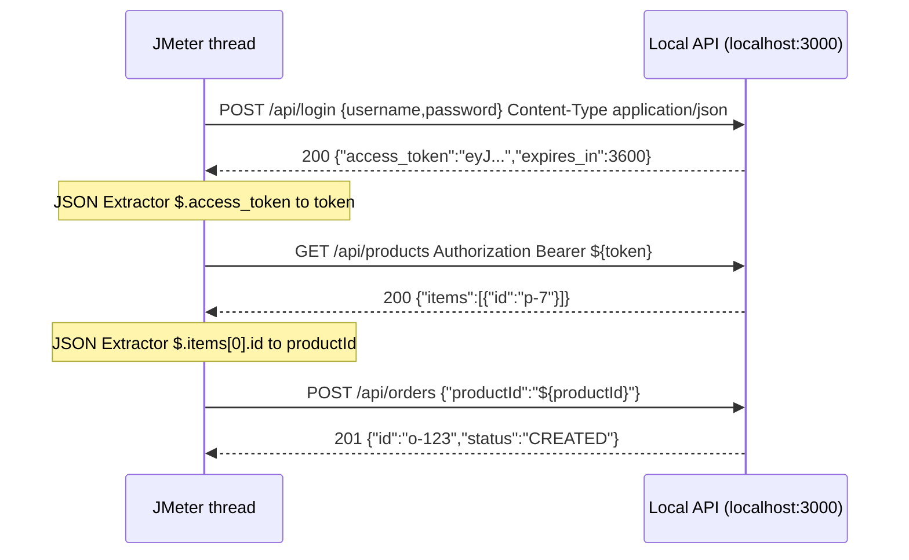

## Beginner-friendly explanation

A **REST API** is a set of web addresses that programs (not people) call to read or change data, usually exchanging **JSON**, a text format like `{"name":"Asha","age":30}`.

Many APIs work like a hotel. First you check in at reception (the **login** call) and receive a key card (an **access token**, a long string proving who you are). For every later door (API call) you show the key card. If you show no card, you get a "401 Unauthorized".

In JMeter you must automate that: log in, copy the token out of the response, and attach it to every later request. Copying a value from one response into another request is called **chaining**.

> **Authorisation rule:** practise only on an API you run yourself, for example a small app on `localhost:3000`. Never load-test third-party APIs without written permission.

## Technical explanation

Building blocks:

| Element | Add via | Role |
|---|---|---|
| HTTP Request | Add → Sampler → HTTP Request | Method, path and **Body Data** (raw JSON) |
| HTTP Header Manager | Add → Config Element → HTTP Header Manager | Headers such as `Content-Type: application/json` and `Authorization` |
| JSON Extractor | Add → Post Processors → JSON Extractor | Reads a value with a **JSONPath** into a variable |
| Response Assertion | Add → Assertions → Response Assertion | Checks the status code or text |
| JSON Assertion | Add → Assertions → JSON Assertion | Checks a JSONPath exists or equals a value |

**JSONPath** is a query language for JSON: `$` is the root, `.field` a child, `[0]` the first array element. `$.access_token` reads the token; `$.items[0].id` the first item's id.

**JSON Extractor fields:** *Names of created variables* (`token`), *JSON Path expressions* (`$.access_token`), *Match No.* (`1` = first, `0` = random, `-1` = all), *Default Values* (`TOKEN_NOT_FOUND`).



For deeper coverage of extractors and assertions see [Assertions and extractors](/learn/jmeter/jmeter-assertions-and-extractors) and [Correlation](/learn/jmeter/jmeter-correlation-and-parameterization).

## Step-by-step walkthrough

1. **Test Plan → Add → Config Element → HTTP Request Defaults:** Protocol `http`, Server `localhost`, Port `3000`.
2. **Thread Group → Add → Config Element → CSV Data Set Config** with `username,password` (see [CSV Data Set Config](/learn/jmeter/jmeter-csv-data-set-config)).
3. **Login request.** HTTP Request named `01 Login`, Method `POST`, Path `/api/login`, **Body Data** tab:

```json
{ "username": "${username}", "password": "${password}" }
```

4. Right-click `01 Login` → **Add → Config Element → HTTP Header Manager**, click **Add**: Name `Content-Type`, Value `application/json`.
5. Right-click `01 Login` → **Add → Post Processors → JSON Extractor**: variable `token`, path `$.access_token`, Match No. `1`, Default `TOKEN_NOT_FOUND`.
6. Right-click `01 Login` → **Add → Assertions → Response Assertion**: *Field to Test* = **Response Code**, *Pattern Matching Rules* = **Equals**, pattern `200`.
7. Add a **Transaction Controller** named `Authenticated calls`. Under it add an HTTP Header Manager with `Content-Type: application/json` and `Authorization: Bearer ${token}`.
8. Inside it: `02 List products` (`GET /api/products`) with a JSON Extractor `productId` = `$.items[0].id`, default `PRODUCT_NOT_FOUND`.
9. `03 Create order` (`POST /api/orders`), body `{"productId":"${productId}","quantity":1}`. Add a Response Assertion (Response Code equals `201`) and a **JSON Assertion**: *Assert JSON Path exists* `$.status`, tick *Additionally assert value*, *Expected Value* `CREATED`.
10. Optionally, select the Thread Group and set **Action to be taken after a Sampler error** to *Start Next Thread Loop*, so a failed login skips the rest of that iteration.
11. Add **View Results Tree**, run 1 thread first, then a few.

## Expected output

Illustrative View Results Tree for one iteration:

```text
01 Login            200  Response: {"access_token":"eyJhbGciOi...","expires_in":3600}
Authenticated calls
  02 List products  200  Request headers: Authorization: Bearer eyJhbGciOi...
  03 Create order   201  Response: {"id":"o-123","status":"CREATED"}
```

With a wrong password, `01 Login` is red with "Test failed: code expected to equal 200" and the next steps are skipped.

## Real-world example

A team load-testing its own order API saw a 30-minute run with almost no errors and impressive speed. View Results Tree revealed every order call returned 200 with `{"error":"token expired"}`: the token lived 15 minutes and was fetched once. They added a JSON Assertion on `$.status`, re-logged in each iteration, and the real response time of order creation became visible.

## Common mistakes

- **No Content-Type header**, giving 415 or 400 responses.
- **Authorization header at Thread Group level**, sending `Bearer ${token}` on the login call itself.
- **No default value in the extractor**, making a missed match hard to see.
- **Asserting only status codes** on APIs that return errors inside 200 responses.
- **Hard-coding a token** copied from a browser; it expires and every user shares it.
- **Pointing the test at a public API** you do not own.

## Troubleshooting

- **401 on protected calls:** inspect the request headers in View Results Tree; check the token value and spelling of `Bearer`.
- **Extractor gives the default:** paste the response into a JSONPath tester (View Results Tree has a "JSON Path Tester" renderer) and fix the path.
- **400 Bad Request:** the JSON body is invalid, often an unquoted string variable or a trailing comma.
- **Works for 1 user, fails for many:** check data uniqueness and token expiry.

## Handling token expiry under load

Tokens usually expire (the `expires_in` field above says 3600 seconds). Choose a strategy that matches how real clients behave:

| Strategy | How in JMeter | When it fits |
|---|---|---|
| Log in every iteration | Login sampler inside the main loop | Short sessions; also load-tests the login service |
| Log in once per thread | Put login in a **Once Only Controller** | Long sessions; login is not the focus |
| Refresh when expired | If Controller checking a stored expiry time, then a refresh call | Long soak tests with short token lifetimes |

Whichever you choose, keep an assertion on every protected call so an expired token shows up as an error, not as a suspiciously fast 401 that looks like good performance.

## Key takeaways summary

A JMeter API test is a chain: send JSON with the right headers, extract what the next step needs, attach the token as `Bearer ${token}`, and assert both status and content at every step. Keep header managers scoped correctly and always run against an API you are authorised to test.
