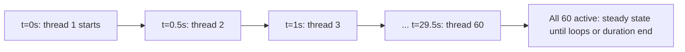

## Beginner-friendly explanation

Picture a theme park opening its gates. **Number of Threads** is how many visitors you let in today. **Ramp-up** is how gradually you let them through the turnstile: all 100 at once creates a crush; one per second over 100 seconds is calm. **Loop Count** is how many times each visitor rides the roller coaster before going home. A **Duration** is a closing time: everyone keeps riding until the park shuts.

Each visitor is a **thread**, also called a **virtual user**: a little worker inside JMeter that runs the steps you placed in the Thread Group, one after another, as one person would.

## Technical explanation

Add one with **right-click Test Plan → Add → Threads (Users) → Thread Group**.

| Field | Meaning |
|---|---|
| Action to be taken after a Sampler error | Continue, Start Next Thread Loop, Stop Thread, Stop Test, Stop Test Now |
| Number of Threads (users) | How many virtual users run in parallel |
| Ramp-up period (seconds) | Time JMeter takes to start all threads |
| Loop Count | Iterations per thread; **Infinite** keeps going until stopped or the duration ends |
| Same user on each iteration | When ticked (default), cookies and cache are kept between iterations, like the same person returning. Unticked, each iteration behaves like a brand new user |
| Delay Thread creation until needed | Threads are created only when their start time arrives instead of all up front, saving memory during long ramp-ups |
| Specify Thread lifetime | Enables **Duration (seconds)** and **Startup delay (seconds)** |

Key formulas:

| Question | Formula | Example (60 threads, 30 s ramp-up, 10 loops, 2 samplers) |
|---|---|---|
| Threads started per second | threads ÷ ramp-up | 60 ÷ 30 = 2 |
| Delay between thread starts | ramp-up ÷ threads | 0.5 s |
| Total samples (loop-based) | threads × loops × samplers | 60 × 10 × 2 = 1,200 |

If both a loop count and a duration are set, a thread stops at whichever comes first.

**Special Thread Groups.** A **setUp Thread Group** runs before regular Thread Groups (for example, to create test accounts); a **tearDown Thread Group** runs after (to clean up). The Test Plan option **Run Thread Groups consecutively** makes multiple regular Thread Groups run one after another instead of in parallel.

## Step-by-step walkthrough

1. Start your practice server: `python -m http.server 8000`.
2. Right-click **Test Plan → Add → Threads (Users) → Thread Group**. Name it `Browsers`.
3. Set **Number of Threads** `10`, **Ramp-up** `10`, **Loop Count** `5`.
4. Right-click **Browsers → Add → Sampler → HTTP Request**: server `localhost`, port `8000`, path `/`, name `Home page`.
5. Right-click **Browsers → Add → Listener → Summary Report**.
6. Predict: 10 × 5 × 1 = 50 samples. Click **Start**.
7. Watch the top-right counter climb from `1/10` to `10/10` over about ten seconds (on a fast local server, early threads may finish before the last ones start, so the count may never reach 10 at once).
8. Now set Loop Count to **Infinite**, tick **Specify Thread lifetime**, set **Duration** `30`. Clear All and run. The test stops itself after about 30 seconds.
9. Right-click **Test Plan → Add → Threads (Users) → setUp Thread Group**, give it 1 thread and an HTTP Request named `SETUP check`. Run and confirm it appears first in View Results Tree.

## Expected output

Illustrative Summary Report for step 6:

| Label | # Samples | Average | Error % |
|---|---|---|---|
| Home page | 50 | 3 | 0.00% |

For the duration test, the sample count is not fixed; it depends on how fast your server answers. That is expected.

## Troubleshooting

| Symptom | Cause | Fix |
|---|---|---|
| Fewer samples than expected | Error action is Stop Thread, or Duration ended first | Check the error action and duration |
| Test never ends | Loop Count Infinite with no duration | Tick Specify Thread lifetime or use Shutdown |
| Active threads never reach the total | Each thread finishes before the last starts | Increase loops, use a duration, or shorten ramp-up |
| JMeter memory warnings with many threads | All threads created up front | Tick Delay Thread creation until needed; run in non-GUI mode |
| setUp results mixed into totals | Not filtered | Name setUp samplers clearly and exclude them when analysing |

## Real-world example

A team needs a steady-state test of a search API in their own staging environment: 100 users, a 5-minute ramp-up so caches warm gradually, then 20 minutes of steady load. They set 100 threads, 300 s ramp-up, Infinite loops and a 1,500 s duration. A setUp Thread Group loads search test data, and a tearDown Thread Group deletes it. Analysts exclude the first five minutes when reporting steady-state numbers.

A quick word on the **Action to be taken after a Sampler error** setting. **Continue** (the default) simply records the failure and carries on, which suits most load tests because you want to measure how often errors happen. **Start Next Thread Loop** abandons the rest of the current iteration, which is useful when later steps depend on an earlier one, such as viewing an order that was never created. **Stop Thread**, **Stop Test** and **Stop Test Now** end things progressively more abruptly and are mostly used while debugging.

## Common mistakes

- **Zero ramp-up with many threads**, creating an artificial spike that real users never produce.
- **Confusing ramp-up with request rate.** Use timers to control pacing; see [timers and throughput shaping](/learn/jmeter/jmeter-timers-and-throughput-shaping).
- **Infinite loops without a duration**, leaving a test running forever.
- **Too many threads for one machine.** The load generator becomes the bottleneck.
- **Targeting systems you do not own.** Practise on localhost only.

## Key takeaways summary

Threads are virtual users, ramp-up controls how quickly they start, and loops or duration control how long they work. Compute expected samples before running, use time-based tests for steady state, and reach for setUp and tearDown Thread Groups for preparation and cleanup. Next: what each user actually sends, in [the HTTP Request sampler](/learn/jmeter/jmeter-http-request-sampler).
