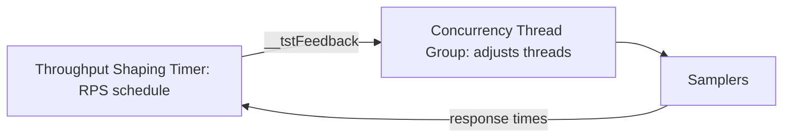

## Beginner-friendly explanation

Imagine a ticket barrier that lets people through. If everyone walks at exactly the same pace, they arrive in neat waves, which never happens in real life. If you want exactly 10 people per minute through the barrier, someone has to hold people back when they are early.

JMeter **timers** are those pauses. Some imitate human hesitation (think time). Others act like the barrier attendant, holding virtual users back so the overall rate matches a target. **Throughput shaping** goes further: it lets you draw the load curve you want over time, such as "climb slowly, hold, spike, recover".

## Technical explanation

Timers run **before** each sampler in their scope (after pre-processors). A timer at Thread Group level delays every sampler; a timer under one sampler delays only that one. If several timers are in scope, their delays are added.

### Built-in think-time timers

| Timer | Delay |
|---|---|
| Constant Timer | Fixed delay |
| Uniform Random Timer | Offset + random value from 0 to maximum |
| Gaussian Random Timer | Offset + normally distributed deviation |
| Poisson Random Timer | Offset + Poisson-distributed value |

Random timers prevent virtual users from moving in lockstep, which would create artificial bursts.

### Built-in rate-controlling timers

- **Constant Throughput Timer:** target in **samples per minute** for the samplers in its scope. Calculation modes include *this thread only*, *all active threads*, *all active threads in current thread group*, and shared variants of the last two. It works by delaying threads, so it **cannot exceed** what the threads can deliver.
- **Precise Throughput Timer:** schedules samples to hit a target per period with randomised (Poisson-like) arrivals, which is closer to an open model, again limited by available threads.

### Plugins from the JMeter Plugins project

These are **not part of core JMeter**. They come from the community project at jmeter-plugins.org and are installed via the Plugins Manager (a JAR in `lib/ext`). Every load generator needs the same plugin versions.

- **Concurrency Thread Group:** defines *target concurrency*, ramp-up time, ramp-up steps and hold time, and starts or stops threads to keep concurrency at the target.
- **Throughput Shaping Timer:** a schedule of rows, each with start RPS, end RPS and duration, so you can draw ramps, plateaus and spikes in requests per second.
- **Feedback between them:** setting the Concurrency Thread Group's target concurrency to the plugin function `${__tstFeedback(timerName,start,max,spare)}` lets the timer request more threads when needed. Check the plugin's documentation for your version's exact parameters.



### Sizing threads

By [Little's Law](/learn/performance/littles-law), concurrency needed ≈ rate × time each thread is busy per request. For 250 RPS with responses up to 0.8 s at the tail, plan for at least 250 × 0.8 = 200 threads, plus spare. If threads run out, the achieved rate falls below the schedule and the test silently becomes closed-model.

## Real-world example

A team needed to verify a spike from 100 to 250 requests per second for a promotion. Their first plan used a standard Thread Group with 100 threads and a Constant Throughput Timer. During the spike, response times rose to about 1 s, so 100 threads could deliver at most about 100 per second, and the "spike" never happened. They switched to a Concurrency Thread Group with a Throughput Shaping Timer and `__tstFeedback`, capped at 400 threads. The shaped schedule reached 250 RPS, and the test revealed a connection pool that saturated during the spike.

## Step-by-step walkthrough

1. **Decide the model**: think-time realism (closed) or target rate (open-like).
2. **Add random think-time timers** under the samplers or controllers where users pause.
3. **For a constant target rate**, add a Constant Throughput Timer (samples per minute) or Precise Throughput Timer and calculate thread count with Little's Law.
4. **For a shaped profile**, install the Concurrency Thread Group and Throughput Shaping Timer plugins on all generators.
5. **Define the schedule rows** and wire `__tstFeedback` into the target concurrency.
6. **Run a short trial** and compare achieved RPS with the schedule.
7. **Check the load generator** CPU and memory during the peak.

## Code examples

Throughput Shaping Timer schedule (rows as entered in the plugin's table; the `#` comments are annotations for this lesson, not part of the table):

```text
Start RPS  End RPS  Duration (s)
0          100      300      # ramp-up over 5 minutes
100        100      1200     # steady state 20 minutes
100        250      30       # spike rise
250        250      120      # spike hold 2 minutes
250        100      30       # fall
100        100      600      # recovery check 10 minutes
```

Concurrency Thread Group target concurrency with feedback (timer named `tst-main`):

```text
${__tstFeedback(tst-main,10,400,20)}
```

## Expected output

In the HTML dashboard's "Transactions Per Second" graph, a correct run follows the schedule: a ramp, a flat line at 100, a sharp rise to 250, a flat top and a return to 100. If the top is flattened below 250 while active threads hit the 400 cap, you have run out of threads; raise the cap or investigate the slow responses.

## Common mistakes

- **Entering requests per second** into the Constant Throughput Timer, which expects samples per minute.
- **Too few threads** for the target rate, so timers cannot reach it.
- **Constant timers for think time**, producing lockstep waves of requests.
- **Assuming plugins are core JMeter**, then a teammate's or CI machine's JMeter cannot open the plan.
- **Timer at the wrong scope**, delaying every sampler several times.
- **Ignoring the achieved rate** and reporting the configured one.

## Troubleshooting

- **The plan fails to load with missing class errors.** A plugin is not installed on that machine; install the same versions everywhere.
- **Achieved RPS below target.** Check active thread count, response times and load generator health.
- **Rate overshoots after a pause.** Review the Constant Throughput Timer's calculation mode; per-thread and shared modes behave differently when threads start and stop.

## Key takeaways summary

Use random timers for realistic think time and rate-based timers for predictable throughput. Core JMeter gives you the Constant and Precise Throughput Timers; the JMeter Plugins project adds the Concurrency Thread Group and Throughput Shaping Timer for shaped, rate-driven profiles. Always size threads with Little's Law and verify the achieved rate.
