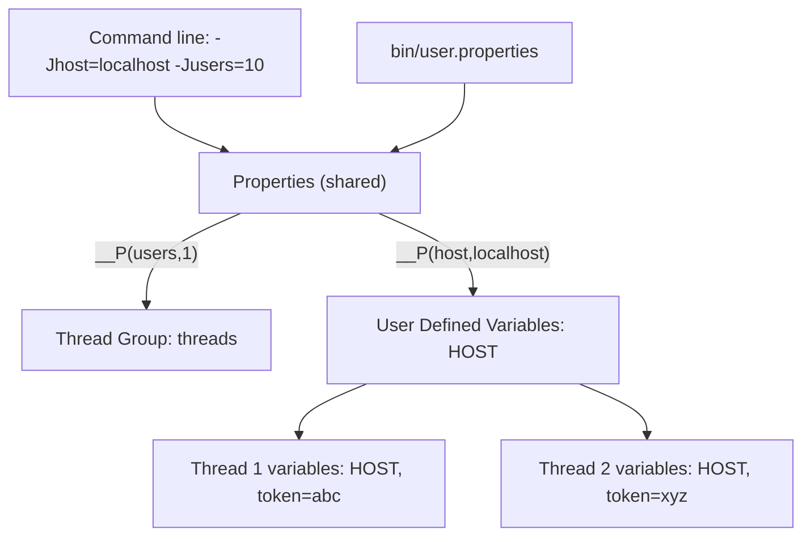

## Beginner-friendly explanation

Think of a recipe card that says "bake at **OVEN_TEMP**". You can write the real number on a sticky note once, and every step that mentions OVEN_TEMP uses it. Change the sticky note, and the whole recipe changes.

In JMeter that placeholder is a **variable**: a named value you reference with `${name}`. Instead of typing `localhost` into twenty samplers, you type `${host}` and define `host` once.

There is a second, similar idea called a **property**. A variable is like a note in each cook's own pocket: every cook (each **thread**, which is one virtual user) has a private copy. A property is like a notice pinned on the kitchen wall: one value everyone shares, usually set before cooking starts.

## Technical explanation

**Variables**

- Referenced as `${name}`. Names are case-sensitive.
- Created by User Defined Variables, CSV Data Set Config, extractors (JSON, Regular Expression, Boundary), scripts (`vars.put` in Groovy) and some functions.
- **Local to each thread.** Thread 3's `${token}` is independent of thread 4's.
- If undefined, the text `${name}` is sent unchanged.

**User Defined Variables (UDV)** is a config element (**Add → Config Element → User Defined Variables**, or the table on the Test Plan itself). It is processed **once at the start**, regardless of where it sits, so it is meant for constants. Do not expect a UDV containing `${__Random(1,9)}` to give a fresh value each iteration.

**Properties**

- Global to the JMeter process (all threads and thread groups).
- Defined in `bin/jmeter.properties` (defaults, do not edit), `bin/user.properties` (your overrides), with `-Jname=value` on the command line, or with `-q extra.properties`. Remote servers in distributed mode use `-Gname=value`.
- Read with `${__P(name,default)}` or `${__property(name,,default)}`.

| | Variable | Property |
|---|---|---|
| Scope | One thread | Whole JMeter process |
| Syntax to read | `${name}` | `${__P(name,default)}` |
| Typical source | UDV, CSV, extractor | `-J`, user.properties |
| Typical use | Per-user data, tokens | Host, users, duration, environment |



A common, clean pattern combines both: a UDV row `HOST` = `${__P(host,localhost)}`. Samplers use `${HOST}`, and the run can override it with `-Jhost=...`.

## Step-by-step walkthrough

Practice target: a REST app you run yourself on `localhost:3000`. (Only test systems you own or are authorised in writing to test.)

1. Select **Test Plan**, right-click → **Add → Config Element → User Defined Variables**. Add rows:

| Name | Value |
|---|---|
| HOST | `${__P(host,localhost)}` |
| PORT | `${__P(port,3000)}` |
| THINK_MS | `1000` |

2. Add **Config Element → HTTP Request Defaults**: Server Name `${HOST}`, Port Number `${PORT}`.
3. In the Thread Group set **Number of Threads** to `${__P(users,1)}`, **Ramp-up** to `${__P(rampup,1)}` and **Loop Count** to `${__P(loops,1)}`.
4. Add an HTTP Request with Path `/health` (leave server blank; it inherits defaults).
5. Add **Sampler → Debug Sampler** with "JMeter properties" set to True, and a **View Results Tree** listener.
6. Run in the GUI (green Start button). Then from a terminal in JMeter's `bin` folder:

```bash
jmeter -n -t vars-demo.jmx -Jusers=3 -Jloops=2 -Jport=3000 -l vars.jtl
```

## Code examples

Reading and writing from Groovy (see [Groovy and JSR223](/learn/jmeter/jmeter-groovy-jsr223)):

```groovy
// per-thread variable
vars.put("orderId", "A-" + vars.get("__jm__Thread Group__idx"))
// global property (shared by all threads, use sparingly)
props.put("lastRunHost", vars.get("HOST"))
log.info("users property = " + props.get("users"))
```

## Expected output

Illustrative Debug Sampler response data (trimmed) for a run with `-Jusers=3`:

```text
JMeterVariables:
HOST=localhost
PORT=3000
THINK_MS=1000
...
JMeterProperties:
users=3
loops=2
```

The summary at the end of the non-GUI run shows 6 samples for `/health` (3 users × 2 loops), plus the Debug Sampler's own samples.

## Real-world example

A team keeps one test plan for its internal order service. Developers run it in the GUI with defaults (1 user, localhost). The CI pipeline runs the same file with `-Jhost=perf-env -Jusers=40 -Jduration=900`. Because every environment-specific value goes through `__P`, nobody edits the `.jmx` per environment, and code review only sees real script changes.

## Common mistakes

- **Expecting UDV to re-evaluate** each iteration. It is processed once; use functions directly in the sampler or a User Parameters pre-processor instead.
- **Using variables to share data between threads.** Variables are per thread.
- **Typos and case:** `${Host}` and `${HOST}` are different.
- **Editing jmeter.properties** instead of user.properties, so an upgrade wipes your changes.
- **No default in __P**, so a GUI run gets an empty value and fails.

## Troubleshooting

- **Literal `${name}` in the request:** check spelling, check the element that creates it runs earlier and is in scope (see [Scope and execution order](/learn/jmeter/jmeter-scope-and-execution-order)).
- **-J value ignored:** you probably used `${name}` instead of `${__P(name)}`; -J sets properties, not variables.
- **Distributed run uses wrong value:** `-J` only sets the controller; use `-G` for remote engines.

## Choosing between them: a quick decision guide

Ask two questions about any value in your plan.

1. **Does it change per virtual user or per iteration?** Usernames, tokens, order ids and cart contents differ between users, so they must be **variables**. They come from CSV files, extractors or functions.
2. **Does it change per run or per environment?** Host name, port, number of users, ramp-up, duration and think-time multipliers are the same for every user in one run, but differ between a laptop run and a CI run. Make them **properties** with sensible defaults, then copy them into variables through User Defined Variables if you like the shorter `${HOST}` syntax.

| Value | Per user? | Per run? | Recommended |
|---|---|---|---|
| Server host | No | Yes | Property via `__P`, copied into UDV |
| Number of threads | No | Yes | `${__P(users,1)}` in the Thread Group |
| Login username | Yes | No | Variable from CSV Data Set Config |
| Access token | Yes | No | Variable from JSON Extractor |
| Fixed API version string | No | No | Plain UDV constant |

Following this rule keeps the test plan readable for the next person: anything that looks like `${__P(...)}` is a knob you can turn from the command line, and anything that looks like `${name}` comes from somewhere inside the plan.

## Key takeaways summary

`${name}` connects every field to a single source of truth. Variables belong to one thread and carry per-user data; properties belong to the process and carry run settings. Combine them with `${__P(name,default)}` so one test plan runs anywhere without edits.
