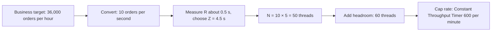

## Beginner-friendly explanation

Before cooking for a party you decide how many guests, what they will eat, and when they arrive. A **workload model** is the same plan for a load test: how many requests per second, which user journeys in what proportions, how users pause, and how load builds over time.

JMeter does not understand "busy Monday morning". It understands **threads** (virtual users), **ramp-up** (how quickly threads start), **timers** (pauses) and **controllers** (which steps run). This lesson shows how to translate a business target into those settings. The theory is in [Workload modeling](/learn/performance/workload-modeling) and [Little's Law](/learn/performance/littles-law).

> **Authorisation rule:** run workloads only against systems you own, such as an app on `localhost`, or have written permission to test.

## Technical explanation

**Key terms**

- **Throughput (X):** completed transactions or iterations per second.
- **Response time (R):** time the system takes to answer.
- **Think time (Z):** the pause a real user takes between actions, added with timers.
- **Concurrency (N):** threads busy at once.

**Little's Law** for a closed system (fixed number of users looping): **N = X × (R + Z)**. Rearranged, one thread can deliver at most 1 / (R + Z) iterations per second.

**JMeter controls**

| Concern | Element | Notes |
|---|---|---|
| Users | Thread Group: Number of Threads | From Little's Law plus headroom |
| Ramp-up | Thread Group: Ramp-up period | Seconds to start all threads; avoid starting everyone at once |
| Duration | Thread Group: Loop Count Infinite + Specify thread lifetime → Duration | Steady state long enough to observe trends |
| Think time | Uniform Random Timer, Gaussian Random Timer | Realistic variation, e.g. 3–6 s |
| Fixed rate | Constant Throughput Timer (built in) | Target in **samples per minute**; mode "all active threads" shares the target |
| Rate schedule | Throughput Shaping Timer (plugin) | Rows of start rps, end rps, duration; install via Plugins Manager |
| Mix | Throughput Controller | Percent Executions or Total Executions |

The Constant Throughput Timer and Throughput Shaping Timer only **delay** threads. If N is too small, the target cannot be met. See [Timers and throughput shaping](/learn/jmeter/jmeter-timers-and-throughput-shaping) for each timer in depth.

## Step-by-step walkthrough

Scenario: your local shop app (`localhost:3000`). Model: 10 iterations per second at steady state, mix 70 % browse, 25 % add to cart, 5 % checkout, 15 minutes steady state.

1. **Measure R.** Run 1 thread for a few minutes and read the average iteration time without think time. Suppose about 0.5 s.
2. **Choose Z.** From product analytics or a sensible assumption, 4.5 s average, documented as an assumption.
3. **Calculate:** N = 10 × (0.5 + 4.5) = 50; with 20 % headroom, 60 threads.
4. **Thread Group:** Threads `${__P(users,60)}`, Ramp-up `300` (one thread every 5 s), Loop Count *Infinite*, tick **Specify Thread lifetime**, Duration `1200` (5 min ramp + 15 min steady).
5. **Mix:** under the Thread Group add **Logic Controller → Throughput Controller** three times: *Percent Executions*, 70 / 25 / 5, each containing its journey (in Transaction Controllers).
6. **Think time:** add a **Uniform Random Timer** inside each journey: Constant Delay `3000`, Random Delay Maximum `3000` (3–6 s, average 4.5 s).
7. **Rate cap:** at Thread Group level add **Timer → Constant Throughput Timer**, Target throughput `600.0` (samples per minute), Calculate based on *all active threads*. Note it counts samples, so put it under a single sampler or divide the target by samplers per iteration.
8. **Alternative stepped profile:** install **Throughput Shaping Timer** (Options → Plugins Manager → Available Plugins → "Throughput Shaping Timer", plugin id `jpgc-tst`; it is a separate plugin from "Custom Thread Groups", `jpgc-casutg`), and add rows:

| Start RPS | End RPS | Duration (s) |
|---|---|---|
| 0 | 10 | 300 |
| 10 | 10 | 900 |

9. Run non-GUI, then verify achieved throughput and mix in the [HTML dashboard](/learn/jmeter/jmeter-html-dashboard-report).

## Expected output

Illustrative check after a run (numbers depend entirely on your app):

| Transaction | Target share | Achieved count | Achieved share |
|---|---|---|---|
| Browse | 70 % | 6,280 | 69.8 % |
| Add to cart | 25 % | 2,270 | 25.2 % |
| Checkout | 5 % | 450 | 5.0 % |

Throughput Over Time should show a ramp for 5 minutes, then a flat line near the target. If it sags below target while response times rise, the system or the thread count is the limit.

## Real-world example

A team was asked to "test with 1,000 users". Asking what that meant revealed the real target: about 5 checkouts per second during a promotion hour, with users pausing roughly 20 s between steps. Using Little's Law with measured response times, they needed far fewer than 1,000 threads, and a throughput timer kept the rate honest. The report then answered the real question: can we sustain 5 checkouts per second within the agreed response time?

## Common mistakes

- **Equating threads with real users** without considering think time.
- **No think time**, so a handful of threads produce an unrealistic hammering.
- **Ramp-up of 0**, starting all threads at once and measuring a self-made spike.
- **Throughput timer with too few threads**, then reporting the target as achieved.
- **Forgetting the timer counts samplers**, so the per-minute target is off by the number of samplers per iteration.
- **Not checking the achieved mix**, so a 5 % checkout path silently ran at 1 %.

## Troubleshooting

- **Rate below target:** add threads (recalculate with real R), check generator CPU, check errors.
- **Rate overshoots then dips:** use "all active threads" mode or the Precise Throughput Timer for smoother pacing.
- **Plugin elements missing on CI machine:** install the same plugins and versions on every load generator.

## Key takeaways summary

Workload design is arithmetic plus evidence. Convert the business target into a rate and mix, size threads with N = X × (R + Z) plus headroom, ramp up gradually, add realistic think time, cap the rate with a throughput timer, and always verify achieved rate and mix before trusting the results.
