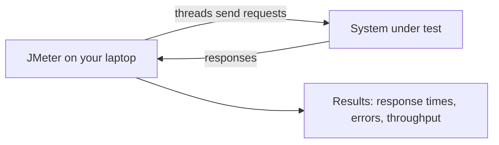

## Beginner-friendly explanation

Imagine you open a small café. One customer at a time is easy: you take the order, make the coffee, hand it over. But what happens at 8 a.m. when forty people walk in at once? Does the queue move? Does the coffee machine overheat? Does the till crash? You would love to find out **before** opening day, by hiring forty pretend customers to rush in on purpose.

That is what **Apache JMeter** does for software. It is a program that pretends to be many users at once. Each pretend user sends requests to a website or API, just like a real person clicking around, and JMeter writes down how long every answer took and whether it was correct. Afterwards you can say things like "with 50 users, the login page answers in under a second, but at 200 users it starts failing".

This kind of testing has a name: **performance testing**. It asks "is the system fast and stable enough?", not "does the button work?". **Load testing** is one type of performance testing where you apply an expected amount of traffic and check the system copes.

## Technical explanation

Some terms you will meet in every JMeter lesson:

| Term | Plain meaning |
|---|---|
| System under test (SUT) | The application you are testing, for example a web server |
| Load generator | The machine running JMeter that produces the traffic |
| Thread (virtual user) | One simulated user; JMeter runs many in parallel |
| Sampler | An element that sends one request, such as **HTTP Request** |
| Sample | The record of one request: time taken, size, success or failure |
| Response time | Time from sending a request until the full response arrives |
| Throughput | How many requests the system completes per second |
| Listener | An element that collects and displays results |

JMeter is an open-source project of the Apache Software Foundation, written in Java. That is why you need Java installed to run it. You build a **Test Plan**, a tree of elements saved as a `.jmx` file (an XML document). The plan contains **Thread Groups** that define how many users to simulate, and inside them **samplers** that describe the requests.

JMeter works at the **protocol level**. For a web page, it sends the HTTP request and receives the HTML bytes. It can optionally download embedded resources such as images and CSS, but it does not lay out the page or run JavaScript. This makes it efficient: one machine can simulate many more users than if it had to run real browsers.

Besides HTTP and HTTPS, JMeter supports other protocols out of the box, such as JDBC (databases), JMS (messaging), FTP, LDAP, SMTP and TCP. Its capabilities can be extended with plugins and with scripting in Groovy.

### What JMeter is not

| JMeter is not... | Because... |
|---|---|
| A browser | It does not render HTML or execute JavaScript |
| A functional UI test tool | Tools like Selenium or Playwright drive real browsers for that |
| A monitoring system | It measures the client side; you still need server metrics (CPU, memory) |
| Magic | A badly designed test produces misleading numbers |

JMeter has two ways of running. **GUI mode** (graphical user interface) is a window where you build and debug test plans. **Non-GUI mode** (also called CLI mode) runs a saved plan from the command line without a window. The JMeter documentation is clear: use the GUI to create and debug, and non-GUI mode to run actual load, because the GUI consumes resources that should go into generating load.

## Real-world example

A team building an online booking app expects about 300 people to search for appointments during a busy hour. Before launch, a tester builds a JMeter plan in which each virtual user opens the home page, searches for a date and views results. They run it in a test environment that mirrors production, ramping up to 300 users. The results show that search stays fast but the "view results" step slows down sharply above 200 users. Developers find an unindexed database query, fix it, and the tester reruns the same plan to confirm the improvement. Nobody touched the real production system, and the test environment belonged to the team.

## Step-by-step walkthrough

You will not build anything yet; this is a map of the journey ahead.

1. **Install Java and JMeter** on your own machine (next lesson: [Installing JMeter](/learn/jmeter/installing-jmeter)).
2. **Start a practice server you own.** Throughout this track we use Python's built-in server: open a terminal in an empty folder and run `python -m http.server 8000`. It serves files at `http://localhost:8000`.
3. **Explore the GUI** ([GUI tour](/learn/jmeter/jmeter-gui-tour)).
4. **Build a first plan**: a Thread Group, an HTTP Request to `localhost:8000` and a listener ([JMeter fundamentals](/learn/jmeter/jmeter-fundamentals)).
5. **Learn the building blocks** one by one, starting with [Thread Groups](/learn/jmeter/jmeter-thread-groups).

## Expected output

When you eventually run a small test against your local server, a results table might look like this (illustrative numbers only, yours will differ):

| Label | # Samples | Average (ms) | Error % | Throughput |
|---|---|---|---|---|
| Home page | 100 | 4 | 0.00% | 48.2/sec |

Do not read too much into tiny local tests: your laptop is both the client and the server, so the numbers mostly reflect your machine.

## Troubleshooting

| Problem | Likely cause | Fix |
|---|---|---|
| You expected JMeter to show the page visually | JMeter is not a browser | Use the View Results Tree listener to read the raw response |
| Numbers vary wildly between runs | Small tests on a busy laptop | Close other programs, run longer, compare trends not single runs |
| "Is it allowed to test site X?" | Unclear ownership | If you do not own it and have no written permission, do not test it |

## Common mistakes

- **Testing websites you do not own.** Sending load to third-party systems without written authorization can disrupt real users and may be illegal. Practise against your own local server.
- **Treating JMeter like Selenium.** JMeter will not click buttons or run scripts on a page.
- **Running big tests in the GUI.** The GUI slows down the load generator and skews results.
- **Reading one number in isolation.** An average response time without error rate and throughput tells an incomplete story.
- **Forgetting the server side.** JMeter tells you something got slow; server monitoring tells you why.

## Key takeaways summary

JMeter is a free, Java-based, protocol-level load testing tool. It simulates users with threads, sends requests with samplers and records results with listeners. It is not a browser and not a monitoring tool. Build in the GUI, run in non-GUI mode, and only ever test systems you own or are authorized to test.
