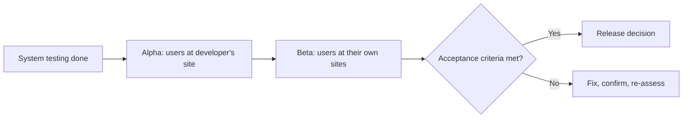

## Beginner-friendly explanation

When you buy a made-to-measure suit, the tailor has already checked the seams, the buttons and the measurements. But before you pay, you put it on, walk around, sit down and lift your arms. You are not hunting for loose threads; you are deciding **"Is this what I wanted, and can I wear it to work?"**

**Acceptance testing** is that fitting. After the development team has tested the product thoroughly, the people who asked for it, will use it or will run it confirm that it does their job. The result is a decision: accept, accept with conditions, or reject.

## Technical explanation

Acceptance testing is the final ISTQB test level. Its focus is on **validation** and on demonstrating **readiness for deployment**, meaning the system fulfils the user's business needs. Ideally it reveals few defects; serious defects found here are expensive and may indicate gaps earlier. See [verification vs validation](/learn/manual-testing/verification-vs-validation) for the underlying distinction.

ISTQB CTFL v4.0 lists these main forms:

| Form | Who | Focus |
|---|---|---|
| User acceptance testing (UAT) | Intended users | Can users do their real tasks in a real or simulated environment? |
| Operational acceptance testing (OAT) | Operations and administration staff | Backup and restore, installation, upgrades, disaster recovery, user management, maintenance, data migration, security and performance in operation |
| Contractual acceptance testing | Users or independent testers | Criteria written into a contract for custom-developed software |
| Regulatory acceptance testing | Users or independent testers, sometimes with regulators observing | Compliance with laws, regulations or safety standards |
| Alpha testing | Customers or an independent test team | Performed at the **developing organisation's site** |
| Beta testing | Potential or existing customers | Performed at **users' own locations**, in their real environments |

**Test basis** for acceptance testing includes business processes, user and business requirements, regulations, contracts and standards, use cases, system documentation, installation procedures and risk analysis.

### Acceptance in agile teams

In agile teams, acceptance criteria on each user story act as small acceptance tests. Approaches such as acceptance test-driven development (ATDD) and BDD capture them as examples before coding, sometimes as executable Gherkin scenarios. Story-level acceptance does not replace a release-level UAT for large business changes.

## Real-world example

A logistics company replaced its warehouse picking system. System testing passed, including performance tests. During UAT, warehouse supervisors ran a normal shift's work on handheld scanners and found that a common real-world action, splitting one pallet across two delivery bays, needed eleven screens. It was technically correct per the specification, but would have slowed every shift.

The business accepted the release with a condition: a simplified split-pallet flow delivered before peak season. Meanwhile, operational acceptance testing by the infrastructure team found that the nightly backup job overlapped the early shift's start and locked tables. Neither problem was a "bug" against the written requirements; both would have hurt the business.

## Step-by-step walkthrough

1. **Agree acceptance criteria and exit criteria** with business owners before testing starts.
2. **Choose the forms needed**: UAT almost always; OAT for anything operations must run; contractual or regulatory where applicable; alpha and beta for widely distributed products.
3. **Select participants** who do the work daily, not only managers.
4. **Prepare the environment and data**: production-like, with realistic, anonymised data.
5. **Write business scenarios** rather than step-by-step scripts, so users exercise real workflows.
6. **Run sessions with support**: a tester records issues, helps reproduce them and separates defects from training needs.
7. **Triage findings** into defects, change requests and training or documentation gaps.
8. **Record the sign-off decision** with evidence and any conditions; see [release sign-off](/learn/manual-testing/release-sign-off).

### Worked example: a UAT scenario

| Item | Content |
|---|---|
| Scenario | Manager approves an annual leave request that overlaps a public holiday |
| Acceptance criterion | Given a request spanning a public holiday, when the manager approves it, then the holiday is not deducted from the employee's balance |
| Participants | Two line managers, one HR officer |
| Evidence | Balance before and after, approval email, HR report row |

## Common mistakes

- **Letting the test team run UAT alone.** It turns into another round of system testing and loses its validation value.
- **Starting UAT with unstable builds.** Users lose trust quickly; enter UAT only when system testing exit criteria are met.
- **Undefined acceptance criteria.** Without them, sign-off becomes a matter of opinion.
- **Forgetting operational acceptance.** A system users love can still fail if nobody can back it up, patch it or restore it.
- **Treating beta feedback as noise.** Beta users reveal environments and usage patterns the team never imagined; collect it in a structured way.

## Troubleshooting

- **Users report "it's wrong" without detail.** Pair them with a tester who captures steps, data and expected behaviour.
- **UAT finds many requirement gaps.** Log them as change requests, then ask why reviews and story refinement missed them.
- **Beta participants stop responding.** Keep the programme short, make feedback one tap away and show them their reports were acted on.

## Key takeaways summary

Acceptance testing answers "Is this fit for use and ready to deploy?" Use the right forms, including user, operational, contractual, regulatory, alpha and beta, let the business own the decision, define criteria up front, and record sign-off with evidence and conditions.
