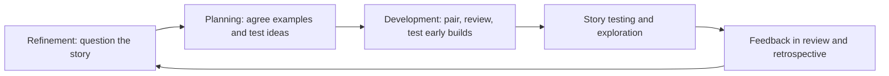

## Beginner-friendly explanation

Think about two ways to cook a big family meal. In the first, one person cooks every dish alone, and only when everything is plated does someone else taste it. If the soup is too salty, it is too late; the whole meal is already on the table. In the second, the cooks taste as they go, ask the family what they want before starting, and adjust the recipe as they learn.

Agile software development is the second kitchen. Instead of building everything and testing at the end, a team builds small pieces, checks them constantly, and adjusts based on feedback. For a tester this is a big shift. You are no longer the person who tastes the finished meal; you are one of the cooks, tasting and asking questions all the way through.

## Technical explanation

The [Agile Manifesto](https://agilemanifesto.org/) (2001) contains four values:

| Valued more | Over | Valued less (but still valued) |
|---|---|---|
| Individuals and interactions | over | Processes and tools |
| Working software | over | Comprehensive documentation |
| Customer collaboration | over | Contract negotiation |
| Responding to change | over | Following a plan |

The closing line matters: *while there is value in the items on the right, we value the items on the left more.* Agile is a statement of priorities, not an excuse to drop documentation, process or planning.

The manifesto is backed by twelve principles. Several have direct consequences for testing:

| Principle (paraphrased closely) | What it means for testers |
|---|---|
| Satisfy the customer through early and continuous delivery of valuable software | Test in small increments so each one can be shipped with confidence |
| Welcome changing requirements, even late in development | Keep test assets easy to change; prefer examples and checklists over brittle scripts |
| Deliver working software frequently | Regression risk grows with every release, so fast, repeatable checks are essential |
| Business people and developers must work together daily | Testers bridge business language and technical detail, often by turning rules into examples |
| Working software is the primary measure of progress | "Code complete" is not done; tested and accepted is |
| Continuous attention to technical excellence and good design enhances agility | Invest in testability, automation and clean test design |
| At regular intervals, the team reflects and adjusts | Bring quality data (escaped defects, flaky tests) to retrospectives |

### Whole-team quality

In a phase-based model, testing is a stage and the test team is a gate. In an agile team, **quality is everyone's responsibility**. Developers write unit tests, the Product Owner clarifies what "right" means, and testers bring a risk-focused, questioning mindset to every stage. Scrum, the most common agile framework, does not even have a "tester" accountability; people who test are among the **Developers** (see [Scrum roles and ceremonies](/learn/manual-testing/scrum-roles-and-ceremonies)).

## Real-world example

A team building a loyalty-points feature worked in two-week Sprints. Historically, developers merged everything in the final days, the tester found a pile of defects, and half the stories slipped.

The team changed three things. First, the tester joined refinement and asked questions such as "what happens to points when an order is partially refunded?" That question alone produced two new acceptance criteria. Second, stories were sliced smaller, so the first one was ready for testing on day three rather than day nine. Third, the tester and a developer paired to automate the points calculation checks at the API level, leaving the tester free to explore the user journey.

Nothing about this required new tools. It was the agile principles applied: earlier collaboration, smaller increments, and attention to technical excellence.

## Step-by-step walkthrough

How a tester adds value across one story's life:

1. **Before the Sprint (refinement):** read the story, ask about rules, edge cases, error states, permissions and data. Suggest splitting stories that are too large to test in a few days.
2. **Sprint Planning:** help turn acceptance criteria into concrete examples and agree what will be automated and what will be explored.
3. **During development:** review unit and API tests with developers, test early builds or feature branches, and give feedback within hours rather than days.
4. **Story testing:** verify the acceptance criteria, then run a short exploratory session on the risks you noted.
5. **Done:** confirm the story meets the team's Definition of Done, including regression checks.
6. **Sprint Review and Retrospective:** share what you learned about quality, such as recurring defect types, and propose improvements.

## Common mistakes

- **Treating agile as "no documentation".** Keep what helps the team: acceptance criteria, charters, risk notes. Drop what nobody reads.
- **Mini-waterfall inside the Sprint.** Coding for nine days and testing on the tenth gives the worst of both worlds.
- **Testers as the only quality gate.** If only the tester cares about quality, defects are found late and expensively.
- **Skipping regression because "it's only a small change".** Frequent delivery makes regression risk constant, not occasional.
- **Silent testers in refinement.** The cheapest defect is the one prevented by a question before coding starts.
- **Confusing agile with a specific framework.** Agile is the values and principles; Scrum and Kanban are ways of applying them.

## Troubleshooting

- **The team won't involve you early.** Offer something concrete: "Give me ten minutes per story in refinement and I will bring three edge cases." Results build the habit.
- **Requirements change mid-Sprint.** Talk to the Product Owner about impact, update the examples, and make the change visible rather than silently retesting.
- **Too much manual regression each Sprint.** Raise it in the retrospective with data (hours spent, defects escaped) and agree an automation plan with the developers.

## Key takeaways summary

Agile asks testers to move from checking at the end to collaborating throughout. Learn the four values and the principles that shape testing, ask questions early, test in small increments, and help the whole team own quality.
