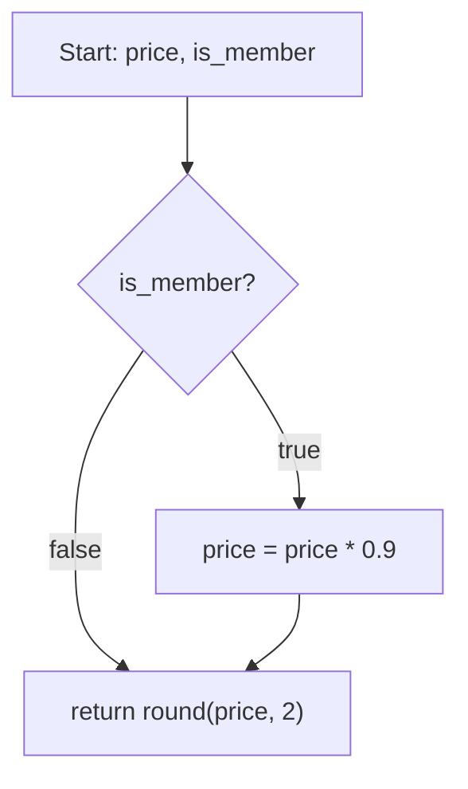

## Beginner-friendly explanation

Imagine testing a vending machine.

- **Black-box:** you stand in front of it like any customer. You do not know what is inside. You put in coins, press buttons and check that the right snack and the right change come out. You test it against what it is *supposed* to do.
- **White-box:** an engineer opens the front panel. They can see every coil, sensor and wire. They design checks to make sure every coil turns, every sensor triggers, and every path the coins can take is used at least once. They test against *how it is built*.
- **Gray-box:** you test from the front like a customer, but you have seen the wiring diagram. So after buying a snack, you also open the coin box to check the coins landed in the right tube. You use some inside knowledge to make outside tests sharper.

Each viewpoint finds different problems. A customer will never notice an unused coil; an engineer might never think to buy two snacks in a row with exact change.

## Technical explanation

The ISTQB CTFL v4.0 syllabus (chapter 4) groups test techniques into three categories:

| Category | Also called | Test basis | Techniques in CTFL v4.0 |
|---|---|---|---|
| Black-box | Specification-based | Specified behaviour: requirements, user stories, use cases, specifications | Equivalence partitioning, boundary value analysis, decision table testing, state transition testing |
| White-box | Structure-based | Internal structure: code, architecture, detailed design, data flows | Statement testing, branch testing |
| Experience-based | (none) | Knowledge and experience of testers, developers, users | Error guessing, exploratory testing, checklist-based testing |

Key points:

- **Black-box tests are independent of the implementation.** If the code is rewritten but the behaviour is unchanged, the tests still apply. They can be designed before code exists.
- **White-box tests can only be fully designed once the structure exists**, and they let you **measure coverage** of that structure. They can find defects even when the specification is vague or incomplete.
- **Neither is sufficient alone.** Black-box tests cannot reveal untested code paths; white-box tests cannot detect a missing requirement, because code that was never written has no structure to cover.

### Gray-box testing

**Gray-box testing** is a widely used industry term, not one of the ISTQB CTFL categories. It describes testing through external interfaces while using partial knowledge of internals, for example:

- verifying database records after a UI or API action,
- designing API tests using knowledge of service boundaries and the data model,
- reading logs to confirm which internal path a request took,
- targeting known integration points with boundary or error-handling tests.

### Statement and branch coverage



- **Statement coverage** = statements executed ÷ total executable statements × 100%.
- **Branch coverage** = branches exercised ÷ total branches × 100%. A branch is a transfer of control between two nodes, so each decision outcome counts, and so do unconditional transfers.

Achieving 100% branch coverage guarantees 100% statement coverage, but not the reverse.

## Code examples

```python
def member_price(price: float, is_member: bool) -> float:
    if is_member:
        price = price * 0.9
    return round(price, 2)
```

| Test set | Statement coverage | Branch coverage |
|---|---|---|
| `member_price(100.0, True)` only | 100% (all three statements) | 50%: the false outcome of `if is_member` is never taken |
| `member_price(100.0, True)` and `member_price(100.0, False)` | 100% | 100% |

## Expected output

```text
member_price(100.0, True)  -> 90.0
member_price(100.0, False) -> 100.0
```

Both results match the specification "members get 10% off". The black-box view checks that; the white-box view confirms both paths through the code have been exercised.

## Real-world example

A generic scenario: a team builds a loan-eligibility API.

- **Black-box:** the tester uses the business rules to build a decision table of income bands, employment status and existing debt, and boundary tests on the income thresholds. Several cases fail because the debt-to-income threshold was implemented as `>` instead of `>=`.
- **White-box:** developers run unit tests with branch coverage. The report shows an error-handling branch for a missing credit-score response that no test reaches. They add a test with a stubbed timeout and find the API returns "eligible" by default on timeout, a serious defect no business rule would have prompted.
- **Gray-box:** the tester checks the audit table after each API call and finds that declined applications are not being logged, breaching an audit requirement that the API response alone could never reveal.

## Common mistakes

- **Thinking black-box means "no thinking".** Black-box techniques are systematic and precise; they are not random clicking.
- **Treating 100% coverage as "fully tested".** Code can be fully covered and still be wrong, or missing a requirement entirely.
- **Confusing statement and branch coverage.** An `if` without an `else` is the classic case where they differ.
- **Calling gray-box an ISTQB category in an exam.** Use black-box, white-box and experience-based.
- **Assuming manual testers never need white-box knowledge.** It helps when reading coverage reports and in gray-box checks, even if it is not essential for every manual role.

## Key takeaways summary

Black-box techniques test what the system should do, white-box techniques test how it is built, and experience-based techniques use testers' knowledge. Gray-box testing is a practical blend of outside-in tests with inside knowledge. Strong test approaches combine them, because each view finds defects the others cannot.
