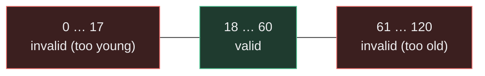

## Beginner-friendly explanation

Imagine a theme-park ride with a sign: **"Riders must be 120 cm to 195 cm tall."** If you were checking that the ticket gate enforces this rule, which heights would you try?

You could try 150 cm, but almost any gate would get that right. The interesting questions are at the edges: does a 120 cm child get in? Is a 119 cm child turned away? What about exactly 195 cm, and 196 cm? Edges are where people — and programs — make mistakes, because someone has to decide whether "120" means "more than 120" or "120 or more".

**Boundary value analysis (BVA)** is the habit of testing exactly those edge values. It is one of the most effective techniques you will ever learn, because a handful of carefully chosen tests finds a large share of input-handling defects.

## Technical explanation

BVA builds on [equivalence partitioning](/learn/manual-testing/equivalence-partitioning). First you split an input's domain into partitions that the system should treat the same way. For an **ordered** domain (numbers, dates, lengths, counts), each partition has a minimum and a maximum value: its **boundaries**.

A boundary value is the minimum or maximum of a partition. Its **neighbours** are the closest values on either side, determined by the input's precision:

| Input precision | Neighbour of 100 |
|---|---|
| Integer | 99 and 101 |
| One decimal place | 99.9 and 100.1 |
| Two decimal places (currency) | 99.99 and 100.01 |
| Dates (day precision) | the previous and next day |

There are two common variants:

- **Two-value BVA** tests each boundary and its nearest neighbour in the *adjacent* partition.
- **Three-value BVA** tests the boundary plus *both* neighbours. This catches extra defect types, such as a comparison written as `== 18` instead of `>= 18`, which two-value BVA can miss.

Why it works: developers implement ranges with relational operators (`<`, `<=`, `>`, `>=`). Using the wrong one, or an off-by-one constant, shifts a boundary by exactly one step. Only a test on or next to the boundary can see that shift.

### Worked example: an age rule

Requirement: *"Customers aged 18 to 60 inclusive can open a standard account. Customers under 18 or over 60 are rejected."* Ages are whole numbers from 0 to 120.

Partitions: invalid low **0–17**, valid **18–60**, invalid high **61–120**.



| Variant | Lower edge | Upper edge | Total |
|---|---|---|---|
| Two-value | 17, 18 | 60, 61 | 4 tests |
| Three-value | 17, 18, 19 | 59, 60, 61 | 6 tests |

If the domain itself is bounded (0 to 120), the outer edges 0, −1, 120 and 121 are boundaries too, and are worth testing when invalid input could crash the system rather than just be rejected.

## Real-world example

A payments team shipped a rule that blocked card transactions **over** ₹2,00,000 without extra verification. The requirement said "₹2,00,000 **or more** requires step-up authentication". The code used `amount > 200000`. Every functional test used round amounts like ₹50,000 and ₹5,00,000, so all passed.

In production, a customer paid exactly ₹2,00,000 and was not challenged, which breached the bank's risk policy. A single boundary test — amount = 200000.00 — would have exposed it before release.

## Step-by-step walkthrough

1. **Read the requirement and list ordered inputs.** Note the type and precision of each (integer, 2 decimals, date, length).
2. **Partition each input** into valid and invalid equivalence partitions.
3. **Mark the boundaries** — the minimum and maximum of every ordered partition.
4. **Choose two-value or three-value BVA** based on risk. Use three-value for money, security and safety rules.
5. **Write the neighbour values** using the input's precision.
6. **Design test cases that change one input at a time.** Keep every other field valid so that a failure clearly points to the boundary under test.
7. **Record expected results** for each value, including the exact error message for invalid ones.

### Worked example: a password length rule

*"Passwords must be 12 to 64 characters."* The boundaries are on **length**, so keep the content valid (mixed case, digits) and vary only the length:

| Test | Length | Expected |
|---|---|---|
| BVA-01 | 11 | Rejected: "Password must be at least 12 characters" |
| BVA-02 | 12 | Accepted |
| BVA-03 | 64 | Accepted |
| BVA-04 | 65 | Rejected: "Password must be at most 64 characters" |
| EP-extra | 0 (empty) | Rejected: "Password is required" |

## Code examples

The same boundary tests expressed as a data-driven TestNG test, so each value is a separate, clearly reported case:

```java
public class AgeEligibilityTest {

    @DataProvider(name = "ageBoundaries")
    public Object[][] ageBoundaries() {
        return new Object[][] {
            {17, false}, {18, true}, {19, true},   // lower boundary (three-value)
            {59, true},  {60, true}, {61, false},  // upper boundary (three-value)
        };
    }

    @Test(dataProvider = "ageBoundaries")
    public void eligibilityRespectsAgeBoundaries(int age, boolean expected) {
        assertEquals(Eligibility.isEligible(age), expected, "age=" + age);
    }
}
```

## Expected output

Against a correct implementation, all six cases pass. Against the buggy `age > 18 && age <= 60` from the quiz, TestNG reports exactly one failure:

```text
FAILED: eligibilityRespectsAgeBoundaries(18, true)
java.lang.AssertionError: age=18 expected [true] but found [false]
```

## Common mistakes

- **Testing only "typical" values.** 25 and 45 tell you nothing about the edges.
- **Ignoring precision.** For a currency field, 99 is not the neighbour of 100.00 — 99.99 is.
- **Changing several inputs at once.** If two boundaries fail together you cannot tell which caused the error.
- **Forgetting implicit boundaries**, such as maximum field length, empty input, zero, or the largest value a data type can hold.
- **Skipping invalid neighbours** because "the UI prevents it". APIs and imports often bypass UI validation.
- **Confusing inclusive and exclusive wording.** "Under 18" and "up to 18" put the boundary in different places — clarify ambiguous requirements before writing tests.

## Troubleshooting

- **The requirement doesn't say whether limits are inclusive.** Raise a clarification question; record the assumption in the test case until it is answered.
- **You can't type an out-of-range value in the UI.** Test the boundary through the API or by editing the request in browser developer tools, and separately confirm the UI restriction.
- **Too many inputs make the test set huge.** Apply BVA per input while holding the others at a valid nominal value, then use pairwise testing for interactions.

## Key takeaways summary

Boundary value analysis is fast, cheap and finds a disproportionate number of defects. Partition first, find each ordered partition's edges, then test on and around them at the right precision — one input at a time.
