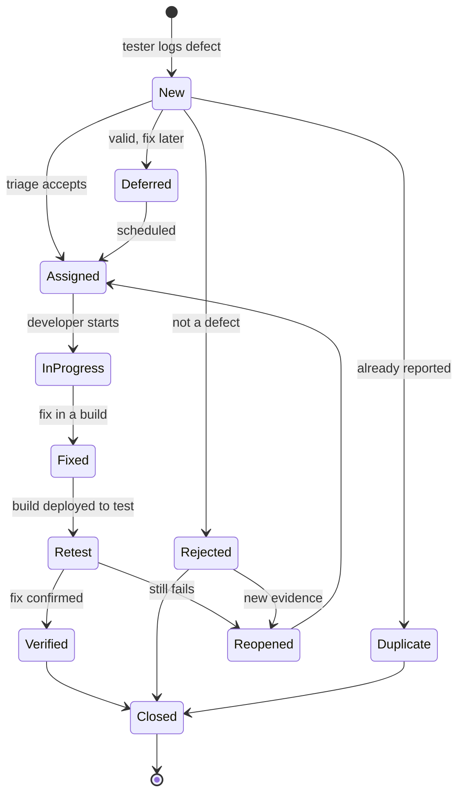

## Beginner-friendly explanation

Think of sending a parcel with tracking. It is **created**, **picked up**, **in transit**, **out for delivery**, **delivered**. Sometimes it is **returned to sender** (wrong address), sometimes **held** for later delivery, and sometimes the recipient says "this is damaged" and it goes **back** through the system.

A defect has a tracking history too. Everyone involved can see where it is, who has it, and what happened at each step. Without that, defects get lost, fixed twice, or "fixed" without anyone checking.

## Technical explanation

ISTQB Foundation Level v4.0 describes defect management as a workflow for handling individual defects from discovery to closure, with rules for classification. The syllabus does not mandate state names; tools and teams define them. A common workflow:

| State | Meaning | Usual owner of the next move |
|---|---|---|
| New | Logged, not yet reviewed | Triage group / lead |
| Assigned | Accepted and given to a developer | Developer |
| In Progress | Being investigated or fixed | Developer |
| Fixed (Resolved) | Code change made and included in a build | Build/release, then tester |
| Retest (Ready for QA) | Fix deployed where it can be tested | Tester |
| Verified | Tester confirmed the fix | Tester or lead |
| Closed | No further action | n/a |
| Reopened | Fix did not work | Developer |
| Rejected | Not a defect (works as designed, cannot reproduce, invalid) | Reporter may challenge with evidence |
| Duplicate | Same root problem as an existing defect | Closed with link to the original |
| Deferred | Valid, but fix postponed | Product owner reschedules |

Tools differ: Jira's default workflows use statuses such as "To Do", "In Progress" and "Done" with resolutions such as "Duplicate" or "Won't Do"; Bugzilla uses statuses such as UNCONFIRMED, CONFIRMED, IN_PROGRESS, RESOLVED and VERIFIED, with resolutions such as FIXED, DUPLICATE and WONTFIX. Names change; the ideas map across.

## Real-world example

A travel-booking team tracks this defect's history:

| Date | Transition | By | Comment |
|---|---|---|---|
| Mon 10:12 | → New | Tester | "Return date picker allows a date before the departure date" (build 3.4.0-112) |
| Mon 15:00 | New → Assigned | Triage | Severity Medium, priority High (booking form, many users). Assigned to front-end dev |
| Tue 09:30 | Assigned → In Progress | Developer | Validation was missing on the client side |
| Tue 16:40 | In Progress → Fixed | Developer | Fixed in build 3.4.0-118; added server-side validation too |
| Wed 10:05 | Fixed → Retest | Release | 3.4.0-118 deployed to QA |
| Wed 11:20 | Retest → Reopened | Tester | Still fails when the date is typed manually instead of picked. Video attached |
| Thu 12:00 | Reopened → Assigned → Fixed | Developer | Typed input now validated; build 3.4.0-121 |
| Thu 15:30 | Fixed → Retest → Verified | Tester | Verified on 3.4.0-121: picker, typed input and API all rejected; regression of date search passed |
| Thu 15:31 | Verified → Closed | Tester | |

The history itself is valuable: it records which build fixed it, why it was reopened, and what was retested.

## Step-by-step walkthrough

1. **Log the defect** with full detail (see [writing a great defect report](/learn/manual-testing/writing-a-great-defect-report)).
2. **Triage** decides: accept and assign, reject, mark duplicate or defer (see [defect triage](/learn/manual-testing/defect-triage)).
3. **Developer fixes** and records the build or version that contains the fix.
4. **Tester retests** on that build, using the original steps plus variations.
5. **Run regression** around the change.
6. **Verify and close**, or **reopen** with new evidence.
7. **Review aged and deferred defects** regularly so nothing is forgotten.

## Common mistakes

- **Closing without retesting** because "the developer said it's fixed".
- **Reopening for a different problem** instead of raising a new linked defect.
- **Silent transitions** with no comment, so nobody knows why a defect was rejected.
- **Retesting on the wrong build**, which produces false results in both directions.
- **Deferred becoming a graveyard**: postponed defects never reviewed again.
- **Over-complicated workflows** with 15 states that nobody follows consistently.

## Troubleshooting

- **The fix is not in your build.** Check the fix version and build number before retesting; ask for the deployment if needed.
- **Developer and tester disagree on Rejected.** Bring the requirement and evidence to triage; the product owner decides on expected behaviour.
- **The defect cannot be reproduced any more** but nothing was changed. Record the build tested, keep it open for a defined period or close as "cannot reproduce" with a note on how to reopen.

## Key takeaways summary

A defect lifecycle makes ownership and history visible. Keep the main path simple, use clear side exits with reasons, verify fixes on the right build, and raise new linked defects for new problems rather than reopening old ones.
