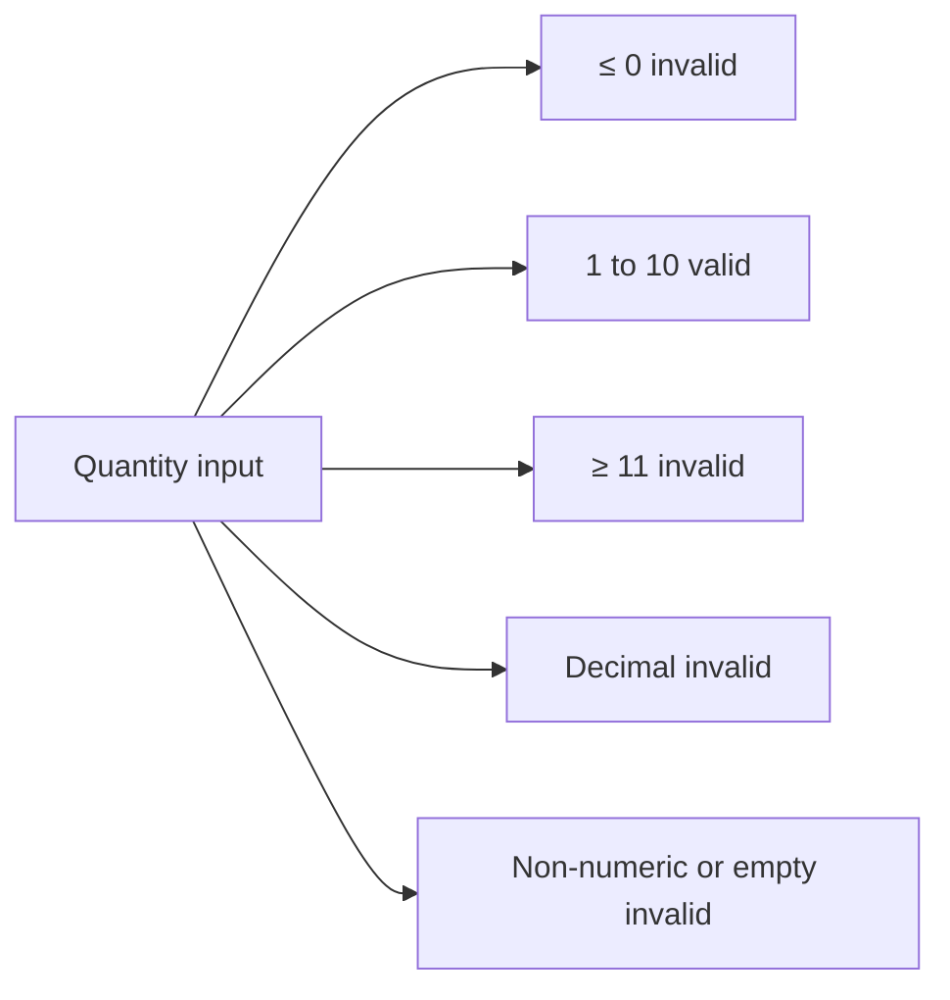

## Beginner-friendly explanation

Imagine you are checking a vending machine that accepts ₹10 and ₹20 coins. You do not need to insert every ₹10 coin ever minted. One ₹10 coin tells you how the machine handles *all* ₹10 coins, because the machine treats them identically. You would then try one ₹20 coin, one ₹5 coin (which it should reject) and maybe a button or a foreign coin.

That is **equivalence partitioning (EP)**: sort all the possible inputs into groups that the system should treat the same way, then try one example from each group. If one member of a group works, the others very probably do too. If one fails, they very probably all fail.

## Technical explanation

ISTQB CTFL v4.0 defines EP as dividing data into **partitions** (equivalence classes) based on the expectation that all elements of a partition are processed the same way by the test object. Key rules:

- Partitions can be identified for **inputs, outputs, configuration items, internal values and time-related values**.
- Partitions may be **continuous or discrete, ordered or unordered, finite or infinite**.
- Partitions **must not overlap** and **must not be empty**.
- A **valid partition** contains values the component should accept. An **invalid partition** contains values it should reject or ignore, or for which behaviour is not specified.

**Coverage** = partitions exercised by at least one test ÷ total identified partitions × 100%.

When several inputs are involved, the minimum practical target is **each-choice coverage**: every partition of every input is used at least once. Valid partitions from different inputs can share a test. **Invalid partitions are tested one at a time** with all other inputs valid, because a system typically stops at the first validation error. That hides any defect in the second, an effect called **fault masking**.

EP works hand in hand with [boundary value analysis](/learn/manual-testing/boundary-value-analysis). EP chooses one value per group, and BVA then adds the edges of each ordered group.

### Worked example: cinema ticket booking

Requirement: *"A booking contains 1 to 10 tickets (whole numbers). Seat category is Standard, Premium or Recliner; each category has its own price."*



| ID | Input | Partition | Type | Representative |
|---|---|---|---|---|
| V1 | Quantity | 1–10 | Valid | 4 |
| I1 | Quantity | ≤ 0 | Invalid | 0 |
| I2 | Quantity | ≥ 11 | Invalid | 15 |
| I3 | Quantity | Non-integer number | Invalid | 2.5 |
| I4 | Quantity | Non-numeric or empty | Invalid | "abc" |
| V2 | Seat | Standard | Valid | Standard |
| V3 | Seat | Premium | Valid | Premium |
| V4 | Seat | Recliner | Valid | Recliner |
| I5 | Seat | Not in the list | Invalid | "VIP" (via API) |

There are 9 partitions. The minimal test set below covers all of them in 8 tests:

| Test | Quantity | Seat | Partitions covered | Expected result |
|---|---|---|---|---|
| EP-01 | 4 | Standard | V1, V2 | Booking priced at Standard rate × 4 |
| EP-02 | 7 | Premium | V1, V3 | Booking priced at Premium rate × 7 |
| EP-03 | 2 | Recliner | V1, V4 | Booking priced at Recliner rate × 2 |
| EP-04 | 0 | Standard | I1 | Rejected with quantity error |
| EP-05 | 15 | Standard | I2 | Rejected with quantity error |
| EP-06 | 2.5 | Standard | I3 | Rejected with quantity error |
| EP-07 | abc | Standard | I4 | Rejected with quantity error |
| EP-08 | 3 | VIP | I5 | Rejected with seat category error |

Notice that every invalid test keeps the *other* input valid, and the three valid seat categories needed three tests even though quantity needed only one valid partition.

## Real-world example

An insurance team had a premium calculator with an "occupation" dropdown of 40 entries. Testers originally treated it as one valid partition ("any listed occupation") and tested only "Teacher". When they reread the rules, the occupations fell into four risk classes, each with a different loading on the premium. Those four classes were the real partitions. Re-partitioning by *how the system processes the value*, not by how the UI displays it, produced four tests instead of one, and one of them exposed a class whose loading had never been applied.

## Step-by-step walkthrough

1. **List every input and output** that the requirement mentions, plus implicit ones (empty value, data type, length).
2. **Ask "does the system treat these values differently?"** Each distinct treatment is a separate partition.
3. **Add invalid partitions**: out of range, wrong type, wrong format, missing, not in the allowed list.
4. **Check the partitions**. They must not overlap, none may be empty, and together they should cover the whole domain.
5. **Number them** (V1, I1 …) in a partition table so coverage is traceable.
6. **Pick a representative** from the middle of each partition. Leave the edges to BVA.
7. **Build tests**: combine valid partitions to minimise test count, and give each invalid partition its own test.
8. **Calculate coverage** and record any partitions you consciously chose not to test.

## Code examples

The partition table translates directly into a data-driven test. Each row carries its partition ID so a failure report says exactly which class broke:

```python
import pytest
from booking import create_booking, ValidationError

VALID = [
    ("EP-01", 4, "Standard"),
    ("EP-02", 7, "Premium"),
    ("EP-03", 2, "Recliner"),
]
INVALID = [
    ("EP-04", 0, "Standard", "quantity"),
    ("EP-05", 15, "Standard", "quantity"),
    ("EP-06", 2.5, "Standard", "quantity"),
    ("EP-07", "abc", "Standard", "quantity"),
    ("EP-08", 3, "VIP", "seat"),
]

@pytest.mark.parametrize("case_id, qty, seat", VALID, ids=[v[0] for v in VALID])
def test_valid_partitions(case_id, qty, seat):
    booking = create_booking(qty, seat)
    assert booking.quantity == qty

@pytest.mark.parametrize("case_id, qty, seat, field", INVALID, ids=[i[0] for i in INVALID])
def test_invalid_partitions(case_id, qty, seat, field):
    with pytest.raises(ValidationError) as err:
        create_booking(qty, seat)
    assert err.value.field == field
```

## Expected output

Against a correct implementation pytest reports `8 passed`. If the seat validation were missing, only `test_invalid_partitions[EP-08]` would fail, which points straight at partition I5.

## Common mistakes

- **Partitioning by UI appearance, not by processing.** A 40-item dropdown may hide four partitions, or forty.
- **Forgetting invalid partitions** such as wrong type, empty value or values that only an API can send.
- **Combining invalid values in one test**, which causes fault masking.
- **Overlapping partitions**, such as "0–10" and "10–20". The value 10 cannot belong to both.
- **Testing many values from the same partition** and calling it thorough. Ten tests from one partition add little over one.
- **Skipping output partitions.** Error messages, statuses and calculated bands are partitions too.

## Troubleshooting

- **You cannot tell whether two values are processed the same way.** Ask the developer or product owner, or read the business rules. Until you know, treat them as separate partitions.
- **The partition table has exploded.** You may be listing values, not classes. Merge values that share a rule, and use pairwise testing for multi-input interactions.
- **An invalid value cannot be entered in the UI.** Note the UI restriction as passing, then test the partition through the API or an import.

## Key takeaways summary

Equivalence partitioning turns an infinite input space into a short list of classes, each tested once. Partition by behaviour, include invalid classes, never overlap, combine valid classes and isolate invalid ones. Then add [boundary value analysis](/learn/manual-testing/boundary-value-analysis) for the edges.
