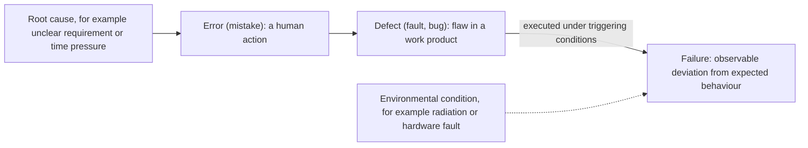

## Beginner-friendly explanation

Imagine a recipe book with a typo: "add 2 tablespoons of salt" instead of "2 teaspoons".

- The **error** is the moment the writer, tired and distracted, typed the wrong word. It is a human slip.
- The **defect** is the wrong word now sitting in the book. It does no harm while the book is on the shelf.
- The **failure** happens when someone actually cooks that recipe and the dish is far too salty.
- The **root cause** is why the slip happened and was not caught: maybe the writer was rushed and nobody proof-read the book.

If nobody ever cooks that recipe, the defect is still there, but no failure ever happens. And if you only correct this one typo without fixing the "nobody proof-reads" problem, the next book will have new typos.

## Technical explanation

The ISTQB syllabus (v4.0, section 1.2.3) describes a chain:



| Term | ISTQB meaning | Example |
|---|---|---|
| **Error** (mistake) | A human action that produces an incorrect result | A developer assumes prices are in whole currency units |
| **Defect** (fault, bug) | An imperfection or deficiency in a work product where it does not meet its requirements | The code stores price as an integer and drops the decimals |
| **Failure** | An event in which a component or system does not perform a required function within specified limits | An item priced 9.99 is charged as 9 |
| **Root cause** | A source of a defect such that if it is removed, the occurrence of the defect type is decreased or removed | No examples with decimals in the acceptance criteria |

Key mechanics:

- **Defects can be in any work product**, not only code: requirements, designs, test scripts, build files. A defect in a requirement can lead to defects in the code built from it.
- **A defect does not always cause a failure.** The defective code must be executed, often with specific data, configuration or timing. Some defects are never triggered.
- **Failures can also be caused by environmental conditions.** ISTQB gives examples such as radiation or electromagnetic fields affecting firmware. In everyday practice, misconfigured or unhealthy environments also cause failures that are not software defects.
- **Not every unexpected result is a failure.** A **false positive** is a reported failure that is not real, for example caused by a wrong test or broken test data. A **false negative** is a test that misses a real defect.
- **"Bug" is an informal synonym for defect.** In exams, use the precise word.

### Testing and debugging along the chain

Dynamic testing observes **failures**. Static testing such as a review finds **defects** directly, without needing them to fail. Debugging traces a failure back to its **defect** and fixes it. Root cause analysis goes one step further to the **root cause**, so that the process can be improved. See [root cause analysis](/learn/manual-testing/root-cause-analysis).

## Real-world example

A generic scenario: a gym's booking app lets members book classes up to seven days ahead.

- **Failure:** a member tries to book next Sunday's class on a Sunday evening and is told the class is "not yet available".
- **Investigation (testing):** the tester reproduces it on a test environment, notes that it only happens for classes exactly seven days ahead and only after a certain time of day, and reports it with clear steps and times.
- **Defect (debugging):** the developer finds the code compares the class start time with "now plus seven days" using the server's UTC clock while class times are stored in local time.
- **Error:** the developer assumed all times were in the same time zone.
- **Root cause:** the team had no agreed convention for time zones, and the acceptance criteria said "seven days" without defining when a day starts.

Fixing the comparison removes this defect. Agreeing a time-zone convention and adding time-boundary examples to acceptance criteria removes the root cause, preventing a whole family of similar defects.

## Code examples

A small defect that hides until a specific input triggers it:

```python
def apply_discount(price: float, percent: int) -> float:
    # Defect: integer division drops the fractional part of the discount
    discount = price * percent // 100
    return round(price - discount, 2)
```

## Expected output

Most inputs look fine, so the defect stays hidden. A boundary-style input triggers the failure:

```text
apply_discount(200.0, 10) -> 180.0   (correct: 180.00)
apply_discount(9.99, 10)  -> 9.99    (expected 8.99: failure)
```

For 9.99 at 10%, `9.99 * 10` is 99.9, and floor division by 100 gives 0.0, so no discount is applied. The defect existed for every call; the failure appears only for certain inputs.

## Common mistakes

- **Calling everything a bug.** Distinguish the failure you observed from the defect you suspect.
- **Writing defect titles that guess the cause.** Describe the failure and its conditions; let debugging confirm the defect.
- **Assuming a failure means a code defect.** Check the environment, test data and the test itself first.
- **Stopping at the defect.** Without addressing the root cause, similar defects keep appearing.
- **Blaming people.** Errors are normal human behaviour; root causes are usually in processes, information or tools.

## Key takeaways summary

A human error introduces a defect into a work product; when that defect is executed under the right conditions it causes a failure. A root cause is the deeper reason the error happened. Testers observe failures and find defects, debugging locates and fixes them, and root cause analysis prevents them from coming back.
