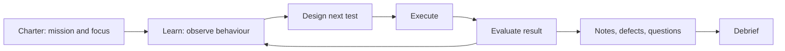

## Beginner-friendly explanation

Imagine you arrive in a city you have never visited. One way to see it is a guided bus tour: a fixed route, decided in advance. Another is to set out on foot with a goal, "find the best street food near the old market", and let what you see guide your next turn. You notice an interesting alley, follow it, and discover something no tour would show you.

**Exploratory testing** is the walk with a goal. The tester learns how the product behaves, and each discovery shapes the next test. **Ad hoc testing** is more like wandering with no goal and no map: sometimes you find something interesting, but you cannot easily say where you went or what you missed.

## Technical explanation

ISTQB CTFL v4.0 classifies exploratory testing as an **experience-based test technique**, alongside error guessing and checklist-based testing. In exploratory testing, tests are **simultaneously designed, executed and evaluated** while the tester learns about the test object. Its purposes are to learn more about the test object, explore it more deeply with focused tests, and create tests for untested areas.

The syllabus notes it is useful when:

- specifications are few or inadequate,
- there is significant time pressure,
- it complements more formal test techniques.

It works best when testers are experienced, have domain knowledge and have strong analytical skills, curiosity and creativity.

### Structure: session-based test management

Exploratory testing is often run with **session-based test management**:

- **Charter**: the mission for the session, for example "Explore checkout with expired and declined cards to discover how payment errors are communicated." See [exploratory testing charters](/learn/manual-testing/exploratory-testing-charters).
- **Time-box**: an uninterrupted session, often 60 to 120 minutes.
- **Session sheet**: notes on what was tested, data used, defects, questions and issues.
- **Debrief**: a short conversation with a lead or the team about findings, coverage and what to explore next.

### Ad hoc testing

**Ad hoc testing** is informal testing performed without planned test preparation, recognised test design or documentation, and often without a defined objective. It can find defects quickly, especially in experienced hands, but its coverage is unknown and its results are hard to repeat or report.

| | Exploratory testing | Ad hoc testing |
|---|---|---|
| Mission | Defined in a charter | Usually none |
| Time | Time-boxed sessions | Unbounded |
| Documentation | Session notes, defects, debrief | Usually only defects found |
| Reportable coverage | Yes, by charter and area | Rarely |
| Techniques | Any, applied deliberately | Intuition |

## Real-world example

A travel booking team had thorough scripted tests for its new multi-city flight search, all passing. A tester ran a 90-minute session with the charter "Explore multi-city search with unusual itineraries to discover date and time-zone problems."

Following a hunch after noticing the return date picker reset when the origin changed, the tester tried a journey crossing the International Date Line where the second leg departed "before" the first leg arrived in local time. The search rejected a valid itinerary as "dates out of order." No scripted test had considered local versus UTC comparison. The session sheet listed the defect, two follow-up questions for the product owner and an area, open-jaw trips, still unexplored.

## Step-by-step walkthrough

1. **Pick a risk or area** from the risk list, a new story or recent defects.
2. **Write a charter**: target, resources (data, tools, personas) and the information you want to discover.
3. **Prepare lightly**: test accounts, data, a note-taking template, logging or developer tools open.
4. **Time-box the session** and protect it from interruptions.
5. **Explore deliberately**: vary inputs, sequences, states, users and environments; apply boundaries, error guessing and checklists as ideas arise.
6. **Take notes as you go**: what you tried, what you saw, questions, and potential defects with reproduction steps.
7. **Log defects** with enough detail to reproduce; see [writing a great defect report](/learn/manual-testing/writing-a-great-defect-report).
8. **Debrief**: summarise coverage, findings, open questions and new charters.

### Worked example: a session sheet

| Field | Content |
|---|---|
| Charter | Explore password reset with expired, reused and tampered links to discover security and usability problems |
| Duration | 60 minutes (50 testing, 10 notes) |
| Covered | Expired link, reused link, link opened in second browser, edited token |
| Defects | Reused link still accepted within 5 minutes |
| Questions | Should reset invalidate existing sessions on other devices? |
| Not covered | Mobile app deep links, so a new charter is proposed |

## Common mistakes

- **Calling unrecorded clicking "exploratory testing".** Without a mission and notes it is ad hoc.
- **Charters that are too broad** ("explore the app") or too narrow (a disguised script).
- **Not time-boxing**, so sessions drift and cannot be compared or planned.
- **Skipping the debrief**, losing the learning and the follow-up charters.
- **Using exploratory testing to replace all scripted testing**, including regression and compliance checks that need repeatable evidence.

## Troubleshooting

- **Managers say exploratory work is invisible.** Report sessions completed, charters covered against risks, defects and open questions.
- **Sessions keep getting interrupted.** Book them in calendars as focused time, like meetings.
- **You find nothing.** Change one variable at a time: user role, data shape, sequence, device. Or pair with a developer or another tester for new ideas.

## Key takeaways summary

Exploratory testing is skilled, simultaneous learning, test design and execution. Give it structure with charters, time-boxes, notes and debriefs so it is accountable. Use ad hoc testing for quick informal checks, but rely on structured exploration when you need to report what was covered.
