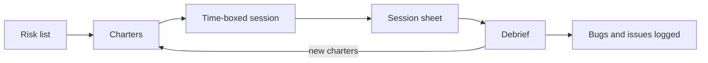

## Beginner-friendly explanation

Imagine visiting a new city with one free afternoon. You could wander randomly, or you could set yourself a mission: *"Explore the old market with a street-food map to discover the best breakfast places."* You are still free to follow your curiosity, take side streets and change plans, but you know what you are looking for, and at the end you can tell a friend exactly what you covered.

Exploratory testing is like that afternoon: you learn the software while testing it, and each discovery shapes the next test. A **charter** is your mission statement for the trip. It keeps exploration focused and makes it easy to report what you did.

## Technical explanation

ISTQB CTFL v4.0 (section 4.4.2) describes **exploratory testing** as testing in which tests are simultaneously designed, executed and evaluated while the tester learns about the test object. It is used to learn more about the test object, to explore it more deeply with focused tests, and to create tests for untested areas. ISTQB notes it is useful when specifications are few or inadequate, under significant time pressure, or to complement more formal techniques. It is more effective when the tester is experienced, has domain knowledge and applies skills such as curiosity, analytical thinking and creativity, and it can incorporate other techniques such as equivalence partitioning.

ISTQB adds that exploratory testing is sometimes conducted as **session-based testing**: the tester works within a defined **time-box**, guided by a **test charter** containing test objectives, and the session is usually followed by a **debriefing** with stakeholders.

### The charter format

A widely used template, popularised by Elisabeth Hendrickson in her book *Explore It!*, is:

> **Explore** *target* **with** *resources* **to discover** *information*

| Part | Meaning | Example |
|---|---|---|
| Target | Where to explore: a feature, area, requirement, module | the coupon field at checkout |
| Resources | What you bring: data, tools, techniques, personas, configurations | stacked, expired and malformed codes |
| Information | What you are looking for: risks, defects, quality characteristics | pricing and validation defects |

### Worked example: charters for a checkout release

| ID | Charter | Risk addressed |
|---|---|---|
| CH-1 | Explore the coupon field with stacked, expired and malformed codes to discover pricing and validation defects | Wrong totals |
| CH-2 | Explore the address form with long, non-Latin and incomplete addresses to discover data loss and formatting problems | Failed deliveries |
| CH-3 | Explore checkout with two concurrent browser sessions on one account to discover stale-cart and double-order problems | Duplicate orders |
| CH-4 | Explore the payment step with a throttled network and the browser back button to discover inconsistent order states | Charged but no order |
| CH-5 | Explore checkout with keyboard only and a screen reader to discover accessibility barriers | Excluded users |

**Too broad:** "Explore checkout." It cannot be finished in one session and cannot be reviewed. **Too narrow:** "Check that SAVE10 gives 10%." That is a scripted test case with nothing left to explore.

## Session-based test management

**Session-based test management (SBTM)**, developed by Jonathan Bach and James Bach, makes exploratory testing manageable:

- **Session**: an uninterrupted, time-boxed period of testing against one charter, commonly 60 to 120 minutes.
- **Session sheet**: the record of the session.
- **Time split**: the share of session time spent on **test design and execution**, **bug investigation and reporting**, and **session setup**. A high setup or bug share explains why less was covered.
- **Debrief**: a short conversation with a lead after each session about what was tested, what was found, what got in the way, and what should come next.



### Example session sheet

```text
CHARTER   CH-1 Explore the coupon field with stacked, expired and malformed
          codes to discover pricing and validation defects
TESTER    A. Tester            DATE 2026-03-12   START 10:00   DURATION 90 min
BUILD     checkout-web 4.2.0 on staging, Chrome desktop

TIME SPLIT   design and execution 60%   bug investigation 30%   setup 10%
CHARTER vs OPPORTUNITY   85 / 15

TEST NOTES
- Valid code, then remove item below minimum spend: discount removed correctly
- Two percentage codes: second replaces first, message shown
- Expired code: generic "invalid code" (no expiry reason) -> issue
- Code with trailing space: rejected; same code trimmed: accepted -> bug
- Lower-case code accepted; mixed case accepted

BUGS      BUG-ref: trailing whitespace makes valid coupon fail
ISSUES    Expiry message wording unclear (question for product owner)
          Switching currency changed total unexpectedly (off-charter, new charter proposed)
DATA      coupons-staging.csv
```

## Real-world example

A team building an internal claims tool had thin requirements and a fixed demo date. Instead of writing scripts that would be outdated within days, the test lead listed the main risks, wrote one or two charters per risk, and ran two 90-minute sessions per tester per day with ten-minute debriefs. The debriefs repeatedly showed high setup time for one area because test claims were hard to create, so the team built a data seeding script. Session sheets gave stakeholders a clear record of what had been explored, which they had never had from earlier unstructured "free testing".

## Step-by-step walkthrough

1. **List risks** for the release or feature. See [risk-based scenario selection](/learn/manual-testing/risk-based-scenario-selection).
2. **Write charters** in the Explore/with/to discover format, each sized for one session.
3. **Prioritise charters** by risk and assign them.
4. **Prepare**: environment, build, accounts, test data, tools such as a screen recorder or proxy.
5. **Run the session** uninterrupted. Take notes as you go: what you tried, what you observed, questions.
6. **Log bugs and issues** with enough detail to reproduce.
7. **Complete the session sheet**, including the time split and charter-versus-opportunity share.
8. **Debrief** within the day. Decide whether the charter is done, needs another session or has spawned new charters.

## Common mistakes

- **No charter at all**, which turns exploratory testing into undirected ad hoc clicking.
- **Charters that are really test cases**, with nothing left to discover.
- **Charters too big for a session**, so they never finish and coverage is unclear.
- **Taking notes afterwards from memory**, which loses steps needed to reproduce bugs.
- **Skipping debriefs**, which wastes what the session taught about risk and next steps.
- **Treating exploratory testing as unaccountable.** Session sheets and debriefs make it as auditable as scripted testing.

## Troubleshooting

- **Sessions keep getting interrupted.** Agree protected session slots with the team; an interrupted session should be noted and its time adjusted.
- **Setup eats the time-box.** Track it in the time split and use the evidence to request data seeding or environment fixes.
- **Stakeholders want "proof".** Share the charter list with status, session sheets and the bugs and issues raised.

## Key takeaways summary

Charters give exploratory testing a mission. Write them as "Explore target with resources to discover information", size them for one session, run uninterrupted time-boxes, record a session sheet and debrief every time. That is how learning-driven testing stays focused and visible. Pair it with [error guessing](/learn/manual-testing/error-guessing) checklists for extra ideas.
