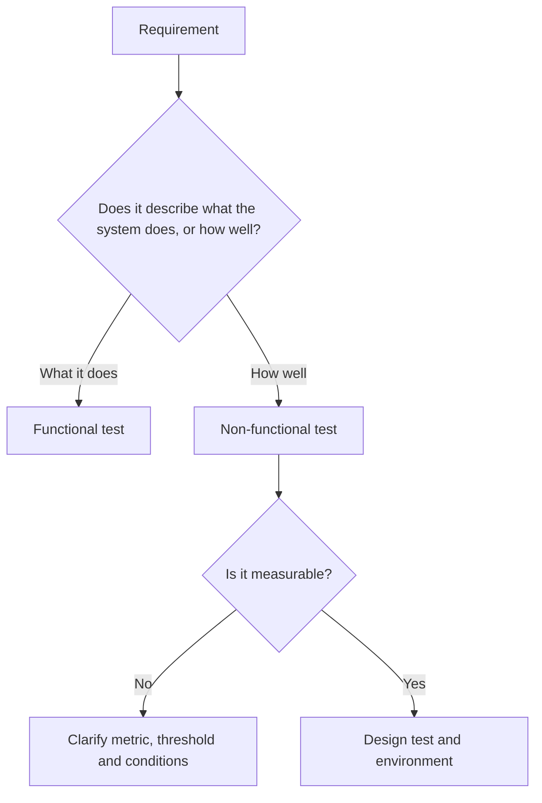

## Beginner-friendly explanation

Imagine reviewing a new coffee machine. First you check: does it make an espresso when you press "espresso"? Does the milk button froth milk? Does it refuse to start when the water tank is empty? Those checks are about **what** the machine does.

Then you ask different questions. How long does it take to make a cup? Is it loud? Can someone with poor eyesight read the buttons? Does it still work after a thousand cups? Will it fit and run with the power socket in your country? Those are about **how well** it does its job.

That is the difference between **functional testing** (what) and **non-functional testing** (how well). A product can do every function correctly and still fail its users because it is slow, confusing, insecure or unreliable.

## Technical explanation

ISTQB CTFL v4.0 describes four test types: functional, non-functional, black-box and white-box testing. This lesson covers the first two.

### Functional testing

Functional testing evaluates the functions a component or system should perform. Its main objective is checking **functional completeness** (all required functions exist), **functional correctness** (they give correct results) and **functional appropriateness** (they help users achieve their tasks). The test basis is typically requirements, user stories, use cases and business rules. Techniques like [equivalence partitioning](/learn/manual-testing/equivalence-partitioning) and decision tables are used heavily here.

### Non-functional testing

Non-functional testing evaluates attributes other than functional characteristics. CTFL v4.0 organises it by the product quality characteristics of ISO/IEC 25010:

| Quality characteristic | What you check | Example test |
|---|---|---|
| Performance efficiency | Time behaviour, resource use, capacity | Search returns in under 2 s at 500 concurrent users |
| Compatibility | Co-existence and interoperability | App runs alongside antivirus software; exports open in the partner's system |
| Usability | Learnability, operability, accessibility, error protection | New users complete sign-up unaided; screen reader announces form errors |
| Reliability | Maturity, availability, fault tolerance, recoverability | Service recovers within 5 minutes after a database failover |
| Security | Confidentiality, integrity, authenticity, accountability | Users cannot see other users' orders by changing an id |
| Maintainability | Modularity, analysability, modifiability, testability | Static analysis finds no critical code smells in changed modules |
| Portability | Adaptability, installability, replaceability | Installer works on all supported OS versions |

The 2023 revision of ISO/IEC 25010 renames and extends some of these (for example adding safety), so check which version your organisation follows.

### Test types are independent of test levels

Both types apply at every level. A developer can measure a function's execution time in a component test; operations can check recoverability during operational acceptance testing. Non-functional testing sometimes needs a very specific environment, such as a usability lab or a production-sized performance environment.

## Real-world example

A team built an online exam platform. All functional tests passed: students could log in, answer questions and submit. On the first real exam morning, thousands of students logged in within the same few minutes, and pages took over 30 seconds to load. Some students' answers timed out on submit.

The requirement had said "the platform must handle exam traffic", with no number. A performance test with a realistic peak was never run because nobody could say what "handle" meant. After the incident the team agreed measurable targets, built a load test modelled on the exam-start spike, and ran it before every release.

## Step-by-step walkthrough

1. **Sort requirements** into functional and non-functional. Many stories hide non-functional expectations, such as "users can quickly find…".
2. **Map each non-functional requirement to a quality characteristic** so nothing important (security, accessibility, recoverability) is forgotten.
3. **Make it measurable**: metric, threshold, conditions, environment. For example, "p95 under 2 s, 500 users, production-sized data".
4. **Choose techniques and tools**: black-box techniques for functional; load tools, accessibility checkers, security scanners or usability sessions for non-functional.
5. **Plan the environment.** Non-functional results are only meaningful in a representative environment.
6. **Execute, measure and compare** to thresholds, and report results with the conditions under which they were measured.

## Common mistakes

- **Treating non-functional testing as optional extras** done "if there is time" at the end.
- **Accepting unmeasurable requirements** like "fast", "secure" or "user-friendly".
- **Classifying by tool rather than by intent.** An automated UI script can be a functional test; a manual usability session is non-functional.
- **Measuring in an unrepresentative environment** and presenting the numbers as if they apply to production.
- **Ignoring accessibility**, which is both a usability characteristic and, in many jurisdictions, a legal obligation.

## Troubleshooting

- **Stakeholders cannot give a number.** Offer options based on current behaviour or user expectations and let them choose; record the agreed value.
- **Results vary widely between runs.** Check environment noise, test data and warm-up; repeat runs and report percentiles, not single values.
- **A non-functional defect needs redesign.** Raise it as early as possible with evidence; this is why early non-functional checks matter.

## Key takeaways summary

Functional testing asks "does it do the right thing?"; non-functional testing asks "does it do it well enough?" Use quality characteristics as a checklist, make every non-functional requirement measurable, and test both types at every level rather than leaving the "how well" questions until the end.
