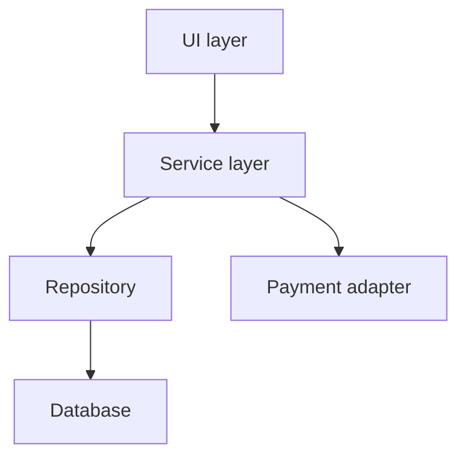

## Beginner-friendly explanation

Imagine two builders working on a bridge from opposite riverbanks. Each builder's half is solid, measured and inspected. But when they meet in the middle, one side is ten centimetres higher than the other. Nothing was wrong with either half; the problem is where they **join**.

**Integration testing** checks the joins. Software components are often built by different people, teams or companies. Each piece can pass its own tests and still fail when connected, because the two sides understood the connection differently. Integration testing deliberately exercises those connections to find such disagreements early.

## Technical explanation

ISTQB CTFL v4.0 defines two integration test levels:

| | Component integration testing | System integration testing |
|---|---|---|
| Focus | Interfaces and interactions between components of one system | Interfaces between systems, packages and external services |
| Example | Order service calling an internal inventory module | Shop calling a third-party payment gateway |
| Typical tester | Developers, sometimes testers | Testers, often with partner teams |
| Timing | After or alongside component testing | Often after system testing, or in parallel with it |
| Main challenge | Many internal interfaces | External environments outside your control |

The **test basis** includes interface specifications, sequence diagrams, API definitions, data-exchange formats and workflows that cross component boundaries.

### Integration strategies



- **Big-bang**: integrate everything at once. Simple to arrange, but failures are hard to localise and testing starts late.
- **Top-down**: start at the UI or top service and add lower layers progressively, using **stubs** for missing lower components. Gives an early skeleton of the workflow.
- **Bottom-up**: start with the lowest components (repository, adapters) and work upwards, using **drivers** to call them. Solid foundations, but the full workflow appears late.
- **Sandwich (hybrid)**: top-down and bottom-up in parallel, meeting in the middle.

Integration should normally be **incremental**, and its order should be planned with the architecture, so that each newly added interface is tested on its own. ISTQB stresses that integration tests should concentrate on the integration itself, not repeat each component's functional tests.

### What to test at an interface

- Data: field names, types, formats, units, encodings, optional versus mandatory fields
- Behaviour: the order of calls, retries, idempotency, transactions spanning components
- Errors: timeouts, error status codes, malformed responses, partner unavailable
- Contracts: does each side still match the agreed interface after a change? [Contract testing](/learn/api-testing/contract-testing) automates this check.

## Real-world example

A retail team integrated a new loyalty-points service with its checkout. Both teams had thorough unit tests. During component integration testing, a tester posted an order with a points redemption and a voucher together. Checkout sent the discounted total; the loyalty service expected the pre-discount total to calculate points. Customers would have earned fewer points than promised.

Nothing in either codebase was "wrong" by its own specification; the interface document simply did not say which total to send. The fix was a clarified contract plus an integration test for every combination of discount type, which now runs on every build.

## Step-by-step walkthrough

1. **Map the interfaces.** List every component or system pair that exchanges data, and the direction of each call.
2. **Collect the interface specification.** API schema, file layout, message format, error codes and agreed units.
3. **Choose an integration order** that matches delivery: top-down if the UI is ready first, bottom-up if the data layer is.
4. **Prepare test doubles** for anything not yet available, and plan when each will be replaced by the real component.
5. **Design tests per interface:** valid data, boundary data, missing and extra fields, error responses, timeouts.
6. **Verify on both sides.** Check what was sent and what was received and stored, not just the screen.
7. **Log interface defects with evidence**: the request, the response, timestamps and correlation ids.

## Code examples

An HTTP-level integration check using `curl`, verifying that the inventory service handles a reservation for an unknown product correctly:

```bash
curl -s -o /dev/null -w "%{http_code}\n" \
  -X POST http://localhost:8081/reservations \
  -H "Content-Type: application/json" \
  -d '{"productId": "DOES-NOT-EXIST", "quantity": 1}'
```

## Expected output

The interface specification says unknown products return `404`. Anything else, especially `500`, is an integration defect because the caller cannot react sensibly:

```text
404
```

## Common mistakes

- **Re-running component tests and calling it integration.** Focus on the data and calls crossing the boundary.
- **Testing only the happy path.** Partners fail, time out and return unexpected payloads; those paths must be tested.
- **Leaving stubs in place too long.** A stub only reflects your assumption about the partner; replace it with the real component as early as possible.
- **Checking only the UI.** Verify the data at the receiving end, for example in the partner's log or database.
- **Ignoring versioning.** An interface that worked last sprint can break when one side upgrades.

## Troubleshooting

- **A failure appears only in the shared test environment.** Compare configuration: endpoint URLs, credentials, feature flags and data seeded on each side.
- **You cannot tell which side is wrong.** Capture the raw request and response, then check both against the written contract. If the contract is silent, that is the defect to raise.
- **A third-party sandbox is unreliable.** Use a stub or service virtualisation for most runs and schedule a smaller set of tests against the real sandbox.

## Key takeaways summary

Integration testing looks at the joins. Separate component integration from system integration, integrate incrementally so each failure points to one interface, and test data formats, sequencing and error handling across every boundary, not just the sunny-day flow.
