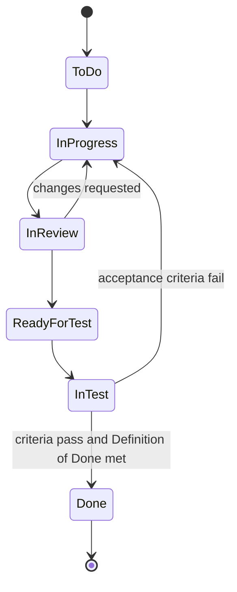
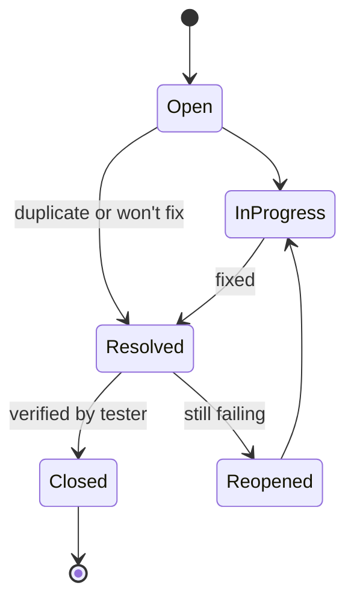

## Beginner-friendly explanation

Think of a parcel-tracking page. A parcel moves from "Label created" to "In transit" to "Out for delivery" to "Delivered", and at every step you know who has it. If the delivery fails, it goes back to "Returned to depot".

JIRA works the same way for work items. A story or a bug moves through **statuses**, and each move is a **transition**. Testers rely on this to know what is ready to test, what is blocked and what has been fixed. A **test management tool** adds the missing piece: a list of the checks you planned, a record of which ones you ran, and what happened.

## Technical explanation

### Workflow vocabulary

| Term | Meaning |
|---|---|
| Issue type | Story, Bug, Task, Sub-task, Epic (configurable) |
| Status | Where the issue is now, such as In Progress |
| Transition | A permitted move between statuses, which may require fields or comments |
| Resolution | How the issue ended, such as Fixed, Duplicate, Cannot Reproduce, Won't Do |
| Fix version | The release the work is planned for |
| Link | A relationship such as "blocks", "relates to" or "is tested by" (link types vary) |

Workflows are configured per project and issue type, so names differ between teams. The examples below use common, generic statuses.

### Example story workflow



### Example bug workflow



A good bug workflow has an owner for each status, a verification step by someone other than the person who fixed it, and a **Reopened** path that keeps history instead of creating a duplicate bug.

### JQL a tester uses daily

```sql
-- Stories ready for me to test in the current sprint
project = SHOP AND issuetype = Story AND status = "Ready for Test" AND sprint in openSprints()

-- Open high-priority bugs for the next release
project = SHOP AND issuetype = Bug AND resolution = Unresolved
  AND priority in (Highest, High) AND fixVersion = "2.4.0" ORDER BY priority DESC

-- Bugs I reported in the last 7 days
project = SHOP AND issuetype = Bug AND reporter = currentUser() AND created >= -7d

-- Bugs resolved and waiting for retest
project = SHOP AND issuetype = Bug AND status = Resolved AND resolution = Fixed
```

Status, priority and version names must match your project's configuration exactly.

### Test management tools

Plain issue tracking does not model test cases or executions well. Test management tools fill the gap. Some run as apps inside JIRA (for example Xray or Zephyr) and some are standalone with a JIRA integration (for example TestRail). Names and features vary by product and edition, but the core model is the same:

| Concept | Purpose |
|---|---|
| Test case | Reusable steps, data and expected results; linked to a requirement |
| Test set or suite | A group of related cases, such as checkout regression |
| Test plan or cycle | The cases to run for a given build, sprint or release |
| Execution | One run of a case, with status Passed, Failed, Blocked or Not Run, plus evidence |
| Defect link | Each failed execution linked to a bug |

These links give you a live [traceability matrix](/learn/manual-testing/traceability-matrix-and-coverage): requirement, tests, executions, defects.

## Real-world example

A team preparing a release of an online grocery app has 14 stories. The tester creates a release test cycle containing the new story tests plus the checkout and payments regression sets. Each morning, a dashboard built from JQL filters shows stories in Ready for Test, executions by status, and unresolved bugs by priority for the fix version.

Two days before the planned release, the dashboard shows one story with no linked tests. The tester raises it at the Daily Scrum; it turns out the story was added late and nobody had analysed it. Because the gap was visible, it was tested in time instead of shipping untested.

## Step-by-step walkthrough

1. **Learn your workflow**: list every status, who owns it and which transitions you are expected to perform.
2. **Create personal filters** for "ready for me to test" and "waiting for my retest".
3. **Link tests to stories** as you write them, so coverage is always visible.
4. **Create a test cycle** per sprint or release and add the right cases.
5. **Record executions honestly**: Blocked is not Failed, and Not Run is not Passed.
6. **Link every failure to a defect** with clear steps and evidence.
7. **Build a release dashboard** from saved filters and share it with the team.

## Common mistakes

- **Closing bugs without retesting**, or retesting in a different environment from the fix.
- **Creating new bugs instead of reopening** when a fix fails, which loses history.
- **Reaching Done without a resolution**, making the issue appear unresolved in reports.
- **Recording Blocked tests as Failed**, which hides the real cause (environment, data, dependency).
- **Copying another team's workflow** instead of designing one that fits how your team works.
- **Too many statuses**, which turns the board into bureaucracy without adding information.

## Troubleshooting

- **A JQL filter returns nothing.** Check exact status names, quotes around values with spaces, and the project key.
- **The board shows items in the wrong column.** Board columns map to statuses; ask the board administrator to check the mapping.
- **Coverage looks complete but bugs still escape.** Linking a test to a story only proves a test exists, not that it is good; review test design for risky stories.

## Key takeaways summary

JIRA models work as issues moving through configurable workflows; testers use statuses, resolutions, links and JQL to stay in control. Test management tools add test cases, cycles and executions so that coverage, progress and defects are traceable for every release.
