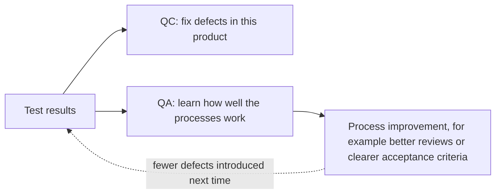

## Beginner-friendly explanation

Picture a bakery that wants every loaf to be perfect.

- The owner writes a standard recipe, trains new bakers, calibrates the ovens every morning and reviews why last week's batch came out flat. None of that looks at a specific loaf. It improves *the way bread is made*, so that good loaves are the normal result. That is **quality assurance (QA)**.
- At the end of each batch, someone cuts open a loaf, checks the crumb, weighs it and tastes it. If it is wrong, the batch is not sold. That looks at *the bread itself*. That is **quality control (QC)**.
- The cutting, weighing and tasting are the bakery's **testing**: the specific checks that make quality control possible.

Both matter. A great recipe does not guarantee every loaf is good, and checking every loaf does not fix a broken recipe.

## Technical explanation

The ISTQB syllabus (v4.0, section 1.2.2) explains that testing and quality assurance are often confused, but are not the same. It frames both inside **quality management**, which includes QA and QC.

| Aspect | Quality assurance (QA) | Quality control (QC) |
|---|---|---|
| Focus | Processes | Product |
| Orientation | Preventive | Corrective |
| Underlying idea | A good process produces a good product | The product is checked against the required quality |
| Typical activities | Process definition, standards, training, audits, retrospectives, process improvement | Testing, reviews of work products, static analysis, and other techniques such as formal methods or simulation |
| Applies to | Development and testing processes | Work products and the system |
| Who | Everyone on the project | Everyone, with testers playing a central role |

**Testing is a major form of quality control.** It is not the only one; ISTQB mentions others such as formal methods (for example model checking and proof of correctness), simulation and prototyping.

### How test results are used

The same test results serve two purposes:

- In **QC**, results are used to fix defects in the product.
- In **QA**, results provide feedback on how well development and test processes are performing, which drives process improvement.

### A note on job titles

Many organisations call their testers "QA engineers" or the test team "QA". That is a naming convention, not the ISTQB definition. In practice a strong tester does both kinds of work: they test the product (QC) and help improve how the team works (QA), for example by analysing defect trends or improving the definition of done.

## Real-world example

A generic insurance-quotes team notices that customers keep reporting wrong premiums after releases.

**QC response:** testers add more test cases for premium calculation, run them on every build and log defects for wrong results. Developers fix those defects. The current product gets better.

**QA response:** the test lead groups the last two quarters of premium defects by root cause. Most trace back to rating rules being copied by hand from a spreadsheet into code. The team introduces a process change: rating rules are reviewed by an actuary as part of each story's acceptance criteria, and a shared table of examples becomes the test basis. Future products get better.

Both responses used the same evidence. One fixed *this* product; the other changed *how* products are built.

## Step-by-step walkthrough

To classify any activity, ask these questions in order:

1. **Does it examine a specific work product or the system?** If yes, it is QC (and if it involves checking against expectations, it is likely testing).
2. **Does it change how work is done in future?** If yes, it is QA.
3. **Does it fix a specific defect?** That is debugging or rework, which follows QC.
4. **Does it do more than one of these?** Many activities do. A retrospective that reviews defect data is QA informed by QC results.

## Common mistakes

- **Using QA and testing as synonyms in exams.** ISTQB treats QA as process-oriented and testing as part of product-oriented QC.
- **Thinking QA belongs to the test team.** Quality assurance is everyone's responsibility; process improvements usually need developers, product owners and managers.
- **Treating QC as enough.** Finding the same kind of defect release after release, without changing the process, wastes effort.
- **Treating QA as enough.** Even an excellent process produces defects; the product still needs checking.
- **Throwing away test results after a release.** Defect data is valuable QA input for retrospectives and root cause analysis.

## Troubleshooting

- **Your team expects "QA" to own quality on its own.** Share defect data showing where defects are introduced, such as unclear stories or missing unit tests, and propose whole-team actions. Quality assurance only works when the people who own the process take part.
- **Retrospectives never discuss defects.** Bring a short summary of escaped and late-found defects grouped by cause. Patterns turn individual QC findings into QA improvements.
- **Process changes are proposed but never stick.** Make each improvement small and measurable, for example "every story has at least one negative acceptance criterion", and check in the next retrospective whether it reduced the defects it targeted.
- **An interviewer asks about QA versus QC and your title says QA.** Give the ISTQB definitions first, then explain honestly which of your activities were QC and which were QA.

## Key takeaways summary

Quality assurance improves the processes that produce software and aims to prevent defects. Quality control examines the product and aims to find and correct them. Testing is a major form of quality control, and its results also feed quality assurance by showing where processes need to improve. Good testers understand the difference and contribute to both.
