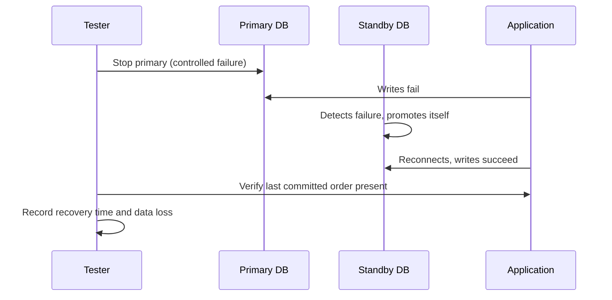

## Beginner-friendly explanation

Think about the lifts in a busy office building. You care that a lift **works every time** you press the button (reliability), that it is **in service** when you need it rather than "out of order" (availability), that if one lift breaks the **others keep running** (fault tolerance), and that when it does break, an engineer gets it **back in service quickly**, ideally without anyone stuck inside (recoverability).

Software has the same needs. **Reliability, availability and recovery testing** check whether a system keeps working, stays reachable, survives faults and recovers within agreed limits when things go wrong.

## Technical explanation

ISTQB CTFL v4.0 lists **reliability** as a quality characteristic for non-functional testing. ISO/IEC 25010 (2011) defines it as the degree to which a system performs specified functions under specified conditions for a specified period of time, with four sub-characteristics:

| Sub-characteristic | Question it answers | Example test |
|---|---|---|
| Maturity | Does it meet reliability needs in normal operation? | Run a realistic workload for 72 hours and count failures |
| Availability | Is it operational and accessible when needed? | Measure uptime against an agreed target |
| Fault tolerance | Does it keep operating despite hardware or software faults? | Stop one of two app servers; users should see no errors |
| Recoverability | Can it recover data and re-establish the desired state after a failure? | Restore from backup and measure time and data loss |

The 2023 revision of ISO/IEC 25010 renames maturity to faultlessness; check which version your organisation uses.

### Measuring availability

Availability is usually expressed as a percentage of required time:

- **Uptime-based**: availability = uptime / (uptime + downtime).
- **MTBF-based**: availability = MTBF / (MTBF + MTTR), where MTBF is mean time between failures and MTTR is mean time to repair (or restore).

| Target | Maximum downtime in a 30-day month |
|---|---|
| 99% | 7.2 hours |
| 99.9% | about 43 minutes |
| 99.99% | about 4.3 minutes |

These figures come straight from the arithmetic: 30 days is 720 hours, and 0.1% of 720 hours is 0.72 hours. Whether planned maintenance counts as downtime must be agreed in advance.

### Recovery objectives

- **Recovery time objective (RTO)**: the maximum acceptable time to restore service after a failure.
- **Recovery point objective (RPO)**: the maximum acceptable data loss, measured in time, for example "no more than 15 minutes of transactions".

Recovery testing checks the real values against these targets.



### Related practices

Long-running **soak tests** check maturity, such as memory leaks and resource exhaustion over time; see [performance testing types](/learn/performance/performance-testing-types). **Chaos engineering** runs controlled failure experiments to build confidence in resilience; see [chaos engineering basics](/learn/specialist/chaos-engineering-basics). All failure-injection work must be authorised, scoped and have an agreed way to stop.

## Real-world example

An online grocery service agreed an RTO of 30 minutes and an RPO of 5 minutes for its order database. In a scheduled recovery test in the pre-production environment, the team stopped the primary database. Automatic failover worked in 2 minutes, but the application kept retrying the old primary's address for another 25 minutes because of a cached DNS entry. Total recovery took 27 minutes, inside RTO but only just, and the team had believed failover was "about 2 minutes".

The restore-from-backup test was worse: restoring took 3 hours, far over the RTO for a scenario where both databases were lost. The findings went into the risk register, the DNS caching was fixed, and a faster restore process was prioritised.

## Step-by-step walkthrough

1. **Agree targets** with the business and operations: availability, RTO, RPO, and what counts as downtime.
2. **List failure modes**: server crash, process kill, network loss, disk full, dependency outage, data-centre loss, corrupted deployment.
3. **Get authorisation and choose the environment.** Use a production-like, isolated environment unless production experiments are explicitly approved and controlled.
4. **Define expected behaviour per failure**: no user-visible error, degraded mode, or full recovery within RTO.
5. **Prepare measurement**: synchronised clocks, monitoring dashboards, a marker transaction just before failure.
6. **Inject the failure** and record exact times.
7. **Verify recovery**: service restored, data consistent, last committed transaction present, no duplicates.
8. **Compare with targets** and report gaps as risks or defects, then retest after fixes.

## Code examples

A simple availability probe that records every failed health check during a recovery test, so downtime can be measured afterwards:

```bash
while true; do
  code=$(curl -s -o /dev/null -w "%{http_code}" --max-time 2 https://staging.example.test/health)
  echo "$(date -u +%H:%M:%S) $code" >> probe.log
  sleep 1
done
```

## Expected output

The log shows when the health check first failed and when it returned to `200`; the gap is the observed recovery time:

```text
10:14:05 200
10:14:06 000
...
10:41:12 000
10:41:13 200
```

## Common mistakes

- **Trusting backups that have never been restored.**
- **Testing only that "it came back"** without measuring time and data loss against RTO and RPO.
- **Injecting failures without authorisation** or without a stop plan.
- **Ignoring dependencies** such as DNS, caches, queues and third-party services in recovery paths.
- **Unclear availability definitions**: whether maintenance windows, partial outages or slow responses count as downtime.
- **One-off tests.** Infrastructure changes; recovery must be re-tested regularly.

## Troubleshooting

- **Recovery time varies widely between runs.** Look for timeouts, retries and caches; record each phase separately (detect, fail over, reconnect, verify).
- **Data is missing after restore.** Compare the backup schedule and replication lag with the RPO; the design, not the test, may be the problem.
- **No safe environment exists.** Raise it as a project risk; untested recovery is an unknown, not a pass.

## Key takeaways summary

Reliability is about doing the job consistently; availability is about being there when needed; recovery is about coming back within agreed limits. Agree measurable targets, test real failures safely and with authorisation, measure time and data loss, and repeat the tests as the system changes.
