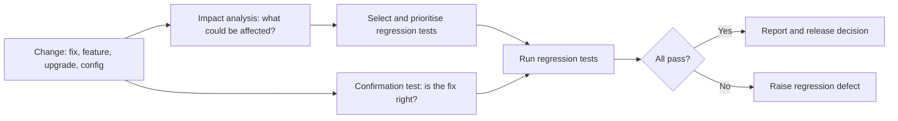

## Beginner-friendly explanation

Imagine a plumber fixes a leak under your kitchen sink. You check the sink: no more drip. Good. But the next morning, the shower upstairs has no hot water, because the plumber closed a valve while working and forgot to reopen it.

Checking the sink is **confirmation testing**: did the fix work? Checking the shower, the washing machine and the other taps is **regression testing**: did the fix, or any other change, **break something that used to work**?

In software, parts are connected in ways that are not always obvious. A change to how dates are formatted might affect invoices, reports and emails. Regression testing is how we catch those surprises before customers do.

## Technical explanation

ISTQB CTFL v4.0 groups confirmation testing and regression testing as **change-related testing**:

- **Confirmation testing** confirms that an original defect has been successfully fixed.
- **Regression testing** confirms that no adverse consequences have been caused by a change, including a fix that has already been confirmation tested.

A **regression** is a degradation in previously working behaviour caused by a change. Changes include new features, defect fixes, refactoring, configuration changes, library upgrades and changes to the environment such as a new operating system or database version. The adverse effects can appear in the same component, other components of the same system, or other connected systems.



### Selecting regression tests

| Strategy | What runs | When it fits |
|---|---|---|
| Retest all | The full regression suite | Major releases, platform upgrades, when time allows |
| Selective (impact-based) | Tests covering changed areas and their dependents | Targeted fixes with clear impact |
| Prioritised (risk-based) | Tests ordered by risk so the most important run first | Time-boxed releases |
| Hybrid | A fast critical set on every build, wider sets nightly or per release | Most CI/CD pipelines |

**Impact analysis** identifies what a change can affect: code that calls the changed component, shared data, shared configuration, and interfaces with other systems. A [traceability matrix](/learn/manual-testing/traceability-matrix-and-coverage) makes this faster because it links requirements, code areas and tests.

### Regression and automation

Regression suites are run many times, so ISTQB notes they are strong candidates for automation, and that automated regression suites should run frequently, ideally in continuous integration. Suites also **grow** with every release, so they need regular review to remain fast, relevant and trustworthy.

## Real-world example

A subscription business changed how its billing service rounded currency, to fix a one-cent discrepancy on invoices. Confirmation testing showed invoices were now correct. The regression run, chosen by impact analysis, included refunds and proration because they used the same rounding function.

A proration test failed: customers downgrading mid-month were now refunded one cent more than they had paid in some cases. Because the regression set was chosen by tracing who used the changed function, rather than only re-checking invoices, the side effect was found before release instead of in a finance reconciliation weeks later.

## Step-by-step walkthrough

1. **Understand the change.** Read the ticket, commit description and, if possible, the diff with a developer.
2. **Perform impact analysis.** List components, features, data and interfaces that use what changed.
3. **Select tests** covering those areas, plus a fixed critical-path set that always runs.
4. **Prioritise by risk** so the most important tests run first if time runs out.
5. **Run confirmation tests first**: there is little point regression testing a fix that does not work.
6. **Run the regression set** and investigate every failure. Is it a regression, an intended behaviour change, or a broken test?
7. **Report** what ran, what failed and, explicitly, what was not covered.
8. **Update the suite**: add a test for the escaped defect, retire obsolete tests.

## Code examples

Tagging tests lets a pipeline run different regression subsets. A TestNG example:

```java
public class CheckoutRegressionTest {

    @Test(groups = {"regression", "critical"})
    public void guestCanPayByCard() { /* ... */ }

    @Test(groups = {"regression"})
    public void savedAddressIsPrefilled() { /* ... */ }
}
```

```bash
# Every commit: only the critical regression subset
mvn test -Dgroups=critical
# Nightly: the full regression group
mvn test -Dgroups=regression
```

## Expected output

On a commit build, only tests in the `critical` group run, so the report shows a small, fast set; the nightly build runs both groups and shows the larger total.

## Common mistakes

- **Confusing confirmation and regression testing.** Re-running the failed test proves the fix, not the absence of side effects.
- **Running the same fixed list forever** without considering what actually changed.
- **Letting the suite rot.** Obsolete, duplicate and flaky tests waste time and erode trust in results.
- **Ignoring environment changes.** Library, browser, OS and database upgrades also need regression testing.
- **Hiding gaps.** If part of the suite was skipped, say so in the report.

## Troubleshooting

- **The full suite takes too long.** Split it into tiers, parallelise, and move checks down to API or component level where possible.
- **Failures are often "test problems".** Track flaky tests separately and fix or quarantine them; see [flaky test reduction](/learn/automation/flaky-test-reduction).
- **You cannot tell what a change touches.** Ask developers for an impact note on each pull request and keep traceability up to date.

## Key takeaways summary

Every change carries a risk of breaking something that used to work. Confirm the fix, analyse the impact, run the highest-risk regression tests first, report coverage honestly, and keep the suite lean enough that it can run as often as the product changes.
