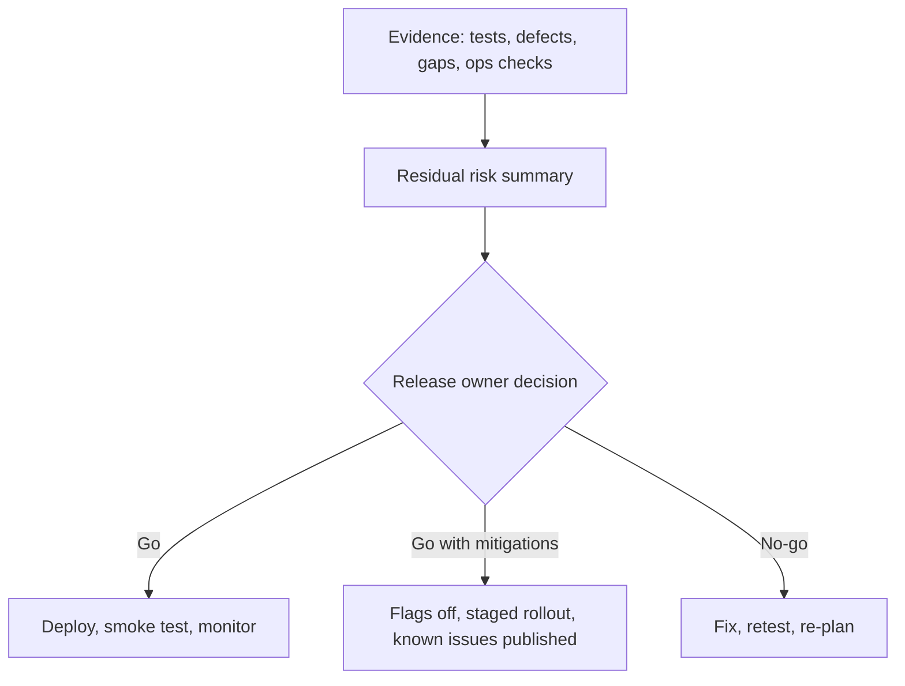

## Beginner-friendly explanation

Before a plane takes off, the pilots run a pre-flight checklist: fuel, instruments, doors, weather, flight plan. They do not ask "did each mechanic finish their job?" only; they ask "is this aircraft ready to fly *now*, with these passengers, on this route?"

**Release readiness** is the software team's pre-flight checklist. Each feature might be finished, but the question is bigger: is the whole thing safe to put in front of users today, and if something goes wrong, can we land safely?

## Technical explanation

Release readiness is the evaluation of whether a version of the product can be deployed to users with acceptable risk. It is a decision made by the product or release owner, informed by evidence from testing, development, operations, security and support.

It differs from the related ideas you have already met:

| Concept | Scope | Question it answers |
|---|---|---|
| Acceptance criteria | One item | Does this item behave as agreed? |
| Definition of Done | Every item in the Increment | Does each item meet our quality bar? |
| Exit criteria | A test level or phase | Have we tested enough to stop this level? |
| Release readiness | The whole release, now | Is it acceptable to deploy to users today? |

### Release readiness checklist

| Area | Check | Evidence |
|---|---|---|
| Scope | Release content agreed; every included item meets the Definition of Done | Release board or fix-version filter |
| Testing | Planned tests executed; results recorded; untested areas listed with reasons | Test cycle report |
| Regression | High-risk areas regression-tested on the release candidate build | Regression run results |
| Defects | No open critical defects; open defects reviewed and accepted with workarounds | Defect filter by severity |
| Non-functional | Performance, security and accessibility checks appropriate to the change | Reports, scan results, manual checks |
| Data | Database migrations rehearsed on a production-like copy; backups confirmed | Rehearsal log |
| Configuration | Environment settings, secrets and feature flags reviewed per environment | Config diff, flag list |
| Dependencies | Other teams and third parties ready; API versions compatible | Confirmations |
| Deployment | Deployment steps written or automated and rehearsed | Pipeline run on staging |
| Rollback | Rollback or roll-forward plan tested; data compatibility understood | Rehearsal result |
| Observability | Dashboards, logs and alerts ready for new features | Dashboard links |
| Support | Release notes, known issues and support briefing done | Notes, briefing record |
| Post-release | Smoke tests and monitoring owner named for the first hours | Plan with names |

### Presenting residual risk

The tester's report should answer four questions in plain language:

1. **What did we test, and how?** (scope, levels, environments)
2. **What did we not test, and why?** (blocked areas, time, environments)
3. **What is still open?** (defects with severity, impact and workaround)
4. **What is the residual risk and what mitigations exist?** (feature flags, monitoring, staged rollout)

## Real-world example

A team is releasing a new returns flow for an online clothing shop. All eight stories meet the Definition of Done. The release readiness review finds three gaps: the warehouse system's new endpoint was only tested with stubs, the refund email template was not checked in one supported language, and no alert exists for failed returns.

The tester's summary states each gap plainly with its risk. The Product Owner decides to release with the returns feature behind a flag enabled for a small percentage of users, adds an alert before the deployment, and schedules a live check with the warehouse team in the first hour. The release goes ahead with risk understood and contained, rather than either blindly shipping or blocking indefinitely.

## Step-by-step walkthrough

1. **Agree the checklist early** in the release cycle, not the day before.
2. **Freeze scope** for the release candidate and confirm each item meets the Definition of Done.
3. **Run regression** on the exact release candidate build.
4. **Review open defects** with the Product Owner; record accepted known issues.
5. **Rehearse deployment, migration and rollback** on a production-like environment.
6. **Write the readiness summary**: tested, not tested, open, residual risk, recommendation.
7. **Hold the go or no-go conversation** and record the decision and its owner.
8. **After deployment**, run smoke tests and watch monitoring for an agreed period.

## Common mistakes

- **Equating "all tests executed" with "ready".** Executed is not passed, and passed is not complete coverage.
- **Hiding untested areas** to avoid looking slow.
- **Testers owning the go decision alone**, which turns a business decision into a tester's burden.
- **Never testing the rollback**, then discovering during an incident that it does not work with the new database schema.
- **Skipping non-functional checks** for changes that clearly affect performance or security.
- **No plan for the first hours after release**, so problems are noticed by customers first.

## Troubleshooting

- **Pressure to sign off quickly.** Keep the summary short and factual; offer options rather than a bare yes or no.
- **Third-party sandbox unavailable.** Record it as untested, propose a controlled production check with an authorised test account, or a flag.
- **Defects found late in the release window.** Assess severity and impact, check for regressions, and present fix, flag, accept or delay options.

## Key takeaways summary

Release readiness asks whether this increment can safely meet users now. Use a checklist that covers quality, operations and support, report gaps honestly, and help the release owner make an informed, recorded decision.
